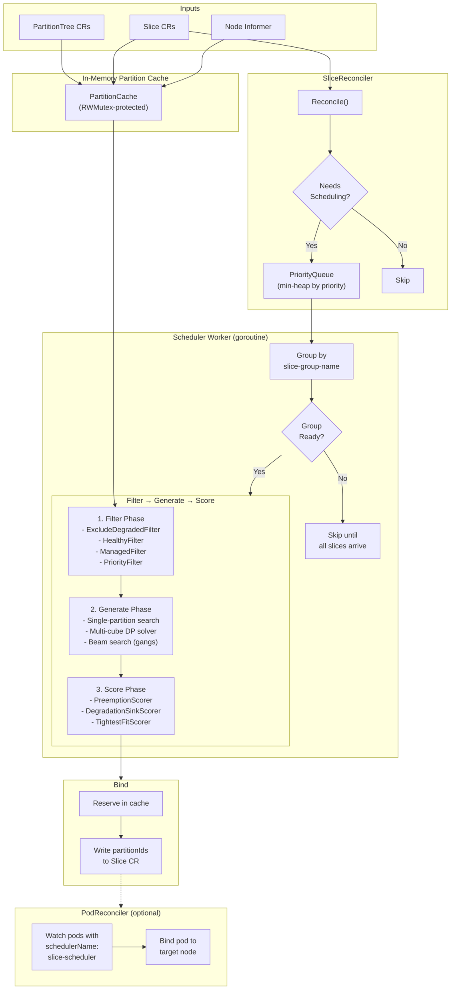

# Slice Scheduler

A Kubernetes controller that places TPU workloads onto GCE accelerator partitions. It watches `Slice` custom resources, finds optimal partition assignments using a modular **Filter → Generate → Score** pipeline, and optionally binds pods to the selected nodes. It works alongside [PartitionTree](https://ai-on-gke-private.googlesource.com/partition-tree/) (which provides partition topology) and the slice-provisioner (which activates partitions in GCE).

## How it works

```
PartitionTree CRs                    Slice CRs
+----------------------------+       +----------------------------+
| .status.root               |       | spec.type: tpu7x           |
|   partitionId: root        | watch | spec.topology: 4x4x4      |
|   topology: 4x4x4          | ----> | spec.partitionIds: []      |
|   childPartitions:          |       +----------------------------+
|     - partitionId: leaf-0   |                   |
|       nodeNames: [node-1]   |                   v
+----------------------------+       +----------------------------+
                                     | PriorityQueue              |
Node informer                        |   -> Filter (degradation,  |
+----------------------------+       |      health, managed,      |
| watch Nodes with matching  | ----> |      priority)             |
| TPU partition labels        |       |   -> Generate (single/     |
+----------------------------+       |      multi-cube, beam      |
                                     |      search)               |
                                     |   -> Score (preemption,    |
                                     |      degradation, fit)     |
                                     |   -> Bind partitions       |
                                     +----------------------------+
```

1. On startup, the controller lists all `PartitionTree` and `Slice` CRs to build an in-memory partition cache with occupancy state.
2. It watches `Slice` CRs annotated with `cloud.google.com/managed-by: slice-scheduler`. When a Slice needs scheduling (no partitions assigned, or unhealthy/failed), it is added to a priority queue.
3. A background worker dequeues slices by priority, groups them by workload name, and runs the **Filter → Generate → Score** pipeline to find the best placement.
4. The winning candidate's partition IDs are written to `slice.spec.partitionIds`. The slice-provisioner picks up the assignment and activates the partitions in GCE.
5. An optional **PodReconciler** watches pods with `schedulerName: slice-scheduler` and binds them to the correct TPU nodes based on the Slice's partition assignments.

## Architecture



### Scheduling pipeline detail

The `DefaultScheduler` in `internal/schedulerlib/` orchestrates three phases:

1. **Filter Phase** — Evaluates every partition in the cluster against all registered `FilterPlugin`s to build a set of eligible partition IDs. Partitions that are excluded-degraded, broken, occupied by unmanaged slices, or protected by higher priority are pruned. The registered filters (in order) are: `ExcludeDegradedFilter`, `HealthyFilter`, `ManagedFilter`, `PriorityFilter`.

2. **Generate Phase** — The `GroupGenerator` produces `PlacementCandidate` objects:
   - **Single-partition topologies** (≤ 4×4×4): Walks partition trees to find subtrees matching the requested topology. Discovers both free and preemption-based placements in a single traversal.
   - **Multi-cube topologies** (> 4×4×4, e.g. 4×4×8): Uses the DP `SolveCover` solver to find the minimum-cost subset of 4×4×4 cubes to cover the requested topology.
   - **Multi-slice (gang) scheduling**: Uses heuristic **beam search** (configurable beam width, default 3) to assemble N slices from the single-slice candidate pool, with collision detection, symmetry-breaking deduplication, and hierarchical cost pruning.

3. **Score Phase** — Each candidate is scored by all `ScorePlugin`s in parallel (bounded by `GOMAXPROCS`). Scores are compared **lexicographically** to enforce a strict ranking hierarchy:
   - `PreemptionScorer` — Minimizes preemption impact (fewer victims, lower priority victims preferred).
   - `DegradationSinkScorer` — For degradation-tolerant workloads on Ironwood (`tpu7x`), steers placement toward already-degraded cubes to preserve healthy capacity.
   - `TightestFitScorer` — Bin-packing: prefers tighter partitions (smallest free ancestor) and denser superpods (fewer free roots).

## Component overview and install order

The slice-scheduler is one component in a multi-controller stack. All three user-deployed components must be installed in the correct order:

```
 ① partition-tree       ② slice-scheduler      ③ slice-provisioner
 (GCE topology → CRs)  (assigns partitions)   (workload → Slice CRs)
        │                       │                       │
        └─── PartitionTree ─────┘                       │
             CRDs must exist                            │
             before scheduler                           │
             starts                                     │
                                └─── Slice CRD ─────────┘
                                     must exist
                                     before provisioner
                                     starts
```

| Order | Component | What it does | Repository |
|-------|-----------|-------------|-----------|
| **①** | [partition-tree](https://ai-on-gke-private.googlesource.com/partition-tree/) | Syncs GCE accelerator topologies into `PartitionTree` CRs | Separate repo |
| **②** | **slice-scheduler** (this repo) | Assigns partitions to `Slice` CRs, optionally binds pods to nodes | This repo |
| **③** | [slice-provisioner](https://ai-on-gke-private.googlesource.com/slice-provisioner/) | Watches workloads (JobSet/StatefulSet) and creates `Slice` CRs | Separate repo |
| — | slice-controller | GKE-managed. Calls GCE APIs to configure partitions, labels nodes, monitors health | **Do NOT deploy** |

> **💡 Unified Helm chart:** If you are deploying the full stack, consider using the umbrella Helm chart in the [gke-reference-architecture](https://ai-on-gke-private.googlesource.com/gke-reference-architecture/) parent repository. It deploys all three components in the correct order with a single `helm install`.

## Prerequisites

- **Go 1.25+** (for building from source)
- **Docker** or Podman (for building the container image)
- **kubectl** v1.30+ configured against your target cluster
- **Helm** v3+ (for Helm deployments)
- A **GKE cluster** with:
  - **Kubernetes >= 1.29** (required for `workload-high` API Priority and Fairness; older versions work but may throttle the scheduler under load)
  - A **CPU node pool** (the scheduler runs here, not on TPU nodes)
  - TPU node pools provisioned for [Dynamic Slicing](https://docs.cloud.google.com/kubernetes-engine/docs/concepts/dynamic-slicing)
  - The **[PartitionTree](https://ai-on-gke-private.googlesource.com/partition-tree/) controller deployed and running** (provides partition topology via `PartitionTree` CRs) — install this first
  - The **GKE-managed slice-controller** running (comes with GKE — do NOT deploy it yourself)

> **⚠️ Node pool name:** The default `nodeSelector` targets `cloud.google.com/gke-nodepool: default-pool`. If your CPU node pool has a different name, override it during install:
> ```bash
> # Helm
> --set nodeSelector."cloud\.google\.com/gke-nodepool"=YOUR_POOL_NAME
> # Kustomize: edit config/manager/manager.yaml
> ```

## Quick start

### Step 0: Clone the repository

```bash
git clone sso://ai-on-gke-private/slice-scheduler
cd slice-scheduler
```

### Step 1: Vendor dependencies and build the image

The Dockerfile uses Go vendoring (`-mod=vendor`), but the `vendor/` directory is **git-ignored** and is not included in a fresh clone. You must populate it before building:

```bash
# Required after every fresh clone (vendor/ is in .gitignore):
go mod vendor

# Build and push
export IMG=us-central1-docker.pkg.dev/YOUR_PROJECT/YOUR_REPO/slice-scheduler:v0.1.0
make docker-build docker-push IMG=$IMG
```

> **Tip:** Ensure the Artifact Registry repository exists first:
> ```bash
> gcloud artifacts repositories create YOUR_REPO \
>   --repository-format=docker \
>   --location=us-central1 \
>   --project=YOUR_PROJECT
> ```

### Step 2a: Deploy via Helm (recommended)

```bash
# Install the Slice CRD (Helm does not manage CRDs).
# NOTE: The PartitionTree CRD is installed by the partition-tree controller, not here.
make install

# Install the scheduler
# NOTE: tpuType is REQUIRED — set it to match your accelerator (v6e or tpu7x).
helm install slice-scheduler charts/slice-scheduler \
  --set image.repository=${IMG%:*} \
  --set image.tag=${IMG##*:} \
  --set tpuType=tpu7x \
  --namespace slice-scheduler-system \
  --create-namespace
```

The PodReconciler is **enabled by default**. To disable it:

```bash
helm install slice-scheduler charts/slice-scheduler \
  --set image.repository=${IMG%:*} \
  --set image.tag=${IMG##*:} \
  --set tpuType=tpu7x \
  --set podReconciler.enabled=false \
  --namespace slice-scheduler-system \
  --create-namespace
```

### Step 2b: Deploy via Kustomize (alternative)

```bash
# Deploy CRDs, RBAC, and controller in one step
make deploy IMG=$IMG
```

This applies the Kustomize bundle from `config/default/`, which creates:
- The **`slice-scheduler-system`** namespace.
- The `Slice` CRD (cluster-scoped).
- RBAC (ClusterRole, ServiceAccount, bindings).
- The **`slice-scheduler-controller-manager`** Deployment (configured to run on a CPU node pool).

> **Note:** The Kustomize `config/manager/manager.yaml` hardcodes `--tpu-type=tpu7x`. Edit this file before deploying if you use a different accelerator type.

> **⚠️ Kustomize vs Helm differences:** The Kustomize manifest (`config/manager/manager.yaml`) sets `--leader-elect`, `--health-probe-bind-address`, `--tpu-type`, and (via `manager_metrics_patch.yaml`) `--metrics-bind-address=:8443`. It does **not** enable the PodReconciler or reschedule tuning flags — those use the code defaults (pod reconciler off, etc.). The Helm chart, by contrast, enables the PodReconciler by default. If deploying via Kustomize, add any additional flags you need to `config/manager/manager.yaml` before running `make deploy`.

### Step 3: Deploy the remaining components

After the slice-scheduler is running, deploy the **slice-provisioner** to complete the stack. The provisioner watches workloads (JobSets, StatefulSets) and creates `Slice` CRs that the scheduler will pick up.

See the [slice-provisioner README](https://ai-on-gke-private.googlesource.com/slice-provisioner/) for installation instructions.

> **⚠️ Provisioner build note:** The slice-provisioner's Dockerfile requires a `third_party_licenses/` directory. If it's not present in your clone, generate it before building:
> ```bash
> go run github.com/google/go-licenses@latest save ./cmd/... --save_path=third_party_licenses
> ```

### Verify

```bash
# 1. Controller pod should be Running
kubectl -n slice-scheduler-system get pods

# 2. Check controller logs
kubectl -n slice-scheduler-system logs deployment/slice-scheduler-controller-manager

# 3. Verify the Slice CRD is installed
kubectl get crds | grep slices

# 4. Check Slice CRs
kubectl get slices
```

### Uninstall

```bash
# Helm
helm uninstall slice-scheduler -n slice-scheduler-system

# Kustomize
make undeploy
```

## Configuration

### Command-line flags

The controller is configured via flags set in the deployment manifest (`config/manager/manager.yaml`):

| Flag | Default | Description |
|------|---------|-------------|
| `--tpu-type` | `v6e` | Accelerator type to schedule (`v6e` or `tpu7x`). Each scheduler instance handles one type. |
| `--leader-elect` | `false` | Enable leader election for HA (required in production). |
| `--health-probe-bind-address` | `:8081` | Address for health/ready probes. |
| `--metrics-bind-address` | `0` | Address for the metrics endpoint. Use `:8443` for HTTPS (recommended) or `:8080` for HTTP. `0` disables metrics. |
| `--metrics-secure` | `true` | Serve metrics over HTTPS with authn/authz. |
| `--pprof-bind-address` | `""` | Address for pprof profiling. Empty disables pprof. |
| `--enable-http2` | `false` | Enable HTTP/2 for metrics and webhook servers. Disabled by default for CVE mitigation. |
| `--enable-node-readiness` | `false` | Factor Kubernetes node presence and readiness into partition eligibility. |
| `--enable-pod-reconciler` | `false` | Enable the PodReconciler for automatic pod-to-node binding. |
| `--wait-for-slice-ready` | `true` | PodReconciler waits for the Slice to reach `ACTIVE` state before binding pods. |
| `--pod-reconciler-workers` | `4` | Number of concurrent PodReconciler workers. |
| `--reschedule-healthy-delay` | `1m` | Back-off delay before rescheduling a Slice whose current partitions are all healthy. |
| `--reschedule-unhealthy-delay` | `5s` | Delay before re-enqueuing a Slice that is unhealthy or failed. |
| `--reschedule-timeout` | `10m` | Timeout for healthy-partition backoff before forcing reschedule. Set to `0` to disable backoff entirely. |

> **Note:** The `--tpu-type` flag defaults to `v6e`, but the Kustomize deployment manifest (`config/manager/manager.yaml`) overrides this to `tpu7x`. When deploying with Helm, use `--set tpuType=<type>` to set the correct value.

### Helm values

Key values in `charts/slice-scheduler/values.yaml`:

```yaml
image:
  repository: slice-scheduler
  tag: "latest"                       # falls back to Chart appVersion (0.1.0) if set to ""
  pullPolicy: Always

# TPU accelerator type. REQUIRED — must be set by the user.
# Supported values: v6e (Trillium), tpu7x (Ironwood).
tpuType: ""                          # v6e | tpu7x
enableNodeReadiness: false           # Consider k8s node readiness

resources:
  limits:
    cpu: "200m"
    memory: 512Mi
  requests:
    cpu: "100m"
    memory: 256Mi

nodeSelector:
  cloud.google.com/gke-nodepool: default-pool  # ⚠️ Change to match your cluster

metrics:
  enabled: true
  port: 8443
  secure: true

podReconciler:                       # Auto-bind pods to TPU nodes
  enabled: true                      # Enabled by default
  workers: 4
  waitForSliceReady: true

reschedule:
  healthyDelay: 1m
  unhealthyDelay: 5s
  timeout: "10m"                     # Timeout for healthy-partition backoff. "0s" disables.

pdb:
  enabled: true
  minAvailable: 1

debug:
  enabled: false
  level: 1
```

### Slice annotations

The scheduler reads these annotations from `Slice` CRs:

| Annotation | Description |
|------------|-------------|
| `cloud.google.com/managed-by` | Must be `slice-scheduler` for the scheduler to manage this Slice. |
| `cloud.google.com/slice-group-name` | Groups Slices into a gang for co-scheduling. All Slices in a gang share this value. |
| `cloud.google.com/num-slices` | Expected number of Slices in the gang. The scheduler waits until all arrive before scheduling. |
| `cloud.google.com/slice-priority` | Integer priority for preemption ordering. Higher values preempt lower values. |
| `cloud.google.com/ici-degradation-tolerance` | ICI degradation tolerance: `none` or `all`. Affects scoring on `tpu7x` only. |

## CRD reference

```yaml
apiVersion: accelerator.gke.io/v1beta1
kind: Slice                           # cluster-scoped
metadata:
  name: my-workload-slice-0
  annotations:
    cloud.google.com/managed-by: slice-scheduler
    cloud.google.com/slice-group-name: my-training-job
    cloud.google.com/num-slices: "1"
    cloud.google.com/slice-priority: "100"
spec:
  # Type specifies the accelerator type.
  # Immutable. Enum: v6e, tpu7x.
  type: tpu7x

  # Topology represents the TPU chip arrangement in XxYxZ format.
  # Immutable. Must match pattern: ^\d+x\d+(x\d+)?$
  # Examples: "2x2x1" (sub-cube), "4x4x4" (single cube), "4x4x8" (2-cube superslice)
  topology: "4x4x4"

  # PartitionIds denotes the set of partitions forming this slice.
  # Written by the scheduler. For sub-cube topologies, a single partition ID.
  # For superslices (> 4x4x4), a list of 4x4x4 cube partition IDs.
  partitionIds:
    - "partition-abc-123"

status:
  conditions:
    - type: Ready
      status: "True"
      reason: ACTIVE
      message: "Slice is active"
```

**Key fields:**
- `spec.type` — Immutable. Each scheduler instance handles one type (`v6e` or `tpu7x`).
- `spec.topology` — Immutable. Determines how many partitions are needed (e.g., `4x4x8` requires 2 cubes of `4x4x4`).
- `spec.partitionIds` — Populated by the scheduler when a placement is found. Cleared on preemption or rescheduling.
- `status.conditions[type=Ready]` — The scheduler triggers rescheduling when `reason` is `FAILED`, `SliceCreationFailed`, `MMIGNotFound`, or `PreflightError` (with status False), or `SliceHealthProbeFailed` (with status Unknown).

**Print columns:**
```
NAME                    TYPE    TOPOLOGY    STATE     AGE
my-workload-slice-0     tpu7x   4x4x4      ACTIVE    5m
```

## PodReconciler

When enabled (`--enable-pod-reconciler`), the PodReconciler watches pods with `schedulerName: slice-scheduler` and:

1. **Resolves the Slice** — Looks up the pod's `cloud.google.com/gke-tpu-slice` label to find the associated Slice CR.
2. **Checks Slice health** — Evicts pods if the Slice is `FAILED`, `MMIGNotFound`, `PreflightError`, or `SliceCreationFailed` (when retry is disabled). Does NOT evict on `SliceHealthProbeFailed` (transient). Also evicts if the `cloud.google.com/evict-pods` annotation is set (preemption signaling).
3. **Checks partition assignment** — Evicts bound pods if the Slice has no partitions (preempted).
4. **Waits for readiness** — Optionally waits for `ACTIVE` state before binding (`--wait-for-slice-ready`).
5. **Resolves node** — Maps partition IDs to hostnames via the partition cache. Uses the pod's job-completion index to select the target node.
6. **Checks partition-state label** — Waits for the slice-controller's health monitor to label the target node with `cloud.google.com/gke-tpu-partition-<topology>-state=HEALTHY|DEGRADED` before binding.
7. **Binds** — Creates a `Binding` subresource to schedule the pod to its target node.
8. **Handles node conflicts** — Evicts pods on wrong nodes and waits for occupied nodes to drain.

## Development

### Build

```bash
# Build the manager binary
make build

# Build the Docker image
make docker-build IMG=my-registry/slice-scheduler:dev
```

> **Vendoring:** This project uses Go module vendoring. The `vendor/` directory is **git-ignored** — you must run `go mod vendor` after cloning or after any dependency change. The Dockerfile copies `vendor/` directly (no `go mod download` at build time). Unlike the other components (partition-tree and slice-provisioner, which use `go mod download`), the slice-scheduler requires this extra step.

### Run tests

```bash
# Unit + integration tests (uses envtest with real etcd + kube-apiserver)
make test

# E2e tests (requires a Kind cluster)
make test-e2e

# Lint
make lint
```

### Run locally

```bash
# Install CRDs into your current kube context
make install

# Run the controller locally
go run ./cmd --tpu-type=tpu7x --enable-node-readiness

# Or use the Makefile shorthand
make run
```

### Project structure

```
cmd/main.go                         Controller entry point, flag parsing, manager setup
internal/
  scheduler/
    slice_scheduler.go              Main reconciler: watch setup, priority queue, group cache,
                                    scheduling orchestration, partition reservation/binding
  schedulerlib/
    default_scheduler.go            DefaultScheduler: Filter → Generate → Score pipeline
  generators/
    group_generator.go              Entry point: single vs. multi-slice routing, beam search
    single_partition.go             Tree traversal for single-partition placement options
    multi_cube.go                   DP solver integration for multi-cube (superslice) topologies
  plugins/
    filters.go                      ExcludeDegradedFilter, HealthyFilter, ManagedFilter, PriorityFilter
    filtered_state.go               Eligible partition set construction
    scorers.go                      PreemptionScorer, DegradationSinkScorer, TightestFitScorer
  solver/
    solver.go                       Generic minimum-cost cover DP solver
  cost/
    cost.go                         Cost types: PreemptionCost, PlacementCost, TightestFitCost,
                                    DegradationCost (all implement solver.Cost interface)
  watcher/
    types.go                        PartitionNode, PartitionCache, KubeNode types
    partition_cache.go              Thread-safe partition cache: reserve, release, availability maps
    partition_node.go               PartitionNode methods (schedulability, leaf detection)
    watcher.go                      ClusterWatcher: GetState, Reserve, Unreserve
  pod_reconciler/
    pod_reconciler.go               Pod-to-node binding controller
  pq/
    priority_queue.go               Min-heap priority queue for scheduling
  interfaces/
    scheduler.go                    Core interfaces: SchedulerLibrary, FilterPlugin, ScorePlugin,
                                    PlacementGenerator, ClusterWatcher, ClusterState
  metrics/
    metrics.go                      Prometheus metrics registration
  preemption/                       Preemption candidate building utilities
  util/                             Topology parsing, chip count helpers
  testutil/                         Test helpers and builders
apis/
  slice/v1beta1/
    slice_types.go                  Slice CRD Go types
  partition/v1beta1/                 PartitionTree CRD Go types (imported)
config/
  crd/                              Generated CRD YAML
  rbac/                             Generated RBAC (ClusterRole, bindings)
  manager/                          Deployment manifest
  default/                          Kustomize overlay (combines all of the above)
docs/
  user_playbook.md                  Practical debugging-focused user playbook
charts/
  slice-scheduler/                  Helm chart (Chart.yaml, values.yaml, templates/)
```

### Regenerate manifests

If you modify CRD types in `apis/` or RBAC markers in controller files, regenerate with:

```bash
make manifests generate
```

Never edit files under `config/crd/bases/` or `config/rbac/role.yaml` by hand.

### Code guidelines

- Follow existing patterns. The codebase uses standard `testing` and envtest for integration tests.
- The scheduling pipeline is modular: add new filters in `internal/plugins/filters.go`, scorers in `internal/plugins/scorers.go`, or generators in `internal/generators/`.
- All cache mutations go through `PartitionCache` methods which hold the `RWMutex`.
- The `solver.Cost` interface requires the **Monotonicity** property: if C1 < C2, then C1 + A ≤ C2 + A.

## Troubleshooting

### Build failures

#### `docker build` fails with missing packages

If `make docker-build` fails with errors like `cannot find package`, `cannot load`, or Docker's `COPY failed: file not found in build context`:

1. **Vendor dependencies:** The Dockerfile uses `-mod=vendor` and copies the `vendor/` directory, which is git-ignored and must be generated locally. Run:
   ```bash
   go mod vendor
   ```
   This is required after every fresh clone and after any dependency change.
2. **Verify vendor is complete:**
   ```bash
   go mod verify
   ```

#### Image pull issues

If the pod fails with `ImagePullBackOff`:
1. Verify the `IMG` variable points to a repository accessible from your cluster.
2. Grant the node service account **Storage Object Viewer** on the Artifact Registry:
   ```bash
   gcloud artifacts repositories add-iam-policy-binding YOUR_REPO \
     --location=us-central1 \
     --member="serviceAccount:YOUR_NODE_SA@YOUR_PROJECT.iam.gserviceaccount.com" \
     --role="roles/artifactregistry.reader"
   ```

### Slice stuck in unscheduled state (no partitionIds)

1. **Check the scheduler logs** for the Slice name:
   ```bash
   kubectl -n slice-scheduler-system logs deployment/slice-scheduler-controller-manager | grep "my-slice"
   ```
2. **Verify the `managed-by` annotation** is set to `slice-scheduler`:
   ```bash
   kubectl get slice my-slice -o jsonpath='{.metadata.annotations.cloud\.google\.com/managed-by}'
   ```
3. **Check the `tpu-type` flag** matches the Slice's `spec.type`. Each scheduler instance handles only one type.
4. **Check group readiness**: If using gang scheduling, all slices in the group (matching `slice-group-name`) must exist before scheduling begins. Look for "Group is not yet complete" in logs.
5. **No valid placement candidates**: Look for "No valid placement candidates found after generation and filtering". This means all partitions are either unhealthy, occupied by unmanaged slices, or protected by higher priority.

### Pods stuck in Pending

1. **PodReconciler not enabled**: Ensure `--enable-pod-reconciler` is set.
2. **Slice not ACTIVE**: If `--wait-for-slice-ready=true` (default), pods won't bind until the Slice reaches `ACTIVE` state.
3. **Missing partition-state label**: The PodReconciler waits for the slice-controller's health monitor to label nodes with `cloud.google.com/gke-tpu-partition-<topology>-state=HEALTHY`. Check node labels.
4. **Node occupied**: The PodReconciler waits for existing pods to drain from the target node before binding.

### Rescheduling behavior

- **Unhealthy/Failed Slice**: Re-enqueued after `--reschedule-unhealthy-delay` (default 5s). The scheduler releases old partitions and attempts a new placement.
- **Healthy rescheduling back-off**: If all current partitions are healthy but rescheduling was triggered, the scheduler backs off for `--reschedule-healthy-delay` (default 1m) to avoid unnecessary churn.
- **Preemption**: Higher-priority slices can evict lower-priority ones. The evicted Slice's `partitionIds` are cleared and it re-enters the scheduling queue.

### PartitionTree CRDs not found

If the scheduler logs show errors about `partitiontrees.partition.tpu.google.com`:
1. **Install partition-tree first.** The partition-tree controller must be deployed before the slice-scheduler. It installs the `PartitionTree` CRD.
2. **Check the CRD exists:**
   ```bash
   kubectl get crds | grep partition
   # Expected: partitiontrees.partition.tpu.google.com
   ```
3. If missing, deploy the partition-tree controller — see the [partition-tree README](https://ai-on-gke-private.googlesource.com/partition-tree/).

### Role of Node Selector

The deployment uses `nodeSelector: cloud.google.com/gke-nodepool: default-pool` to ensure the scheduler runs on a CPU node pool, not on expensive TPU nodes. Override this during install if your CPU pool has a different name (see [Prerequisites](#prerequisites)).

## Further reading

- [User Playbook](docs/user_playbook.md) — Practical, debugging-focused guide with triage decision trees, kubectl recipes, PromQL queries, and suggested alerts.
- [Partition-tree](https://ai-on-gke-private.googlesource.com/partition-tree/) — Provides partition topology CRs.
- [Slice-provisioner](https://ai-on-gke-private.googlesource.com/slice-provisioner/) — Creates Slice CRs from workloads.
- [Umbrella Helm chart](https://ai-on-gke-private.googlesource.com/gke-reference-architecture/) — Deploy the full stack with a single `helm install`.

## License

Apache License 2.0. See [LICENSE](LICENSE).
