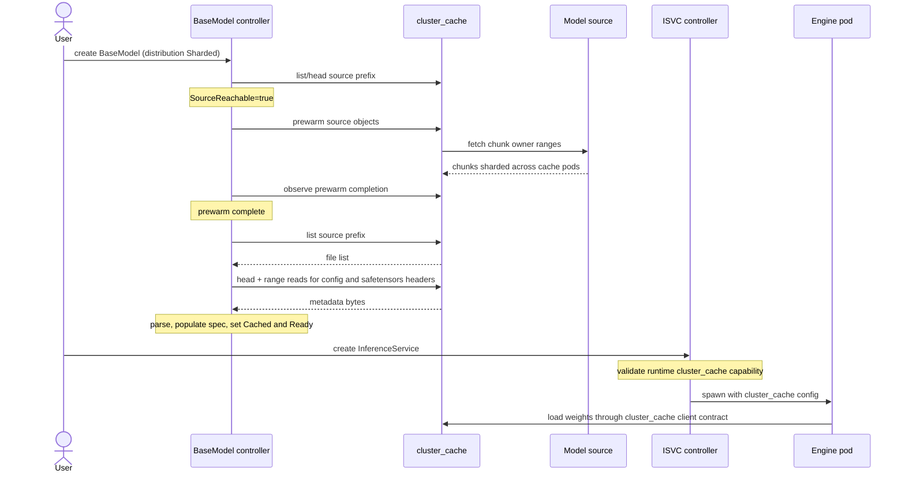

# OEP-0009: OME and Cluster Cache Integration

<!-- toc -->
- [Summary](#summary)
- [Motivation](#motivation)
  - [Goals](#goals)
  - [Non-Goals](#non-goals)
- [Proposal](#proposal)
  - [User Stories](#user-stories)
    - [Story 1: large foundation model, bandwidth-conscious operator](#story-1-large-foundation-model-bandwidth-conscious-operator)
    - [Story 2: HuggingFace-hosted model](#story-2-huggingface-hosted-model)
  - [Notes/Constraints/Caveats](#notesconstraintscaveats)
  - [Risks and Mitigations](#risks-and-mitigations)
- [Design Details](#design-details)
  - [CRD and status changes](#crd-and-status-changes)
  - [Model agent change (PerNode mode)](#model-agent-change-pernode-mode)
  - [cluster_cache API contract](#cluster_cache-api-contract)
  - [Cluster_cache LRU and re-fetch behavior](#cluster_cache-lru-and-re-fetch-behavior)
  - [Auth flow](#auth-flow)
  - [Engine weight consumption contract](#engine-weight-consumption-contract)
  - [End-to-end flow (Sharded mode)](#end-to-end-flow-sharded-mode)
    - [Sequence diagram](#sequence-diagram)
    - [Step-by-step](#step-by-step)
    - [Required cluster_cache code updates](#required-cluster_cache-code-updates)
  - [Failure modes](#failure-modes)
  - [Test Plan](#test-plan)
    - [Prerequisite Testing Updates](#prerequisite-testing-updates)
    - [Unit Tests](#unit-tests)
    - [Integration Tests](#integration-tests)
  - [Graduation Criteria](#graduation-criteria)
- [Implementation History](#implementation-history)
- [Drawbacks](#drawbacks)
- [Alternatives](#alternatives)
<!-- /toc -->

## Summary

This OEP adds an optional cluster-cache-backed download path for `BaseModel` / `ClusterBaseModel` in OME. The existing model-agent behavior is unchanged and remains the default. Operators opt in per model via a new `spec.distribution` field. When opted in, cluster_cache holds the model as chunks distributed across cache pods; the BaseModel controller drives prewarm, status, and metadata parsing; the per-node download path is bypassed for that model. Compatible engines consume Sharded models through a generic cluster_cache weight-loading contract; unsupported engines are rejected until their `ServingRuntime` declares that capability.

This is **additive**: nothing in OME's existing model-distribution behavior is removed for `PerNode` BaseModels (the default). `nodeSelector` injection on inference pods, the per-node ConfigMap status protocol, the HostPath mount in pods, and the `model-init` flow for encrypted models all stay the same when `distribution` is unset or set to `PerNode`. Only `Sharded` BaseModels take the new code path.

## Motivation

OME's model agent works today: per-node downloads to local NVMe, node-label-driven readiness, hard `nodeSelector` injection on inference pods for deterministic scheduling. Per-node storage isn't a constraint — typical GPU nodes have 20-60 TB of free NVMe.

The cost the current path does pay is **external bandwidth and cloud egress**. When N selector-matched nodes each download the same model from the cloud, external network usage and egress cost scale as N × model_size. For a 200 GB model on 50 nodes, that's 10 TB of cloud egress per deployment.

Cluster_cache is an independent sharded NVMe cache service with an RDMA fast path between nodes. Its download semantics are pull-driven: the first request for a chunk triggers a single cloud fetch by the chunk's owner node; subsequent requests from other nodes are served from cluster_cache over RDMA. Backing a BaseModel with cluster_cache gives the cluster the single-cloud-fetch-per-chunk property at the price of running cluster_cache as an additional system.

A second motivation is **HuggingFace source coverage**. Cluster_cache today supports only S3. Adding a HuggingFace source backend gives `Sharded`-mode `BaseModel`s access to HF as a source through the same coordinated cache-layer fan-out that S3-sourced models will use. Other cloud backends (OCI, GCS, Azure) are out of scope for this OEP and can be added later if needed.

### Goals

- Offer an **additional, opt-in** `distribution` field on `BaseModel` / `ClusterBaseModel`. `PerNode` (default) preserves current behavior; `Sharded` routes through cluster_cache.
- Reduce external network bandwidth and cloud egress for opt-in models: each chunk is fetched from cloud once per cluster, not once per node.
- Add **HuggingFace** as a cluster_cache source backend alongside the existing S3 backend.
- Preserve the existing model-agent behavior unchanged as the default for any `BaseModel` not opting in.

### Non-Goals

- **Not replacing the model agent.** Default behavior stays. Operators who don't opt in see no change.
- **Not removing `nodeSelector` injection** on inference pods for `PerNode` BaseModels. It's a feature, not a bug.
- **Not removing the per-node ConfigMap status protocol** for `PerNode` BaseModels.
- **Not modifying inference engines for `PerNode`.** Engines continue to read files from HostPath in `PerNode` mode. `Sharded` mode requires an engine to declare support for the cluster_cache weight-loading contract.
- **Not modifying the encrypted-model flow** for `PerNode` BaseModels. `model-init` continues to operate exactly as today.
- **Not adding Sharded consumption to every runtime.** Engines that do not implement the cluster_cache weight-loading contract remain unsupported for `Sharded` BaseModels and are rejected by OME validation.
- **Not adding multi-cloud support beyond S3 and HF** (no OCI/GCP/Azure cluster_cache backends in this OEP).
- **Not Stage 1 contract negotiation** with MSL TBD lab or MSL FAIR. Out of scope; this OEP works with whatever Stage 1 produces today.

## Proposal

The proposal is a single new field on `BaseModel.spec` plus matching cluster_cache extensions and a new BaseModel-controller code path for `Sharded` BaseModels. Detailed implementation lives in [Design Details](#design-details).

At a high level:

- `PerNode` (default): existing model-agent behavior, unchanged.
- `Sharded` (opt-in): cluster_cache holds the model as chunks; the BaseModel controller drives prewarm, status, and metadata parsing; model agent skips this BaseModel entirely; compatible engines read weights from cluster_cache through the runtime-declared weight-loading contract.

### User Stories

#### Story 1: large foundation model, bandwidth-conscious operator

An operator deploys a 200 GB foundation model to 50 GPU nodes. Today, the model agent downloads the full 200 GB from S3 to each of the 50 nodes — ~10 TB of cloud egress per deployment plus ~10 TB of fleet-side ingress. With `spec.distribution: Sharded`, cluster_cache fetches each chunk from S3 exactly once cluster-wide, then serves chunks to other nodes over RDMA. External egress drops by ~50× for the same workload.

#### Story 2: HuggingFace-hosted model

An operator wants to serve a model hosted in a HuggingFace repo. They set `storage.storageUri: hf://org/model-name` and `spec.distribution: Sharded`. cluster_cache's HuggingFace backend handles authentication via the HF token (default per-cache-pod or per-source override via Secret reference) and fetches the model. The operator gets HF source support without each model-agent node having to grow HF auth.

### Notes/Constraints/Caveats

- **`Sharded` is opt-in.** A BaseModel without `spec.distribution` set behaves identically to today (same as setting it to `PerNode`).
- **Things that do NOT change for `PerNode` BaseModels** (the default):
  - Model agent's overall flow (Scout informer + Gopher worker pool).
  - Per-node ConfigMap status protocol (`models.ome/basemodel-status`) and the BaseModel controller's rollup into `status.nodesReady` / `nodesFailed` / `state`.
  - `AddNodeSelectorForModelReadyNode` injection on inference pods.
  - `UpdatePodSpecVolumes` HostPath emission.
  - `model-init` injection for encrypted models, including all KMS/Vault and decryption logic.
  - `ServingRuntime` / `ClusterServingRuntime` schemas.
  - All engine images and runtimes.
- **`Sharded` pod consumption is runtime-gated.** ISVCs referencing `Sharded` BaseModels are accepted only when their selected runtime declares cluster_cache weight-loading support; other runtimes are rejected with a clear error.
- **HuggingFace tokens are scoped.** Per-source override via Secret reference in `BaseModel.spec.storage.parameters` is supported; cluster_cache pods also accept a default token in their config.

### Risks and Mitigations

1. **cluster_cache as a new operational dependency.** Failure of cluster_cache affects all `Sharded` BaseModels. Mitigation: `Sharded` is opt-in per model; `PerNode` (default) BaseModels are unaffected; switching a specific BaseModel back to `PerNode` is a one-line spec edit.

2. **Sharded mode requires explicit engine support.** Risk: users may select a runtime that still expects a HostPath model directory. Mitigation: the ISVC validating path rejects `Sharded` BaseModels unless the resolved runtime advertises cluster_cache weight-loading support; the controller skips HostPath and model-ready nodeSelector injection only for accepted Sharded runtimes.

3. **HuggingFace backend is new code in cluster_cache.** Risk: bugs in auth, range fetch, or LFS handling; dependence on HF API stability. Mitigation: scope is bounded to one new source backend behind a stable cluster_cache backend interface. Standard integration testing against public HF repos before Beta.

4. **`Cached=true` is a soft guarantee.** Idle Sharded models may need cache re-fetch on next pod load. Mitigation: documented in [Cluster_cache LRU and re-fetch behavior](#cluster_cache-lru-and-re-fetch-behavior); first-pod-after-eviction takes a re-fetch hit but still works.

5. **Controller-side parsing diverges from per-node parsing.** Two parser paths could behave differently for the same model. Mitigation: extract the existing model-agent parser into a shared package called by both `PerNode` (per-node, on the agent) and `Sharded` (cluster-wide, on the controller); only the byte source differs.

6. **cluster_cache extension maintenance.** cluster_cache changes for OEP-0009 (HF backend, listing contract, and async prewarm/status API) must be maintained as part of cluster_cache's own API. Mitigation: extensions land behind a clean API boundary and are additive — they don't alter cluster_cache's existing chunk semantics.

## Design Details

### CRD and status changes

Add `Distribution` to `BaseModelSpec`:

```go
type Distribution string

const (
    // Default. Existing behavior — model agent downloads directly
    // from the cloud source per its current implementation.
    DistributionPerNode Distribution = "PerNode"

    // Opt-in. cluster_cache holds the model as chunks; the BaseModel
    // controller drives prewarm, status, and metadata parsing; model
    // agent skips this BaseModel entirely.
    DistributionSharded Distribution = "Sharded"
)

type BaseModelSpec struct {
    // ... existing fields ...
    // +optional — defaults to PerNode (current behavior).
    Distribution *Distribution `json:"distribution,omitempty"`
}
```

Add condition-capable status fields to `ModelStatusSpec` so `Sharded`
models can report cluster-wide progress without writing per-node ConfigMaps:

```go
type ModelCacheStatus struct {
    // Implementation label, e.g. "cluster_cache".
    Backend string `json:"backend,omitempty"`

    // Source URI being warmed, copied from spec.storage.storageUri.
    SourceURI string `json:"sourceUri,omitempty"`

    // Operation ID returned by the cluster_cache async prewarm API.
    // Empty only before prewarm has been submitted.
    PrewarmID string `json:"prewarmID,omitempty"`

    TotalBytes  *int64 `json:"totalBytes,omitempty"`
    CachedBytes *int64 `json:"cachedBytes,omitempty"`
    TotalChunks *int32 `json:"totalChunks,omitempty"`
    CachedChunks *int32 `json:"cachedChunks,omitempty"`
}

type ModelStatusSpec struct {
    // ... existing fields ...
    State LifeCycleState `json:"state"`
    NodesReady []string `json:"nodesReady,omitempty"`
    NodesFailed []string `json:"nodesFailed,omitempty"`

    // Conditions include SourceReachable, Cached, and Ready for Sharded
    // models. PerNode models continue to use nodesReady/nodesFailed and
    // state exactly as they do today.
    Conditions []metav1.Condition `json:"conditions,omitempty"`

    // Cache contains cluster-wide Sharded cache progress when distribution
    // is Sharded. It is omitted for PerNode models.
    Cache *ModelCacheStatus `json:"cache,omitempty"`
}
```

Safety comes from the opt-in `spec.distribution` value plus
validation/controller guardrails for unsupported serving paths. `Storage`,
`NodeSelector`, `NodeAffinity`, `DownloadPolicy`, and `Path` remain unchanged.

### Model agent change (PerNode mode)

For `distribution == PerNode` (default): no change. Model agent runs exactly as today via the existing storage-backend code in `pkg/modelagent/gopher.go`.

For `distribution == Sharded`: model agent skips the BaseModel. Scout reads `spec.distribution`; if `Sharded`, no Gopher task is enqueued. Sharded BaseModels are not the model agent's responsibility; the BaseModel controller drives them end-to-end (see [End-to-end flow (Sharded mode)](#end-to-end-flow-sharded-mode)).

### cluster_cache API contract

Cluster_cache is treated as an independent cache component. OME depends on a
small source/list/head/range/prewarm contract, not on any engine-specific
implementation detail.

The current cluster_cache API already exposes these read-through primitives:

| Existing API / client method | Purpose |
|------------------------------|---------|
| `GET /head?path=...` / `CacheClient.head_one(path)` | Returns `(size, mtime)` for one object. |
| `GET /chunk_by_key?...` / `CacheClient.fetch_byte_range(path, mtime, size, offset, length)` | Fetches arbitrary ranges by routing chunk-aligned reads through the cache ring. |
| `POST /prefetch_owned_chunks` | Internal owner-side warm call for specific chunks. |
| `CacheClient.prewarm(paths)` | Blocking client-side fan-out: HEADs object paths, groups chunks by owner, and POSTs `/prefetch_owned_chunks` to warm the ring. |

Required cluster_cache code updates for OEP-0009:

| Needed contract | Purpose |
|-----------------|---------|
| Prefix listing | Enumerates files under a model prefix. OME needs a stable cluster_cache-owned equivalent, either as `GET /list?prefix=...` or as a typed cluster_cache client API. |
| HuggingFace backend | Adds `hf://org/model` support alongside S3. This likely requires a stable source-backend interface inside cluster_cache rather than S3-specific fetch logic. |
| HF authentication | Supports a default HF token per cache deployment plus per-source overrides from `BaseModel.spec.storage.parameters` / Secret references. |
| Async prewarm/status API | Adds daemon-side `POST /prewarm` + `GET /prewarm/<id>` operations. OME stores the returned operation ID in `status.cache.prewarmID` and polls status until completion. |

Not added to cluster_cache (intentional): KMS/Vault decryption for `PerNode`
models, engine-aware runtime selection logic, or OME-specific CRD behavior.

### Cluster_cache LRU and re-fetch behavior

Sharded mode does not reserve cache capacity. After prewarm completes and `Cached=true` is set, cluster_cache's normal LRU manages chunks. Frequently-accessed models stay warm naturally; idle models eventually get evicted.

If chunks for a `Ready` model get evicted later, the next inference pod's load triggers cache misses → cluster_cache re-fetches the missing chunks from S3 / HF on the spot. This is just normal cache-miss behavior, not a failure. The trade-off is that `Cached=true` means *"we prewarmed it once"* rather than *"chunks are guaranteed to be in cache right now"* — for active models this is invisible; for rarely-used models a slow first-load occasionally is acceptable.

### Auth flow

Cluster_cache pods bind AWS workload identity (IRSA on EKS, or static keys via Secret) for the S3 backend, and accept a default HF token (per-cache-pod config) for the HuggingFace backend. Per-source overrides come from the `BaseModel.spec.storage.parameters` Secret reference, passed through the prewarm/fetch request. Cluster_cache materializes the credentials at fetch time and uses them only for that source.

### Engine weight consumption contract

Cluster_cache is responsible for source listing, object metadata, range reads,
prewarm, cache ownership, and cache-miss refetch. It is not responsible for
engine-specific tensor loading or runtime selection.

An engine is compatible with `Sharded` BaseModels when it can load model
weights from cluster_cache without requiring a full HostPath copy on the local
node. OME models this as an explicit `ServingRuntime` capability, for example:

```yaml
metadata:
  annotations:
    ome.io/sharded-model-consumption: cluster-cache
```

The exact schema can become a first-class field later if more than one
cluster-wide distribution mechanism exists. For this OEP, the capability means:

- The engine understands the cluster_cache discovery/configuration passed by
  OME.
- The engine can read model weight bytes from cluster_cache using the stable
  cluster_cache range-read/client contract.
- The engine does not require OME to inject a model-ready nodeSelector or a
  model HostPath volume for this BaseModel.

When an ISVC references a `Sharded` BaseModel, OME validates the resolved
runtime before pod creation. Runtimes without this capability remain valid for
`PerNode` models but are not valid for `Sharded` models.

### End-to-end flow (Sharded mode)

The `PerNode` mode lifecycle is the existing OME flow and is not duplicated here.

#### Sequence diagram



#### Step-by-step

1. **User submits the BaseModel CR** with `spec.distribution: Sharded`:

   ```yaml
   apiVersion: ome.io/v1beta1
   kind: BaseModel
   metadata: { name: llama-4 }
   spec:
     storage: { storageUri: "s3://bucket/llama-4/v1/" }
     distribution: Sharded
   ```

2. **K8s API server validation.** OME validating webhook does basic shape checks: `Sharded` requires a storage source supported by cluster_cache, and unsupported storage backends are rejected with a clear error. CR persists in etcd.

3. **BaseModel controller reconciles.** Informer fires. Sees `distribution: Sharded` and takes the new code path. Lists and HEADs the source URI via cluster_cache to validate auth + reachability. Sets `SourceReachable=true`.

4. **Controller calls the cluster_cache async prewarm API.** `POST /prewarm` receives the model source prefix plus any source auth reference. cluster_cache returns an operation ID, which OME stores in `BaseModel.status.cache.prewarmID`.

5. **cluster_cache prewarm runs.** cluster_cache enumerates model files (`config.json`, tokenizer files, index files, `*.safetensors` shards), HEADs each file for `(size, mtime)`, computes chunk layout, and assigns chunks to cache owners via the consistent hash ring. Owner pods fetch their assigned chunks from the source backend using the auth passed for that source and store chunks on local NVMe. **No per-node full copies anywhere** — a 200 GB model becomes chunks distributed across cluster_cache pods.

6. **Controller observes prewarm progress.** The controller polls `GET /prewarm/<id>` and writes progress into `BaseModel.status.cache` and the `Cached` condition. When prewarm completes, `Cached=True`; on failure, `Cached=False` with a reason and message from cluster_cache.

7. **Controller parses model metadata after prewarm completes.** This is the new piece, replacing the per-node parser that runs on each model-agent node in `PerNode` mode:

   - Use the cluster_cache listing contract to enumerate files (or reuse the listing from step 5).
   - For `config.json` (small whole file): `head_one(path)` → `(size, mtime)`, then `fetch_byte_range(path, mtime, size, 0, size)` returns the JSON bytes in memory.
   - For each `*.safetensors` shard (header only — multi-GB tensor body stays in cluster_cache):
     - `head_one(path)` → `(total_size, mtime)`.
     - `fetch_byte_range(path, mtime, total_size, 0, 8)` → first 8 bytes.
     - Decode bytes 0-8 as little-endian `u64` → header size N (typically KB to MB).
     - `fetch_byte_range(path, mtime, total_size, 8, N)` → header JSON bytes.
   - Parses these via a **shared parser package** (extracted from the existing `pkg/modelagent/...ModelConfigParser`, so both `PerNode` and `Sharded` modes use the same parser logic; only the byte source differs).
   - Populates `BaseModel.spec` enrichment fields (`ModelType`, `ModelArchitecture`, `ModelParameterSize`, `ModelCapabilities`, etc.) — same fields the per-node parser populates today.
   - Sets `Cached=true`, `Ready=true`. **No per-node ConfigMap writes. No per-node labels.**

   *(Alternative implementation: a one-shot Job runs step 7 instead of the controller doing it inline. Either works; controller-inline is simpler if the parse stays cheap.)*

8. **Model agent skips the BaseModel.** Scout sees the BaseModel via informer, reads `spec.distribution`. If `Sharded`, no Gopher task is pushed — this BaseModel is not the model agent's responsibility. (For `PerNode` BaseModels, the existing model-agent flow runs unchanged.)

9. **User creates an InferenceService** referencing the BaseModel.

10. **ISVC controller reconciles.** Resolves the BaseModel reference, sees `distribution: Sharded`, and validates that the resolved runtime declares cluster_cache weight-loading support. It **does NOT** call `AddNodeSelectorForModelReadyNode` and **does NOT** inject the model HostPath volume. Instead, it injects the cluster_cache discovery/configuration required by the generic engine contract.

11. **K8s scheduler places the pod.** No model-keyed nodeSelector to satisfy. Pod scheduled based on GPU class, anti-affinity, accelerator class.

12. **Pod starts.** The engine reads model weights through the cluster_cache client contract. Any engine-local metadata cache or manifest is engine-owned; OME only passes cluster_cache configuration and the model source identity.

13. **Engine becomes ready** and serves traffic.

#### Required cluster_cache code updates

OME will update cluster_cache to expose an async prewarm/status API. This is a
required cluster_cache code change for OEP-0009, not an OME-side wrapper around
the existing blocking client call.

The new API shape is:

| API | Purpose |
|-----|---------|
| `POST /prewarm` | Accepts a source prefix/object list plus optional auth reference and returns an operation ID. |
| `GET /prewarm/<id>` | Returns operation phase, progress bytes/chunks, failure reason/message, and completion time. |
| `DELETE /prewarm/<id>` | Optional cancellation/cleanup endpoint. Useful but not required for Alpha. |

cluster_cache owns operation state because it owns chunk assignment, source
fetching, and cache-pod restart behavior. The existing blocking
`CacheClient.prewarm(paths)` can remain as a convenience client, but OME should
depend on the async daemon API.

### Failure modes

| Failure                                                     | Behavior                                                                                                                   |
|-------------------------------------------------------------|----------------------------------------------------------------------------------------------------------------------------|
| Cluster_cache pod death                                     | DNS removes it, ring rebuilds, ~1/N chunks become unowned, next read sees a cache miss and re-fetches from cloud.          |
| Prewarm fails                                               | `BaseModel.status.Cached=false` with reason. Operator can flip BaseModel to `PerNode` mode as a fallback, or retry.        |
| `head_one` / `fetch_byte_range` fails during parse (step 7) | Controller retries with backoff. If repeatedly failing: `Ready=false` with reason; operator inspects cluster_cache health. |
| Cluster_cache unreachable from BaseModel controller         | `Sharded` reconcile fails. `PerNode` BaseModels unaffected. Operator can flip to `PerNode` mode as a fallback.             |
| HF token expired or invalid                                 | Prewarm fails with auth error in status. Operator rotates the Secret.                                                      |

### Test Plan

- [ ] I/we understand that component owners may require updates to existing tests before accepting changes necessary for this enhancement.

#### Prerequisite Testing Updates

- Extend cluster_cache integration test harness to cover the HuggingFace backend (currently S3-only).
- Extend the OME test harness to handle BaseModels with `spec.distribution: Sharded` (validation, controller reconcile, condition assertions).
- Refactor the existing model-agent parser into a shared package without behavior change; existing per-node parser tests move to the shared package.

#### Unit Tests

- `cluster_cache::backends::hf` — HuggingFace backend correctness: token auth, range fetch, repo listing, error handling.
- `cluster_cache::api::prewarm` — async prewarm job lifecycle: create, poll, complete, fail, cancel/cleanup if implemented, and cache-pod restart.
- `cluster_cache::api::list` — `GET /list?prefix=...` for both S3 and HF backends.
- `pkg/modelagent::parser` (refactored shared package) — config.json + safetensors header parsing; same tests as today, just relocated.
- `pkg/controller/v1beta1/basemodel` — Sharded reconcile path: prewarm trigger, status polling, parse invocation, condition writes (`SourceReachable`, `Cached`, `Ready`).
- `pkg/controller/v1beta1/inferenceservice` — Sharded BaseModel: validates runtime capability, skips `AddNodeSelectorForModelReadyNode`, skips HostPath injection, and injects cluster_cache configuration.

#### Integration Tests

- **Backward compat e2e.** Create a `BaseModel` without `spec.distribution`. Confirm zero behavior change vs. existing OME deployments — model agent downloads, ConfigMap status writes, nodeSelector injection, pod load all work identically.
- **Sharded e2e (controller side).** Create a `BaseModel` with `distribution: Sharded`. Observe controller prewarm against cluster_cache, observe condition transitions (`SourceReachable=true` → `Cached=true` → `Ready=true`), and observe `BaseModel.spec` enriched with parsed metadata.
- **Sharded engine contract e2e.** Use a minimal runtime fixture that declares cluster_cache weight-loading support. Confirm the ISVC controller skips model-ready nodeSelector and HostPath injection, passes cluster_cache configuration to the pod, and the engine fixture can read expected bytes through cluster_cache.
- **HuggingFace source e2e.** Create a `BaseModel` with `storageUri: hf://org/model` and `distribution: Sharded`. Verify cluster_cache HF backend handles auth and prewarm.
- **Failure-mode e2e.** Cluster_cache reachable but prewarm fails (e.g., invalid auth) → `Cached=false` with reason; operator switches to `PerNode` and BaseModel transitions to existing flow successfully.
- **Bandwidth observability.** Deploy `Sharded` BaseModel to N nodes; confirm cloud-side egress metrics show ~1× model size pulled (cluster-wide) instead of N×.

### Graduation Criteria

#### Alpha

- `BaseModel.spec.distribution` field added with values `PerNode` (default) and `Sharded`.
- Model agent unchanged for `PerNode`; skips `Sharded` BaseModels cleanly.
- cluster_cache HuggingFace backend implemented; passes integration tests against public HF repos.
- cluster_cache async prewarm + status API implemented.
- cluster_cache `GET /list` endpoint implemented.
- BaseModel controller capable of prewarm + parse + condition writes for `Sharded` BaseModels.
- ISVCs referencing `Sharded` BaseModels are accepted only when the resolved runtime declares cluster_cache weight-loading support.
- Backward compatibility verified — `PerNode` BaseModels behave identically to today's deployments.

#### Beta

- At least one engine-compatible runtime can load and serve a `Sharded` BaseModel through the generic cluster_cache contract.
- Prewarm API hardened for retries, restart recovery, and large-model progress reporting.
- Performance baseline: cloud-egress reduction quantified for representative workloads (target ≥10× for a 50-node deployment).
- Cluster_cache failure-mode operational playbook documented (re-fetch behavior, eviction handling, auth rotation).
- HF backend hardened against repo-side outages and token-rotation flows.

#### Stable

- 6 months of Beta operation with no critical bugs or data-loss incidents.
- Documented migration path for moving BaseModels between `PerNode` and `Sharded` modes.
- Cluster_cache extensions for this OEP (HF backend, prewarm/status, list endpoint) in stable release of cluster_cache.

## Implementation History

- 2026-05-04: OEP-0009 initial draft.
- 2026-05-06: `BaseModel.spec.distribution` field landed.
- 2026-05-06: Existing model config parser extracted into a shared package.
- TBD: cluster_cache HuggingFace backend implementation.
- TBD: cluster_cache async prewarm + status API.
- TBD: cluster_cache `GET /list` endpoint.
- TBD: OME status schema and condition/cache writes.
- TBD: Shared parser source abstraction for cluster_cache range reads.
- TBD: BaseModel controller `Sharded` reconcile path.
- TBD: ISVC controller `Sharded` runtime capability validation and injection behavior.

## Drawbacks

- **New operational dependency.** Operators who opt into `Sharded` mode now run cluster_cache as a DaemonSet alongside the model agent. More moving parts, more monitoring surface.
- **Cluster_cache's NVMe is a shared resource.** Capacity must be planned at deployment time. Over-pressure manifests as eviction plus re-fetch on next pod load, which can make a later first load slower even though the model remains logically usable.
- **`Cached=true` is a soft guarantee.** It means "prewarm completed at some point" — not "chunks are still in cache right now." Active models stay warm via LRU; idle models may need re-fetch. Acceptable for the workloads this OEP targets; revisit if real-time SLOs need stronger guarantees.
- **HuggingFace auth surface in cluster_cache.** A new HF backend module + token handling. Smaller than a full multi-cloud expansion, but still new code that needs maintenance.
- **Sharded mode depends on engine support.** OME can prewarm and parse a `Sharded` BaseModel without changing every engine, but serving traffic requires a runtime that explicitly implements the cluster_cache weight-loading contract.
- **Two parser code paths.** Even with a shared parser package, `PerNode` invokes it on each agent node from disk, while `Sharded` invokes it from the controller via cluster_cache range reads. Operators have to understand both invocation contexts when debugging.

## Alternatives

| Alternative                                                                                                               | Status                                                                                                                                                                           |
|---------------------------------------------------------------------------------------------------------------------------|----------------------------------------------------------------------------------------------------------------------------------------------------------------------------------|
| **Replace the model agent entirely** with cluster_cache-backed engine loading                                            | Rejected. Per-node storage is not a real constraint (20-60 TB free); `nodeSelector` injection is a useful scheduling feature; model agent works for what it's designed for.      |
| **Drop `nodeSelector` injection** in favor of cluster-wide pod placement                                                  | Rejected for `PerNode` mode (it's a feature). Sharded mode doesn't need nodeSelector since chunks are cluster-wide.                                                              |
| **Replace per-node ConfigMap status protocol** with cluster-wide BaseModel conditions for all BaseModels                  | Rejected as a forced replacement. The existing protocol works for `PerNode`; new conditions are added for `Sharded` without removing the existing protocol.                      |
| **Build a separate P2P fan-out component** (BitTorrent-style or NCCL-collective) instead of using cluster_cache           | Possible future work, but cluster_cache already exists, has a working RDMA fan-out, and adding HF backend + async prewarm gives us the same property with reused infrastructure. |
| **Use cluster_cache only as a multi-cloud download library** (linked into the model agent process directly, no DaemonSet) | Considered. Loses the cluster-wide chunk caching benefit; each agent would still pull from cloud per node. The DaemonSet shape is what enables the bandwidth savings.            |
| **Reserve cache capacity for `Sharded` BaseModels**                                                                       | Deferred. LRU plus re-fetch is sufficient for the workloads targeted by this OEP; stronger cache residency guarantees can be considered later if real-time SLOs require them.    |
| **Add OCI / GCP / Azure backends to cluster_cache as part of this OEP**                                                   | Rejected. HF is the immediate need for testing; other clouds can be added in follow-up OEPs as use cases arise.                                                                  |
