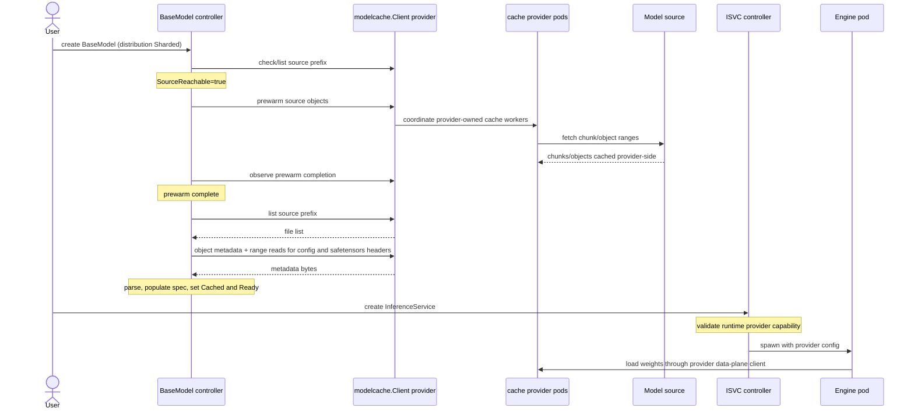

# OEP-0009: OME Model Cache Provider Integration

<!-- toc -->
- [Summary](#summary)
- [Motivation](#motivation)
  - [Goals](#goals)
  - [Non-Goals](#non-goals)
- [Proposal](#proposal)
  - [User Stories](#user-stories)
    - [Story 1: large foundation model, bandwidth-conscious operator](#story-1-large-foundation-model-bandwidth-conscious-operator)
    - [Story 2: HuggingFace-hosted model](#story-2-huggingface-hosted-model)
  - [Notes/Constraints/Caveats](#notesconstraintscaveats)
  - [Risks and Mitigations](#risks-and-mitigations)
- [Design Details](#design-details)
  - [CRD and status changes](#crd-and-status-changes)
  - [Model agent change (PerNode mode)](#model-agent-change-pernode-mode)
  - [Model cache provider architecture](#model-cache-provider-architecture)
  - [Model cache provider contract](#model-cache-provider-contract)
  - [Initial cluster-cache provider work](#initial-cluster-cache-provider-work)
  - [Cache LRU and re-fetch behavior](#cache-lru-and-re-fetch-behavior)
  - [Auth flow](#auth-flow)
  - [Engine weight consumption contract](#engine-weight-consumption-contract)
  - [End-to-end flow (Sharded mode)](#end-to-end-flow-sharded-mode)
    - [Sequence diagram](#sequence-diagram)
    - [Step-by-step](#step-by-step)
    - [Required provider implementation work](#required-provider-implementation-work)
  - [Failure modes](#failure-modes)
  - [Test Plan](#test-plan)
    - [Prerequisite Testing Updates](#prerequisite-testing-updates)
    - [Unit Tests](#unit-tests)
    - [Integration Tests](#integration-tests)
  - [Graduation Criteria](#graduation-criteria)
- [Implementation History](#implementation-history)
- [Drawbacks](#drawbacks)
- [Alternatives](#alternatives)
<!-- /toc -->

## Summary

This OEP adds an optional model-cache-backed distribution path for `BaseModel` / `ClusterBaseModel` in OME. The existing model-agent behavior is unchanged and remains the default. Operators opt in per model via `spec.distribution: Sharded`. When opted in, OME drives source validation, prewarm, status, and metadata parsing through a generic `modelcache.Client` contract. A concrete provider implements that contract. The initial provider is Meta's cluster_cache, but OME core must not assume cluster_cache is the only possible implementation.

For `Sharded` models, the per-node download path is bypassed. Compatible engines consume weights through the selected cache provider's data-plane integration. For the initial cluster-cache provider, engines use the in-process cluster_cache client so high-throughput weight loading can keep its ring fan-out, RDMA, NUMA/HCA affinity, and direct buffer/tensor access. Unsupported engines are rejected until their `ServingRuntime` declares capability for the selected provider.

This is **additive**: nothing in OME's existing model-distribution behavior is removed for `PerNode` BaseModels (the default). `nodeSelector` injection on inference pods, the per-node ConfigMap status protocol, the HostPath mount in pods, and the `model-init` flow for encrypted models all stay the same when `distribution` is unset or set to `PerNode`. Only `Sharded` BaseModels take the new code path.

## Motivation

OME's model agent works today: per-node downloads to local NVMe, node-label-driven readiness, hard `nodeSelector` injection on inference pods for deterministic scheduling. Per-node storage isn't a constraint — typical GPU nodes have 20-60 TB of free NVMe.

The cost the current path does pay is **external bandwidth and cloud egress**. When N selector-matched nodes each download the same model from the cloud, external network usage and egress cost scale as N × model_size. For a 200 GB model on 50 nodes, that's 10 TB of cloud egress per deployment.

The cache-provider path lets OME integrate with a cluster-wide cache service whose download semantics are pull-driven: the first request for a chunk triggers a single cloud fetch by the chunk's owner node; subsequent requests from other nodes are served from the cache provider. The first implementation is cluster_cache, an independent sharded NVMe cache service with an RDMA fast path between nodes. Backing a BaseModel with a cache provider gives the cluster the single-cloud-fetch-per-chunk property at the price of running an additional cache system.

A second motivation is **HuggingFace source coverage**. The initial cluster-cache provider work adds HuggingFace as a source backend alongside S3. Other providers may choose different source coverage, and future OSS providers can implement the same OME-side contract without adopting cluster_cache internals.

### Goals

- Offer an **additional, opt-in** `distribution` field on `BaseModel` / `ClusterBaseModel`. `PerNode` (default) preserves current behavior; `Sharded` routes through a configured model cache provider.
- Reduce external network bandwidth and cloud egress for opt-in models: each chunk is fetched from cloud once per cluster, not once per node.
- Define a provider-neutral OME control-plane contract (`modelcache.Client`) so cluster_cache is the first provider, not a hard dependency baked into controllers.
- Add **HuggingFace** support to the initial cluster-cache provider alongside the existing S3 backend.
- Preserve the existing model-agent behavior unchanged as the default for any `BaseModel` not opting in.

### Non-Goals

- **Not replacing the model agent.** Default behavior stays. Operators who don't opt in see no change.
- **Not removing `nodeSelector` injection** on inference pods for `PerNode` BaseModels. It's a feature, not a bug.
- **Not removing the per-node ConfigMap status protocol** for `PerNode` BaseModels.
- **Not modifying inference engines for `PerNode`.** Engines continue to read files from HostPath in `PerNode` mode. `Sharded` mode requires an engine to declare support for the selected cache provider's data-plane loading path.
- **Not modifying the encrypted-model flow** for `PerNode` BaseModels. `model-init` continues to operate exactly as today.
- **Not adding Sharded consumption to every runtime.** Engines that do not implement a supported model-cache data-plane integration remain unsupported for `Sharded` BaseModels and are rejected by OME validation.
- **Not requiring every provider to support every source backend.** The initial cluster-cache provider targets S3 and HF. OCI/GCP/Azure can be added by provider implementations later.
- **Not adding a `ModelCacheBackend` CRD in Alpha.** Alpha uses cluster-level provider configuration for the controller. A CRD can be added later if OME needs multiple cache providers in one cluster or per-model provider selection.
- **Not Stage 1 contract negotiation** with MSL TBD lab or MSL FAIR. Out of scope; this OEP works with whatever Stage 1 produces today.

## Proposal

The proposal is a single new field on `BaseModel.spec`, a provider-neutral `modelcache.Client` port, and a new BaseModel-controller code path for `Sharded` BaseModels. Detailed implementation lives in [Design Details](#design-details).

At a high level:

- `PerNode` (default): existing model-agent behavior, unchanged.
- `Sharded` (opt-in): a configured model cache provider holds the model as chunks/objects; the BaseModel controller drives prewarm, status, and metadata parsing through `modelcache.Client`; model agent skips this BaseModel entirely; compatible engines read weights through the runtime-declared provider integration.

### User Stories

#### Story 1: large foundation model, bandwidth-conscious operator

An operator deploys a 200 GB foundation model to 50 GPU nodes. Today, the model agent downloads the full 200 GB from S3 to each of the 50 nodes — ~10 TB of cloud egress per deployment plus ~10 TB of fleet-side ingress. With `spec.distribution: Sharded`, the configured model cache provider fetches each chunk from S3 exactly once cluster-wide, then serves chunks to other nodes. With the initial cluster-cache provider this fan-out uses RDMA. External egress drops by ~50× for the same workload.

#### Story 2: HuggingFace-hosted model

An operator wants to serve a model hosted in a HuggingFace repo. They set `storage.storageUri: hf://org/model-name` and `spec.distribution: Sharded`. A provider that supports HF handles authentication via a default provider token or per-source override via Secret reference and fetches the model. With the initial cluster-cache provider, this is implemented by a new HF backend in cluster_cache. The operator gets HF source support without each model-agent node having to grow HF auth.

### Notes/Constraints/Caveats

- **`Sharded` is opt-in.** A BaseModel without `spec.distribution` set behaves identically to today (same as setting it to `PerNode`).
- **Things that do NOT change for `PerNode` BaseModels** (the default):
  - Model agent's overall flow (Scout informer + Gopher worker pool).
  - Per-node ConfigMap status protocol (`models.ome/basemodel-status`) and the BaseModel controller's rollup into `status.nodesReady` / `nodesFailed` / `state`.
  - `AddNodeSelectorForModelReadyNode` injection on inference pods.
  - `UpdatePodSpecVolumes` HostPath emission.
  - `model-init` injection for encrypted models, including all KMS/Vault and decryption logic.
  - `ServingRuntime` / `ClusterServingRuntime` schemas.
  - All engine images and runtimes.
- **`Sharded` pod consumption is runtime-gated.** ISVCs referencing `Sharded` BaseModels are accepted only when their selected runtime declares support for the configured cache provider; other runtimes are rejected with a clear error.
- **HuggingFace tokens are scoped.** Per-source override via Secret reference in `BaseModel.spec.storage.parameters` is supported; providers may also accept a default token in their deployment config.
- **OME does not port or embed provider data-plane clients.** For cluster_cache, the existing Rust client owns hot-path ring lookup, fan-out, RDMA, NUMA/HCA selection, and direct buffer/tensor writes. OME uses only the control-plane `modelcache.Client` port.
- **No OME-specific cluster_cache gateway is required for Alpha.** The initial cluster-cache provider extends its existing DaemonSet server API for OME control-plane operations instead of adding another server solely for OME.

### Risks and Mitigations

1. **A cache provider as a new operational dependency.** Failure of the configured provider affects all `Sharded` BaseModels using it. Mitigation: `Sharded` is opt-in per model; `PerNode` (default) BaseModels are unaffected; switching a specific BaseModel back to `PerNode` is a one-line spec edit.

2. **Sharded mode requires explicit engine support.** Risk: users may select a runtime that still expects a HostPath model directory. Mitigation: the ISVC validating path rejects `Sharded` BaseModels unless the resolved runtime advertises support for the configured cache provider; the controller skips HostPath and model-ready nodeSelector injection only for accepted Sharded runtimes.

3. **Provider-specific source backend bugs.** Risk: the initial cluster-cache HF backend may have bugs in auth, range fetch, or LFS handling; dependence on HF API stability. Mitigation: source support sits behind the provider boundary. OME sees only `modelcache.Client` errors and status reasons; provider implementations own their source-backend tests.

4. **`Cached=true` is a soft guarantee.** Idle Sharded models may need cache re-fetch on next pod load. Mitigation: documented in [Cache LRU and re-fetch behavior](#cache-lru-and-re-fetch-behavior); first-pod-after-eviction takes a re-fetch hit but still works.

5. **Controller-side parsing diverges from per-node parsing.** Two parser paths could behave differently for the same model. Mitigation: extract the existing model-agent parser into a shared package called by both `PerNode` (per-node, on the agent) and `Sharded` (cluster-wide, on the controller); only the byte source differs.

6. **Provider implementation maintenance.** cluster-cache changes for OEP-0009 (HF backend, listing contract, range reads, and async prewarm/status API) must be maintained as part of cluster_cache's own daemon API. Future OSS providers must meet the same OME contract. Mitigation: OME's provider interface is small, additive, and semantic; provider-specific transport and cache behavior stay outside OME controllers.

7. **Two integration surfaces can be confusing.** OME and engines intentionally use different surfaces. Mitigation: keep the split explicit: OME is control plane and talks through `modelcache.Client`; engines are data plane and use provider-specific process-local integrations.

## Design Details

### CRD and status changes

Add `Distribution` to `BaseModelSpec`:

```go
type Distribution string

const (
    // Default. Existing behavior — model agent downloads directly
    // from the cloud source per its current implementation.
    DistributionPerNode Distribution = "PerNode"

    // Opt-in. A model cache provider holds the model as chunks/objects;
    // the BaseModel controller drives prewarm, status, and metadata
    // parsing; model agent skips this BaseModel entirely.
    DistributionSharded Distribution = "Sharded"
)

type BaseModelSpec struct {
    // ... existing fields ...
    // +optional — defaults to PerNode (current behavior).
    Distribution *Distribution `json:"distribution,omitempty"`
}
```

Add condition-capable status fields to `ModelStatusSpec` so `Sharded`
models can report cluster-wide progress without writing per-node ConfigMaps:

```go
type ModelCacheStatus struct {
    // Provider implementation label, e.g. "cluster_cache".
    Backend string `json:"backend,omitempty"`

    // Source URI being warmed, copied from spec.storage.storageUri.
    SourceURI string `json:"sourceUri,omitempty"`

    // Operation ID returned by the provider's async prewarm API.
    // Empty only before prewarm has been submitted.
    PrewarmID string `json:"prewarmID,omitempty"`

    TotalBytes  *int64 `json:"totalBytes,omitempty"`
    CachedBytes *int64 `json:"cachedBytes,omitempty"`
    TotalChunks *int32 `json:"totalChunks,omitempty"`
    CachedChunks *int32 `json:"cachedChunks,omitempty"`
}

type ModelStatusSpec struct {
    // ... existing fields ...
    State LifeCycleState `json:"state"`
    NodesReady []string `json:"nodesReady,omitempty"`
    NodesFailed []string `json:"nodesFailed,omitempty"`

    // Conditions include SourceReachable, Cached, and Ready for Sharded
    // models. PerNode models continue to use nodesReady/nodesFailed and
    // state exactly as they do today.
    Conditions []metav1.Condition `json:"conditions,omitempty"`

    // Cache contains cluster-wide Sharded cache progress when distribution
    // is Sharded. It is omitted for PerNode models.
    Cache *ModelCacheStatus `json:"cache,omitempty"`
}
```

Safety comes from the opt-in `spec.distribution` value plus
validation/controller guardrails for unsupported serving paths. `Storage`,
`NodeSelector`, `NodeAffinity`, `DownloadPolicy`, and `Path` remain unchanged.

### Model agent change (PerNode mode)

For `distribution == PerNode` (default): no change. Model agent runs exactly as today via the existing storage-backend code in `pkg/modelagent/gopher.go`.

For `distribution == Sharded`: model agent skips the BaseModel. Scout reads `spec.distribution`; if `Sharded`, no Gopher task is enqueued. Sharded BaseModels are not the model agent's responsibility; the BaseModel controller drives them end-to-end (see [End-to-end flow (Sharded mode)](#end-to-end-flow-sharded-mode)).

### Model cache provider architecture

OME treats model caching as a provider interface. The controller depends on the
semantic `modelcache.Client` port, not on cluster_cache-specific HTTP routes,
Rust client internals, or data-plane transport details.

Alpha uses one cluster-level model cache provider configured on the OME
controller. The provider name is recorded in `BaseModel.status.cache.backend`.
This keeps the public API simple while still leaving room for OSS providers.
If OME later needs multiple cache providers in one cluster, namespace-specific
provider selection, or per-model provider selection, a `ModelCacheBackend` CRD
or `spec.cacheRef` can be introduced as a follow-up.

The initial provider is `cluster_cache`, backed by Meta's cluster_cache
DaemonSet. Future providers can implement the same control-plane contract using
different implementations, for example an OSS HTTP cache, a PVC-backed cache, or
a development no-op cache.

There are two distinct consumers in this design:

| Consumer | Surface | Responsibilities |
|----------|---------|------------------|
| OME BaseModel controller | `modelcache.Client` implementation selected by provider config | Source validation, source listing, object metadata reads, async prewarm submission, prewarm status polling, small metadata range reads for parsing, status/condition writes in OME. |
| Engine process | Provider-specific data-plane integration declared by the selected runtime | Hot-path weight loading, cache fan-out, transport behavior, locality behavior, and direct writes into engine-owned buffers or tensors. |

The split is intentional. For cluster_cache, the existing Rust client is a fat
data-plane client: it computes ring ownership, talks to many cache nodes,
handles chunk fan-out, maintains transport/RDMA state, and can write directly
into memory owned by the engine process. OME should not reimplement that logic
in Go and should not link it into the controller through cgo/FFI. Other
providers may have different data-plane clients, but the same rule applies:
engine-local transport/runtime concerns stay out of the Kubernetes control
plane.

OME only needs control-plane operations. For the initial cluster-cache provider,
those operations should be added to the existing cluster_cache daemon server
rather than creating a new OME-specific gateway. A separate
coordinator/gateway can be revisited later if operation ownership, restart
recovery, or multi-cluster API shape becomes awkward in the DaemonSet server
model.

### Model cache provider contract

`pkg/modelcache` defines the controller-facing contract. Providers implement
this interface; controllers do not call provider-specific APIs directly.

```go
type Client interface {
    CheckSource(ctx context.Context, source Source) (*SourceStatus, error)
    ListSource(ctx context.Context, source Source) ([]Object, error)
    GetObject(ctx context.Context, ref ObjectRef) (*Object, error)
    ReadMetadataRange(ctx context.Context, req MetadataRangeRequest) ([]byte, error)
    StartPrewarm(ctx context.Context, req PrewarmRequest) (*PrewarmOperation, error)
    GetPrewarmStatus(ctx context.Context, operation PrewarmOperation) (*PrewarmStatus, error)
}
```

The operations are intentionally semantic:

| Operation | Purpose |
|-----------|---------|
| `CheckSource` | Validate that the provider can reach the source and auth material. |
| `ListSource` | Enumerate files/objects under a model source prefix. |
| `GetObject` | Return backend-neutral object metadata such as path, size, and version. |
| `ReadMetadataRange` | Read small byte ranges needed for metadata parsing; not used for full tensor loading. |
| `StartPrewarm` | Start or resume an async prewarm operation. The request includes an idempotency key so retries do not create duplicate operations. |
| `GetPrewarmStatus` | Poll operation phase, progress, and failure reason/message. |

Provider requirements:

- Implement `StartPrewarm` idempotently for a stable `IdempotencyKey`.
- Preserve operation status across controller restarts. Provider restart
  recovery can be best-effort in Alpha, but the API must be pollable after an
  OME manager restart.
- Return provider-neutral errors/reasons suitable for
  `BaseModel.status.conditions`.
- Keep full-weight data-plane loading outside the OME controller.

Provider selection is controller configuration, not a BaseModel field in Alpha.
The first config shape can be a small manager config section or environment
variables, for example:

```yaml
modelCache:
  provider: cluster_cache
  endpoint: http://cluster-cache.ome.svc.cluster.local:10090
  options:
    timeout: 5m
    operation_retention: 10m
```

The controller constructs one `modelcache.Client` from that config and injects
it into BaseModel/ClusterBaseModel reconcilers. If no provider is configured,
`Sharded` BaseModels stay in the current skeleton status behavior until the
provider is configured.

### Initial cluster-cache provider work

The initial `cluster_cache` provider maps `modelcache.Client` operations to
Meta's cluster_cache daemon server API. Cluster_cache remains an independent
component; OME does not import the fat engine client and does not own ring/fanout
logic.

The current cluster_cache API already exposes these read-through primitives:

| Existing API / client method | Purpose |
|------------------------------|---------|
| `GET /head?path=...` / `CacheClient.head_one(path)` | Returns `(size, mtime)` for one object. |
| `POST /fetch` | Warms one or more paths and returns per-path cache/warm results. The initial OME provider wraps this blocking call in a controller-local async operation tracker. |
| `GET /chunk_by_key?...` / `CacheClient.fetch_byte_range(path, mtime, size, offset, length)` | Owner-side chunk reads plus a fat client method that routes chunk-aligned reads through the cache ring and assembles the requested range. |
| `POST /prefetch_owned_chunks` | Internal owner-side warm call for specific chunks. |
| `CacheClient.prewarm(paths)` | Blocking client-side fan-out: HEADs object paths, groups chunks by owner, and POSTs `/prefetch_owned_chunks` to warm the ring. |

The Alpha OME adapter uses `GET /head` for source reachability and `POST /fetch`
for prewarm. Because the daemon API currently exposes prewarm as a blocking
operation, OME stores an operation ID that encodes the path list and tracks the
in-flight request in the manager process. If the manager restarts, polling the
same operation ID can reconstruct and resubmit the idempotent fetch. Completed
operation statuses are retained for a bounded TTL.

Future cluster-cache provider updates for broader OEP-0009 coverage:

| Needed contract | Purpose |
|-----------------|---------|
| Prefix listing | Enumerates files under a model prefix. OME needs a stable provider-owned daemon API, for example `GET /list?prefix=...`, so OME does not need source-backend-specific listing logic. |
| Controller-safe range read | Fetches small metadata byte ranges by path/offset/length through the daemon API. The provider owns owner routing and assembly; OME uses this for `config.json` and safetensors headers, not for full tensor loading. |
| HuggingFace backend | Adds `hf://org/model` support alongside S3. This likely requires a stable source-backend interface inside cluster_cache rather than S3-specific fetch logic. |
| HF authentication | Supports a default HF token per cache deployment plus per-source overrides from `BaseModel.spec.storage.parameters` / Secret references. |
| Daemon-native async prewarm/status API | Optional future hardening if the blocking `/fetch` wrapper is not enough. A daemon-owned `POST /prewarm` + `GET /prewarm/<id>` API would move operation state out of the OME manager while preserving the same `modelcache.Client` semantics. |

Not added to cluster_cache (intentional): KMS/Vault decryption for `PerNode`
models, engine-aware runtime selection logic, or OME-specific CRD behavior.

### Cache LRU and re-fetch behavior

Sharded mode does not reserve cache capacity unless a provider explicitly
supports reservation. After prewarm completes and `Cached=true` is set, the
provider's normal eviction policy manages chunks/objects. Frequently-accessed
models stay warm naturally; idle models may eventually get evicted.

If chunks for a `Ready` model get evicted later, the next inference pod's load
triggers cache misses and the provider re-fetches the missing chunks from the
source on the spot. This is normal cache-miss behavior, not a failure. The
trade-off is that `Cached=true` means *"we prewarmed it once"* rather than
*"chunks are guaranteed to be in cache right now"* — for active models this is
invisible; for rarely-used models a slow first-load occasionally is acceptable.

### Auth flow

Provider implementations own source authentication. OME passes source identity
and optional auth references through `modelcache.Source`; it does not
materialize cloud credentials directly in the controller.

For the initial cluster-cache provider, cluster_cache pods bind AWS workload
identity (IRSA on EKS, or static keys via Secret) for the S3 backend, and accept
a default HF token (per-cache-pod config) for the HuggingFace backend.
Per-source overrides come from the `BaseModel.spec.storage.parameters` Secret
reference, passed through the prewarm/fetch request. The provider materializes
credentials at fetch time and uses them only for that source.

### Engine weight consumption contract

The configured model cache provider is responsible for source listing, object
metadata, range reads, prewarm, cache ownership, and cache-miss refetch. It is
not responsible for engine-specific tensor loading or runtime selection.

An engine is compatible with `Sharded` BaseModels when it can load model
weights from the selected provider without requiring a full HostPath copy on
the local node. OME models this as an explicit `ServingRuntime` capability, for
example:

```yaml
metadata:
  annotations:
    ome.io/model-cache-provider: cluster_cache
```

The exact schema can become a first-class field later if more than one
cluster-wide distribution mechanism exists. For this OEP, the capability means:

- The engine understands the provider discovery/configuration passed by
  OME.
- The engine can read model weight bytes from that provider using the
  process-local client/binding appropriate for that engine.
- The engine does not require OME to inject a model-ready nodeSelector or a
  model HostPath volume for this BaseModel.

The engine path is deliberately not proxied through OME's control-plane client.
High-throughput loads need process-local access to buffers/tensors. For
cluster_cache, they may rely on RDMA sessions pinned to the process's
NUMA/HCA/GPU placement.

When an ISVC references a `Sharded` BaseModel, OME validates the resolved
runtime before pod creation. Runtimes without this capability remain valid for
`PerNode` models but are not valid for `Sharded` models.

### End-to-end flow (Sharded mode)

The `PerNode` mode lifecycle is the existing OME flow and is not duplicated here.

#### Sequence diagram



#### Step-by-step

1. **User submits the BaseModel CR** with `spec.distribution: Sharded`:

   ```yaml
   apiVersion: ome.io/v1beta1
   kind: BaseModel
   metadata: { name: llama-4 }
   spec:
     storage: { storageUri: "s3://bucket/llama-4/v1/" }
     distribution: Sharded
   ```

2. **K8s API server validation.** OME validating webhook does basic shape checks: `Sharded` requires a storage source supported by the configured model cache provider, and unsupported storage backends are rejected with a clear error. CR persists in etcd.

3. **BaseModel controller reconciles.** Informer fires. Sees `distribution: Sharded` and takes the new code path. Uses the configured `modelcache.Client` provider to validate auth + reachability. Sets `SourceReachable=true`.

4. **Controller starts async prewarm.** `StartPrewarm` receives the model source prefix plus any source auth reference and an idempotency key. The provider returns an operation ID, which OME stores in `BaseModel.status.cache.prewarmID`.

5. **Provider prewarm runs.** The provider uses implementation-owned logic to enumerate model files (`config.json`, tokenizer files, index files, `*.safetensors` shards), read object metadata, compute cache layout, and assign work to cache workers. For cluster_cache this means assigning chunks to ring owners. Cache workers fetch their assigned chunks/objects from the source backend using the auth passed for that source. **No per-node full copies anywhere** — a 200 GB model becomes chunks/objects distributed across the provider.

6. **Controller observes prewarm progress.** The controller polls `GetPrewarmStatus` and writes progress into `BaseModel.status.cache` and the `Cached` condition. When prewarm completes, `Cached=True`; on failure, `Cached=False` with a reason and message from the provider.

7. **Controller parses model metadata after prewarm completes.** This is the new piece, replacing the per-node parser that runs on each model-agent node in `PerNode` mode:

   - Use `modelcache.Client.ListSource` to enumerate files (or reuse the listing from step 5).
   - For `config.json` (small whole file): `GetObject(path)` returns object metadata, then `ReadMetadataRange(path, 0, size)` returns the JSON bytes in memory.
   - For each `*.safetensors` shard (header only — multi-GB tensor body stays in the provider cache):
     - `GetObject(path)` → object metadata including total size/version.
     - `ReadMetadataRange(path, 0, 8)` → first 8 bytes.
     - Decode bytes 0-8 as little-endian `u64` → header size N (typically KB to MB).
     - `ReadMetadataRange(path, 8, N)` → header JSON bytes.
   - Parses these via a **shared parser package** (extracted from the existing `pkg/modelagent/...ModelConfigParser`, so both `PerNode` and `Sharded` modes use the same parser logic; only the byte source differs).
   - Populates `BaseModel.spec` enrichment fields (`ModelType`, `ModelArchitecture`, `ModelParameterSize`, `ModelCapabilities`, etc.) — same fields the per-node parser populates today.
   - Sets `Cached=true`, `Ready=true`. **No per-node ConfigMap writes. No per-node labels.**

   *(Alternative implementation: a one-shot Job runs step 7 instead of the controller doing it inline. Either works; controller-inline is simpler if the parse stays cheap.)*

8. **Model agent skips the BaseModel.** Scout sees the BaseModel via informer, reads `spec.distribution`. If `Sharded`, no Gopher task is pushed — this BaseModel is not the model agent's responsibility. (For `PerNode` BaseModels, the existing model-agent flow runs unchanged.)

9. **User creates an InferenceService** referencing the BaseModel.

10. **ISVC controller reconciles.** Resolves the BaseModel reference, sees `distribution: Sharded`, and validates that the resolved runtime declares support for the configured cache provider. It **does NOT** call `AddNodeSelectorForModelReadyNode` and **does NOT** inject the model HostPath volume. Instead, it injects the provider discovery/configuration required by the engine's data-plane integration.

11. **K8s scheduler places the pod.** No model-keyed nodeSelector to satisfy. Pod scheduled based on GPU class, anti-affinity, accelerator class.

12. **Pod starts.** The engine reads model weights through the provider-specific data-plane client/binding. Any engine-local metadata cache, manifest, RDMA session, or tensor-write path is engine-owned; OME only passes provider configuration and the model source identity.

13. **Engine becomes ready** and serves traffic.

#### Required provider implementation work

OME will first implement the provider-neutral controller port and fake provider
tests. The initial cluster-cache provider then needs to expose the operations
required by `modelcache.Client` on the existing cluster_cache daemon server.
This is provider implementation work, not an OME-side wrapper around the
existing blocking client call and not a new server solely for OME.

The new API shape is:

| API | Purpose |
|-----|---------|
| `POST /prewarm` | Accepts a source prefix/object list plus optional auth reference and returns an operation ID. |
| `GET /prewarm/<id>` | Returns operation phase, progress bytes/chunks, failure reason/message, and completion time. |
| `DELETE /prewarm/<id>` | Optional cancellation/cleanup endpoint. Useful but not required for Alpha. |

The provider owns operation state because it owns chunk assignment, source
fetching, and cache-pod restart behavior. For cluster_cache, the existing blocking
`CacheClient.prewarm(paths)` can remain as a convenience client for engines or
tools, but OME should depend on the async daemon API. The operation ID must be
pollable after controller restarts. It may encode the owning daemon endpoint, or
the provider may make operation state visible from any daemon. A separate
coordinator/gateway is a future option only if daemon-owned operation state
proves too awkward.

### Failure modes

| Failure                                                     | Behavior                                                                                                                   |
|-------------------------------------------------------------|----------------------------------------------------------------------------------------------------------------------------|
| Cache provider pod death                                    | Provider-specific recovery runs. For cluster_cache, DNS removes it, ring rebuilds, ~1/N chunks become unowned, and the next read sees a cache miss and re-fetches from cloud. |
| Prewarm fails                                               | `BaseModel.status.Cached=false` with reason. Operator can flip BaseModel to `PerNode` mode as a fallback, or retry.        |
| `GetObject` / `ReadMetadataRange` fails during parse (step 7) | Controller retries with backoff. If repeatedly failing: `Ready=false` with reason; operator inspects provider health. |
| Model cache provider unreachable from BaseModel controller  | `Sharded` reconcile fails. `PerNode` BaseModels unaffected. Operator can flip to `PerNode` mode as a fallback.             |
| HF token expired or invalid                                 | Prewarm fails with auth error in status. Operator rotates the Secret.                                                      |

### Test Plan

- [ ] I/we understand that component owners may require updates to existing tests before accepting changes necessary for this enhancement.

#### Prerequisite Testing Updates

- Extend the initial cluster-cache provider integration test harness to cover the HuggingFace backend (currently S3-only).
- Extend the OME test harness to handle BaseModels with `spec.distribution: Sharded` (validation, controller reconcile, condition assertions).
- Refactor the existing model-agent parser into a shared package without behavior change; existing per-node parser tests move to the shared package.
- Add provider factory tests for configured provider, missing provider, and unsupported provider.

#### Unit Tests

- `pkg/modelcache` — provider-neutral contract, fake/no-op provider behavior, idempotency key propagation.
- `cluster_cache::backends::hf` — initial provider HuggingFace backend correctness: token auth, range fetch, repo listing, error handling.
- `cluster_cache::api::prewarm` — initial provider async prewarm job lifecycle: create, poll, complete, fail, cancel/cleanup if implemented, and cache-pod restart.
- `cluster_cache::api::list` — initial provider `GET /list?prefix=...` for both S3 and HF backends.
- `cluster_cache::api::range` — initial provider controller-safe metadata range reads route to owners and assemble small byte ranges without requiring OME to run ring logic.
- `pkg/modelagent::parser` (refactored shared package) — config.json + safetensors header parsing; same tests as today, just relocated.
- `pkg/controller/v1beta1/basemodel` — Sharded reconcile path: prewarm trigger, status polling, parse invocation, condition writes (`SourceReachable`, `Cached`, `Ready`).
- `pkg/controller/v1beta1/inferenceservice` — Sharded BaseModel: validates runtime/provider capability, skips `AddNodeSelectorForModelReadyNode`, skips HostPath injection, and injects provider configuration.

#### Integration Tests

- **Backward compat e2e.** Create a `BaseModel` without `spec.distribution`. Confirm zero behavior change vs. existing OME deployments — model agent downloads, ConfigMap status writes, nodeSelector injection, pod load all work identically.
- **Sharded e2e (controller side).** Create a `BaseModel` with `distribution: Sharded`. Observe controller prewarm against the configured model cache provider, observe condition transitions (`SourceReachable=true` → `Cached=true` → `Ready=true`), and observe `BaseModel.spec` enriched with parsed metadata.
- **Sharded engine contract e2e.** Use a minimal runtime fixture that declares provider weight-loading support. Confirm the ISVC controller skips model-ready nodeSelector and HostPath injection, passes provider configuration to the pod, and the engine fixture can read expected bytes through the provider.
- **HuggingFace source e2e.** Create a `BaseModel` with `storageUri: hf://org/model` and `distribution: Sharded`. Verify the initial cluster-cache HF backend handles auth and prewarm.
- **Failure-mode e2e.** Provider reachable but prewarm fails (e.g., invalid auth) → `Cached=false` with reason; operator switches to `PerNode` and BaseModel transitions to existing flow successfully.
- **Bandwidth observability.** Deploy `Sharded` BaseModel to N nodes; confirm cloud-side egress metrics show ~1× model size pulled (cluster-wide) instead of N×.

### Graduation Criteria

#### Alpha

- `BaseModel.spec.distribution` field added with values `PerNode` (default) and `Sharded`.
- Model agent unchanged for `PerNode`; skips `Sharded` BaseModels cleanly.
- Provider-neutral `pkg/modelcache.Client` port and provider factory implemented in OME.
- Initial cluster-cache provider wired behind the `modelcache.Client` port.
- Initial cluster-cache provider HuggingFace backend implemented; passes integration tests against public HF repos.
- Initial cluster-cache provider async prewarm + status API implemented.
- Initial cluster-cache provider `GET /list` endpoint implemented.
- Initial cluster-cache provider controller-safe metadata range-read endpoint implemented.
- BaseModel controller capable of prewarm + parse + condition writes for `Sharded` BaseModels.
- ISVCs referencing `Sharded` BaseModels are accepted only when the resolved runtime declares support for the configured provider.
- Backward compatibility verified — `PerNode` BaseModels behave identically to today's deployments.

#### Beta

- At least one engine-compatible runtime can load and serve a `Sharded` BaseModel through the configured provider's data-plane integration.
- Prewarm API/provider contract hardened for retries, restart recovery, and large-model progress reporting.
- Performance baseline: cloud-egress reduction quantified for representative workloads (target ≥10× for a 50-node deployment).
- Model cache provider failure-mode operational playbook documented (re-fetch behavior, eviction handling, auth rotation).
- HF backend hardened against repo-side outages and token-rotation flows.

#### Stable

- 6 months of Beta operation with no critical bugs or data-loss incidents.
- Documented migration path for moving BaseModels between `PerNode` and `Sharded` modes.
- Initial cluster-cache provider extensions for this OEP (HF backend, prewarm/status, list endpoint, metadata range-read endpoint) in stable release of cluster_cache.

## Implementation History

- 2026-05-04: OEP-0009 initial draft.
- 2026-05-06: `BaseModel.spec.distribution` field landed.
- 2026-05-06: Existing model config parser extracted into a shared package.
- 2026-05-06: Clarified OME control-plane daemon API vs. engine in-process cluster_cache client split.
- 2026-05-06: Added provider-neutral `pkg/modelcache` controller port and fake client.
- 2026-05-06: Added Sharded BaseModel controller cache status state machine.
- 2026-05-06: Reframed OEP around a model cache provider contract with cluster-cache as the initial provider.
- TBD: OME model cache provider factory/configuration.
- TBD: initial cluster-cache provider HuggingFace backend implementation.
- TBD: initial cluster-cache provider async prewarm + status API.
- TBD: initial cluster-cache provider `GET /list` endpoint.
- TBD: initial cluster-cache provider controller-safe metadata range-read endpoint.
- TBD: OME status schema and condition/cache writes.
- TBD: Shared parser source abstraction for provider range reads.
- TBD: BaseModel controller `Sharded` reconcile path.
- TBD: ISVC controller `Sharded` runtime capability validation and injection behavior.

## Drawbacks

- **New operational dependency.** Operators who opt into `Sharded` mode now run a model cache provider alongside the model agent. More moving parts, more monitoring surface.
- **Provider cache storage is a shared resource.** Capacity must be planned at deployment time. Over-pressure manifests as eviction plus re-fetch on next pod load, which can make a later first load slower even though the model remains logically usable.
- **`Cached=true` is a soft guarantee.** It means "prewarm completed at some point" — not "chunks are still in cache right now." Active models stay warm via LRU; idle models may need re-fetch. Acceptable for the workloads this OEP targets; revisit if real-time SLOs need stronger guarantees.
- **HuggingFace auth surface in the initial provider.** A new HF backend module + token handling in cluster_cache. Smaller than a full multi-cloud expansion, but still new code that needs maintenance.
- **Sharded mode depends on engine support.** OME can prewarm and parse a `Sharded` BaseModel without changing every engine, but serving traffic requires a runtime that explicitly implements provider-specific weight loading.
- **Two provider surfaces.** OME uses a control-plane API, while engines use provider-specific data-plane loading. This is more nuanced than a single universal client, but avoids putting ring/RDMA/tensor memory logic in the OME controller.
- **Two parser code paths.** Even with a shared parser package, `PerNode` invokes it on each agent node from disk, while `Sharded` invokes it from the controller via provider range reads. Operators have to understand both invocation contexts when debugging.

## Alternatives

| Alternative                                                                                                               | Status                                                                                                                                                                           |
|---------------------------------------------------------------------------------------------------------------------------|----------------------------------------------------------------------------------------------------------------------------------------------------------------------------------|
| **Replace the model agent entirely** with model-cache-backed engine loading                                            | Rejected. Per-node storage is not a real constraint (20-60 TB free); `nodeSelector` injection is a useful scheduling feature; model agent works for what it's designed for.      |
| **Drop `nodeSelector` injection** in favor of cluster-wide pod placement                                                  | Rejected for `PerNode` mode (it's a feature). Sharded mode doesn't need nodeSelector since chunks are cluster-wide.                                                              |
| **Replace per-node ConfigMap status protocol** with cluster-wide BaseModel conditions for all BaseModels                  | Rejected as a forced replacement. The existing protocol works for `PerNode`; new conditions are added for `Sharded` without removing the existing protocol.                      |
| **Build a separate P2P fan-out component** (BitTorrent-style or NCCL-collective) instead of using a model cache provider | Possible future work, but cluster_cache already exists as the initial provider, has a working RDMA fan-out, and adding HF backend + async prewarm gives us the same property with reused infrastructure. |
| **Use cluster_cache only as a multi-cloud download library** (linked into the model agent process directly, no DaemonSet) | Considered. Loses the cluster-wide chunk caching benefit; each agent would still pull from cloud per node. The DaemonSet/provider shape is what enables the bandwidth savings. |
| **Reserve cache capacity for `Sharded` BaseModels**                                                                       | Deferred. LRU plus re-fetch is sufficient for the workloads targeted by this OEP; stronger cache residency guarantees can be considered later if real-time SLOs require them.    |
| **Add OCI / GCP / Azure backends to the initial provider as part of this OEP**                                            | Rejected. HF is the immediate need for testing; other clouds can be added by provider implementations in follow-up work as use cases arise.                                      |
| **Port the fat cluster_cache client to Go or link it into OME through cgo/FFI**                                           | Rejected. The fat client owns ring fan-out, RDMA/transport state, and process-local buffer/tensor writes. Duplicating it in Go or embedding it in the manager would increase build complexity and put data-plane concerns in the control plane. |
| **Add a separate cluster_cache gateway solely for OME**                                                                    | Deferred. The existing cluster_cache DaemonSet already exposes a server. OEP-0009 extends that daemon API first; a coordinator/gateway can be revisited if daemon-owned async operation state becomes difficult. |
| **Add a `ModelCacheBackend` CRD immediately**                                                                              | Deferred. Alpha only needs one cluster-level provider. A CRD becomes useful when OME needs multiple provider instances, per-namespace policy, or per-model provider selection. |
