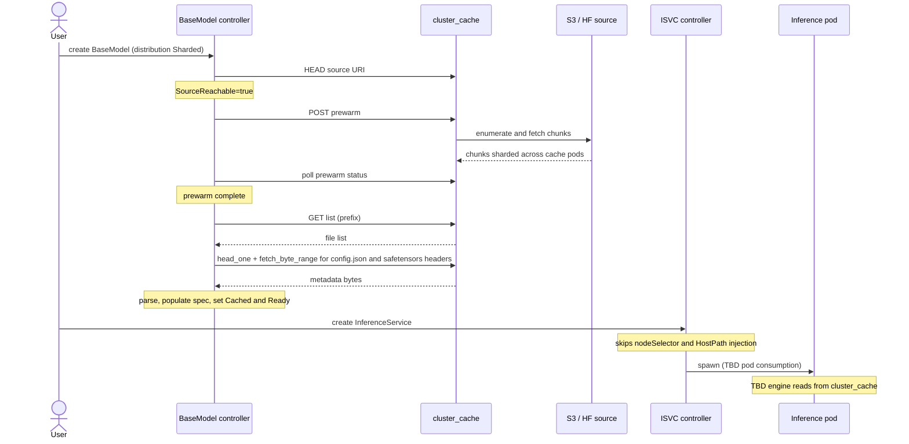

# OEP-0009: OME and Cluster Cache Integration

<!-- toc -->
- [Summary](#summary)
- [Motivation](#motivation)
  - [Goals](#goals)
  - [Non-Goals](#non-goals)
- [Proposal](#proposal)
  - [User Stories](#user-stories)
    - [Story 1: large foundation model, bandwidth-conscious operator](#story-1-large-foundation-model-bandwidth-conscious-operator)
    - [Story 2: HuggingFace-hosted model](#story-2-huggingface-hosted-model)
  - [Notes/Constraints/Caveats](#notesconstraintscaveats)
  - [Risks and Mitigations](#risks-and-mitigations)
- [Design Details](#design-details)
  - [CRD change](#crd-change)
  - [Model agent change (PerNode mode)](#model-agent-change-pernode-mode)
  - [cluster_cache additions](#cluster_cache-additions)
  - [Cluster_cache LRU and re-fetch behavior](#cluster_cache-lru-and-re-fetch-behavior)
  - [Auth flow](#auth-flow)
  - [End-to-end flow (Sharded mode)](#end-to-end-flow-sharded-mode)
    - [Sequence diagram](#sequence-diagram)
    - [Step-by-step](#step-by-step)
    - [Open question: pod consumption mechanism](#open-question-pod-consumption-mechanism)
  - [Failure modes](#failure-modes)
  - [Test Plan](#test-plan)
    - [Prerequisite Testing Updates](#prerequisite-testing-updates)
    - [Unit Tests](#unit-tests)
    - [Integration Tests](#integration-tests)
  - [Graduation Criteria](#graduation-criteria)
- [Implementation History](#implementation-history)
- [Drawbacks](#drawbacks)
- [Alternatives](#alternatives)
<!-- /toc -->

## Summary

This OEP adds an optional cluster-cache-backed download path for `BaseModel` / `ClusterBaseModel` in OME. The existing model-agent behavior is unchanged and remains the default. Operators opt in per model via a new `spec.distribution` field. When opted in, cluster_cache holds the model as chunks distributed across cache pods; the BaseModel controller drives prewarm, status, and metadata parsing; the per-node download path is bypassed for that model.

This is **additive**: nothing in OME's existing model-distribution behavior is removed for `PerNode` BaseModels (the default). `nodeSelector` injection on inference pods, the per-node ConfigMap status protocol, the HostPath mount in pods, and the `model-init` flow for encrypted models all stay the same when `distribution` is unset or set to `PerNode`. Only `Sharded` BaseModels take the new code path.

## Motivation

OME's model agent works today: per-node downloads to local NVMe, node-label-driven readiness, hard `nodeSelector` injection on inference pods for deterministic scheduling. Per-node storage isn't a constraint — typical GPU nodes have 20-60 TB of free NVMe.

The cost the current path does pay is **external bandwidth and cloud egress**. When N selector-matched nodes each download the same model from the cloud, external network usage and egress cost scale as N × model_size. For a 200 GB model on 50 nodes, that's 10 TB of cloud egress per deployment.

Cluster_cache (a sharded NVMe cache DaemonSet that lives in `prod_inference/rust_extensions/`, with an RDMA fast path between nodes) was built independently for the inference-side fast path. Its download semantics are pull-driven: the first request for a chunk triggers a single cloud fetch by the chunk's owner node; subsequent requests from other nodes are served from cluster_cache over RDMA. Backing a BaseModel with cluster_cache gives the cluster the single-cloud-fetch-per-chunk property at the price of running cluster_cache as an additional system.

A second motivation is **HuggingFace source coverage**. Cluster_cache today supports only S3. Adding a HuggingFace `Downloader` backend gives `Sharded`-mode `BaseModel`s access to HF as a source through the same coordinated cache-layer fan-out that S3-sourced models will use. Other cloud backends (OCI, GCS, Azure) are out of scope for this OEP and can be added later if needed.

### Goals

- Offer an **additional, opt-in** `distribution` field on `BaseModel` / `ClusterBaseModel`. `PerNode` (default) preserves current behavior; `Sharded` routes through cluster_cache.
- Reduce external network bandwidth and cloud egress for opt-in models: each chunk is fetched from cloud once per cluster, not once per node.
- Add **HuggingFace** as a cluster_cache `Downloader` backend alongside the existing S3 backend.
- Preserve the existing model-agent behavior unchanged as the default for any `BaseModel` not opting in.

### Non-Goals

- **Not replacing the model agent.** Default behavior stays. Operators who don't opt in see no change.
- **Not removing `nodeSelector` injection** on inference pods for `PerNode` BaseModels. It's a feature, not a bug.
- **Not removing the per-node ConfigMap status protocol** for `PerNode` BaseModels.
- **Not modifying inference engines.** Engines continue to read files from HostPath in `PerNode` mode.
- **Not modifying the encrypted-model flow** for `PerNode` BaseModels. `model-init` continues to operate exactly as today.
- **Not picking the pod consumption mechanism for `Sharded` mode.** That gap is documented but not resolved here; resolving it is a prerequisite for `Sharded` graduation beyond Alpha.
- **Not adding multi-cloud support beyond S3 and HF** (no OCI/GCP/Azure cluster_cache backends in this OEP).
- **Not Stage 1 contract negotiation** with MSL TBD lab or MSL FAIR. Out of scope; this OEP works with whatever Stage 1 produces today.

## Proposal

The proposal is a single new field on `BaseModel.spec` plus matching cluster_cache extensions and a new BaseModel-controller code path for `Sharded` BaseModels. Detailed implementation lives in [Design Details](#design-details).

At a high level:

- `PerNode` (default): existing model-agent behavior, unchanged.
- `Sharded` (opt-in): cluster_cache holds the model as chunks; the BaseModel controller drives prewarm, status, and metadata parsing; model agent skips this BaseModel entirely; inference pods read from cluster_cache via a mechanism still TBD (see [Open question](#open-question-pod-consumption-mechanism)).

### User Stories

#### Story 1: large foundation model, bandwidth-conscious operator

An operator deploys a 200 GB foundation model to 50 GPU nodes. Today, the model agent downloads the full 200 GB from S3 to each of the 50 nodes — ~10 TB of cloud egress per deployment plus ~10 TB of fleet-side ingress. With `spec.distribution: Sharded`, cluster_cache fetches each chunk from S3 exactly once cluster-wide, then serves chunks to other nodes over RDMA. External egress drops by ~50× for the same workload.

#### Story 2: HuggingFace-hosted model

An operator wants to serve a model hosted in a HuggingFace repo. They set `storage.storageUri: hf://org/model-name` and `spec.distribution: Sharded`. cluster_cache's HuggingFace backend handles authentication via the HF token (default per-cache-pod or per-source override via Secret reference) and fetches the model. The operator gets HF source support without each model-agent node having to grow HF auth.

### Notes/Constraints/Caveats

- **`Sharded` is opt-in.** A BaseModel without `spec.distribution` set behaves identically to today (same as setting it to `PerNode`).
- **Things that do NOT change for `PerNode` BaseModels** (the default):
  - Model agent's overall flow (Scout informer + Gopher worker pool).
  - Per-node ConfigMap status protocol (`models.ome/basemodel-status`) and the BaseModel controller's rollup into `status.nodesReady` / `nodesFailed` / `state`.
  - `AddNodeSelectorForModelReadyNode` injection on inference pods.
  - `UpdatePodSpecVolumes` HostPath emission.
  - `model-init` injection for encrypted models, including all KMS/Vault and decryption logic.
  - `ServingRuntime` / `ClusterServingRuntime` schemas.
  - All engine images and runtimes.
- **`Sharded` mode has an unresolved pod-consumption mechanism.** Inference pods can't actually read a `Sharded` model end-to-end until that mechanism is picked. The controller-side machinery (prewarm, parse, status) lands at Alpha; pod consumption is a Beta prerequisite.
- **HuggingFace tokens are scoped.** Per-source override via Secret reference in `BaseModel.spec.storage.parameters` is supported; cluster_cache pods also accept a default token in their config.

### Risks and Mitigations

1. **cluster_cache as a new operational dependency.** Failure of cluster_cache affects all `Sharded` BaseModels. Mitigation: cluster_cache is gated by the `ClusterCacheBackedWeights` feature gate; `PerNode` (default) BaseModels are unaffected; switching a specific BaseModel back to `PerNode` is a one-line spec edit.

2. **Sharded mode pod consumption is unresolved.** Risk: Sharded mode is not end-to-end implementable as currently specified. Mitigation: at Alpha, ISVCs referencing a `Sharded` BaseModel are admission-rejected with a clear error pointing at the gap. Resolving the gap is a prerequisite for Beta.

3. **HuggingFace backend is new code in cluster_cache.** Risk: bugs in auth, range fetch, or LFS handling; dependence on HF API stability. Mitigation: scope is bounded — one new backend module behind the existing `Downloader` trait; HF support is needed regardless of this OEP. Standard integration testing against public HF repos before Beta.

4. **`Cached=true` is a soft guarantee.** Idle Sharded models may need cache re-fetch on next pod load. Mitigation: documented in [Cluster_cache LRU and re-fetch behavior](#cluster_cache-lru-and-re-fetch-behavior); first-pod-after-eviction takes a re-fetch hit but still works. A future OEP can add pinning if real-time SLOs require it.

5. **Controller-side parsing diverges from per-node parsing.** Two parser paths could behave differently for the same model. Mitigation: extract the existing model-agent parser into a shared package called by both `PerNode` (per-node, on the agent) and `Sharded` (cluster-wide, on the controller); only the byte source differs.

6. **cluster_cache extension maintenance.** cluster_cache changes for OEP-0009 (HF backend, prewarm/status APIs, list endpoint) must be maintained alongside its existing inference-side use. Mitigation: extensions land behind a clean API boundary and are additive — they don't alter cluster_cache's existing chunk semantics.

## Design Details

### CRD change

Add `Distribution` to `BaseModelSpec`:

```go
type Distribution string

const (
    // Default. Existing behavior — model agent downloads directly
    // from the cloud source per its current implementation.
    DistributionPerNode Distribution = "PerNode"

    // Opt-in. cluster_cache holds the model as chunks; the BaseModel
    // controller drives prewarm, status, and metadata parsing; model
    // agent skips this BaseModel entirely.
    DistributionSharded Distribution = "Sharded"
)

type BaseModelSpec struct {
    // ... existing fields ...
    // +optional — defaults to PerNode (current behavior).
    Distribution *Distribution `json:"distribution,omitempty"`
}
```

No other CRD fields change. `Storage`, `NodeSelector`, `NodeAffinity`, `DownloadPolicy`, `Path`, status fields — all stay.

### Model agent change (PerNode mode)

For `distribution == PerNode` (default): no change. Model agent runs exactly as today via the existing storage-backend code in `pkg/modelagent/gopher.go`.

For `distribution == Sharded`: model agent skips the BaseModel. Scout reads `spec.distribution`; if `Sharded`, no Gopher task is enqueued. Sharded BaseModels are not the model agent's responsibility; the BaseModel controller drives them end-to-end (see [End-to-end flow (Sharded mode)](#end-to-end-flow-sharded-mode)).

### cluster_cache additions

Hard prerequisites for the `Sharded` mode to be useful:

| Addition                          | Purpose                                                                                                                                                                                                                                                           |
|-----------------------------------|-------------------------------------------------------------------------------------------------------------------------------------------------------------------------------------------------------------------------------------------------------------------|
| HuggingFace `Downloader` backend  | Today cluster_cache is S3-only. Add HF as a second backend behind the existing `Downloader` trait. (OCI / GCS / Azure deferred.)                                                                                                                                  |
| Per-backend authentication for HF | AWS IAM (workload identity / IRSA / static keys) for S3 already exists. Add HF token support — default token configured per cache pod, per-source override via Secret refs in the prewarm/fetch request.                                                          |
| Async prewarm + status            | OME's BaseModel controller issues prewarm to populate the cache. `POST /prewarm` returns a job ID; `GET /prewarm/<id>` returns progress; survives controller restart.                                                                                             |
| `GET /list?prefix=...` endpoint   | Lists files under a storage prefix by delegating to the backend's list operation (S3 `ListObjectsV2`, HF repo file listing). Used by the BaseModel controller (or parsing job) to enumerate files in a model directory before fetching specific ones for parsing. |

Not added to cluster_cache (intentional): KMS/Vault decryption (stays encryption-agnostic; OME's `model-init` flow handles it for `PerNode`), file-level HTTP API for engine consumption, engine-aware logic.

### Cluster_cache LRU and re-fetch behavior

Sharded mode does not pin chunks. After prewarm completes and `Cached=true` is set, cluster_cache's normal LRU manages chunks. Frequently-accessed models stay warm naturally; idle models eventually get evicted.

If chunks for a `Ready` model get evicted later, the next inference pod's load triggers cache misses → cluster_cache re-fetches the missing chunks from S3 / HF on the spot. This is just normal cache-miss behavior, not a failure. The trade-off is that `Cached=true` means *"we prewarmed it once"* rather than *"chunks are guaranteed to be in cache right now"* — for active models this is invisible; for rarely-used models a slow first-load occasionally is acceptable. If we ever need stronger guarantees, pinning + capacity admission can be added in a future OEP.

### Auth flow

Cluster_cache pods bind AWS workload identity (IRSA on EKS, or static keys via Secret) for the S3 backend, and accept a default HF token (per-cache-pod config) for the HuggingFace backend. Per-source overrides come from the `BaseModel.spec.storage.parameters` Secret reference, passed through the prewarm/fetch request. Cluster_cache materializes the credentials at fetch time and uses them only for that source.

### End-to-end flow (Sharded mode)

The `PerNode` mode lifecycle is the existing OME flow and is not duplicated here.

#### Sequence diagram



#### Step-by-step

1. **User submits the BaseModel CR** with `spec.distribution: Sharded`:

   ```yaml
   apiVersion: ome.io/v1beta1
   kind: BaseModel
   metadata: { name: llama-4 }
   spec:
     storage: { storageUri: "s3://bucket/llama-4/v1/" }
     distribution: Sharded
   ```

2. **K8s API server admission.** OME validating webhook does basic shape check. No capacity admission (we don't pin in this OEP). CR persists in etcd.

3. **BaseModel controller reconciles.** Informer fires. Sees `distribution: Sharded` and takes the new code path. HEADs the source URI via cluster_cache to validate auth + reachability. Sets `SourceReachable=true`.

4. **Controller calls cluster_cache prewarm.** `POST /prewarm` with `{paths: ["s3://bucket/llama-4/v1/"], auth: <secret-ref>}`. cluster_cache returns a `job_id`.

5. **cluster_cache prewarm runs.** A receiver pod calls `GET /list?prefix=...` to enumerate files (`config.json`, `tokenizer.json`, `safetensors.index.json`, `*.safetensors` shards). HEADs each file for `(size, mtime)`. Computes chunk layout (96 MiB chunks per file, keyed by `(path, offset, mtime)`). Each chunk's owner is determined by the consistent hash ring. Owner pods fetch their assigned chunks from S3 (using auth from the prewarm request) and store them on local NVMe. **No per-node full copies anywhere** — a 200 GB model becomes ~2,200 chunks distributed across cluster_cache pods.

6. **Controller polls prewarm progress.** `GET /prewarm/<job_id>` periodically. Updates `BaseModel.status` with progress (a `Cached` condition with percentage).

7. **Controller parses model metadata after prewarm completes.** This is the new piece, replacing the per-node parser that runs on each model-agent node in `PerNode` mode:

   - `GET /list?prefix=...` to enumerate files (or reuse the listing from step 5).
   - For `config.json` (small whole file): `head_one(path)` → `(size, mtime)`, then `fetch_byte_range(path, mtime, size, 0, size)` returns the JSON bytes in memory.
   - For each `*.safetensors` shard (header only — multi-GB tensor body stays in cluster_cache):
     - `head_one(path)` → `(total_size, mtime)`.
     - `fetch_byte_range(path, mtime, total_size, 0, 8)` → first 8 bytes.
     - Decode bytes 0-8 as little-endian `u64` → header size N (typically KB to MB).
     - `fetch_byte_range(path, mtime, total_size, 8, N)` → header JSON bytes.
   - Parses these via a **shared parser package** (extracted from the existing `pkg/modelagent/...ModelConfigParser`, so both `PerNode` and `Sharded` modes use the same parser logic — only the byte source differs).
   - Populates `BaseModel.spec` enrichment fields (`ModelType`, `ModelArchitecture`, `ModelParameterSize`, `ModelCapabilities`, etc.) — same fields the per-node parser populates today.
   - Sets `Cached=true`, `Ready=true`. **No per-node ConfigMap writes. No per-node labels.**

   *(Alternative implementation: a one-shot Job runs step 7 instead of the controller doing it inline. Either works; controller-inline is simpler if the parse stays cheap.)*

8. **Model agent skips the BaseModel.** Scout sees the BaseModel via informer, reads `spec.distribution`. If `Sharded`, no Gopher task is pushed — this BaseModel is not the model agent's responsibility. (For `PerNode` BaseModels, the existing model-agent flow runs unchanged.)

9. **User creates an InferenceService** referencing the BaseModel.

10. **ISVC controller reconciles.** Resolves the BaseModel reference, sees `distribution: Sharded`. **Does NOT** call `AddNodeSelectorForModelReadyNode` (no model-keyed nodeSelector injection). **Does NOT** inject HostPath volume (no on-host model directory in Sharded mode). **TBD:** what does ISVC inject for pod consumption? See [Open question](#open-question-pod-consumption-mechanism) below.

11. **K8s scheduler places the pod.** No model-keyed nodeSelector to satisfy. Pod scheduled based on GPU class, anti-affinity, accelerator class.

12. **Pod starts.** **TBD** — depends on step 10's pod-consumption choice. For encrypted models, `model-init` would run, but its byte source is also TBD (was HostPath in `PerNode`; there is no HostPath in `Sharded`).

13. **Engine becomes ready** and serves traffic — once the pod consumption gap is resolved.

#### Open question: pod consumption mechanism

Sharded mode has no per-node copies, so the existing HostPath-mount-and-read pattern doesn't apply. The mechanism for inference pods to actually read the model is unresolved in this OEP. Options previously discussed:

| Option                                                      | Status                                                           |
|-------------------------------------------------------------|------------------------------------------------------------------|
| In-engine cluster_cache_client (PRIVATE plugin in SGLang)   | Ruled out earlier                                                |
| Per-pod init container materializing into emptyDir          | Ruled out earlier                                                |
| Per-node materializer DaemonSet materializing into HostPath | Ruled out earlier                                                |
| FUSE mount of cluster_cache                                 | Not explicitly ruled out, but flagged as too operationally heavy |
| CUDA IPC sidecar                                            | Ruled out (K8s GPU resource model)                               |

**Sharded mode is not end-to-end implementable until this question has an answer.** Resolving it is a prerequisite for `Sharded` graduating beyond Alpha.

### Failure modes

| Failure                                                     | Behavior                                                                                                                   |
|-------------------------------------------------------------|----------------------------------------------------------------------------------------------------------------------------|
| Cluster_cache pod death                                     | DNS removes it, ring rebuilds, ~1/N chunks become unowned, next read sees a cache miss and re-fetches from cloud.          |
| Prewarm fails                                               | `BaseModel.status.Cached=false` with reason. Operator can flip BaseModel to `PerNode` mode as a fallback, or retry.        |
| `head_one` / `fetch_byte_range` fails during parse (step 7) | Controller retries with backoff. If repeatedly failing: `Ready=false` with reason; operator inspects cluster_cache health. |
| Cluster_cache unreachable from BaseModel controller         | `Sharded` reconcile fails. `PerNode` BaseModels unaffected. Operator can flip to `PerNode` mode as a fallback.             |
| HF token expired or invalid                                 | Prewarm fails with auth error in status. Operator rotates the Secret.                                                      |

### Test Plan

- [ ] I/we understand that component owners may require updates to existing tests before accepting changes necessary for this enhancement.

#### Prerequisite Testing Updates

- Extend cluster_cache integration test harness to cover the HuggingFace backend (currently S3-only).
- Extend the OME test harness to handle BaseModels with `spec.distribution: Sharded` (admission, controller reconcile, condition assertions).
- Refactor the existing model-agent parser into a shared package without behavior change; pin existing per-node parser tests to the shared package.

#### Unit Tests

- `cluster_cache::backends::hf` — HuggingFace backend correctness: token auth, range fetch, repo listing, error handling.
- `cluster_cache::api::prewarm` — async prewarm job lifecycle (create, poll, complete, fail, cancel) and persistence across cache-pod restart.
- `cluster_cache::api::list` — `GET /list?prefix=...` for both S3 and HF backends.
- `pkg/modelagent::parser` (refactored shared package) — config.json + safetensors header parsing; same tests as today, just relocated.
- `pkg/controller/v1beta1/basemodel` — Sharded reconcile path: prewarm trigger, status polling, parse invocation, condition writes (`SourceReachable`, `Cached`, `Ready`).
- `pkg/controller/v1beta1/inferenceservice` — Sharded BaseModel: skips `AddNodeSelectorForModelReadyNode` and HostPath injection.

#### Integration Tests

- **Backward compat e2e.** Create a `BaseModel` without `spec.distribution`. Confirm zero behavior change vs. existing OME deployments — model agent downloads, ConfigMap status writes, nodeSelector injection, pod load all work identically.
- **Sharded e2e (controller side).** Create a `BaseModel` with `distribution: Sharded`. Observe controller prewarm against cluster_cache, observe condition transitions (`SourceReachable=true` → `Cached=true` → `Ready=true`), observe `BaseModel.spec` enriched with parsed metadata. Inference pod creation is admission-rejected with the documented "pod consumption mechanism not yet supported" error.
- **HuggingFace source e2e.** Create a `BaseModel` with `storageUri: hf://org/model` and `distribution: Sharded`. Verify cluster_cache HF backend handles auth and prewarm.
- **Failure-mode e2e.** Cluster_cache reachable but prewarm fails (e.g., invalid auth) → `Cached=false` with reason; operator switches to `PerNode` and BaseModel transitions to existing flow successfully.
- **Bandwidth observability.** Deploy `Sharded` BaseModel to N nodes; confirm cloud-side egress metrics show ~1× model size pulled (cluster-wide) instead of N×.

### Graduation Criteria

#### Alpha

- Feature gate `ClusterCacheBackedWeights` enabled.
- `BaseModel.spec.distribution` field added with values `PerNode` (default) and `Sharded`.
- Model agent unchanged for `PerNode`; skips `Sharded` BaseModels cleanly.
- cluster_cache HuggingFace backend implemented; passes integration tests against public HF repos.
- cluster_cache async prewarm + status endpoints implemented.
- cluster_cache `GET /list` endpoint implemented.
- BaseModel controller capable of prewarm + parse + condition writes for `Sharded` BaseModels.
- ISVCs referencing `Sharded` BaseModels are admission-rejected with a clear "pod consumption mechanism not yet supported" error.
- Backward compatibility verified — `PerNode` BaseModels behave identically to today's deployments.

#### Beta

- Pod consumption mechanism for `Sharded` mode resolved (separate OEP) and implemented end-to-end for at least one engine.
- `Sharded` ISVCs admission-accepted; pods can load and serve.
- Performance baseline: cloud-egress reduction quantified for representative workloads (target ≥10× for a 50-node deployment).
- Cluster_cache failure-mode operational playbook documented (re-fetch behavior, eviction handling, auth rotation).
- HF backend hardened against repo-side outages and token-rotation flows.

#### Stable

- 6 months of Beta operation with no critical bugs or data-loss incidents.
- Documented migration path for moving BaseModels between `PerNode` and `Sharded` modes.
- Cluster_cache extensions for this OEP (HF backend, prewarm/status, list endpoint) in stable release of cluster_cache.

## Implementation History

- 2026-05-04: OEP-0009 initial draft.
- TBD: cluster_cache HuggingFace backend implementation.
- TBD: cluster_cache async prewarm + status endpoints.
- TBD: cluster_cache `GET /list` endpoint.
- TBD: OME `BaseModel.spec.distribution` field + admission webhook.
- TBD: Shared parser package extracted from `pkg/modelagent`.
- TBD: BaseModel controller `Sharded` reconcile path.
- TBD: ISVC controller `Sharded` skip logic + admission rejection for unsupported pod consumption.
- TBD: Pod consumption mechanism for `Sharded` mode (separate OEP, prerequisite for Beta).

## Drawbacks

- **New operational dependency.** Operators who opt into `Sharded` mode now run cluster_cache as a DaemonSet alongside the model agent. More moving parts, more monitoring surface.
- **Cluster_cache's NVMe is a shared resource.** Capacity must be planned at deployment time. We don't pin in this OEP, so over-pressure manifests as eviction + re-fetch on next pod load (slower first load, no failure), not as admission rejection.
- **`Cached=true` is a soft guarantee.** It means "prewarm completed at some point" — not "chunks are still in cache right now." Active models stay warm via LRU; idle models may need re-fetch. Acceptable for the workloads this OEP targets; revisit if real-time SLOs need stronger guarantees.
- **HuggingFace auth surface in cluster_cache.** A new HF backend module + token handling. Smaller than a full multi-cloud expansion, but still new code that needs maintenance.
- **Sharded mode is incomplete at Alpha.** Pod consumption mechanism is a documented gap; ISVCs referencing `Sharded` BaseModels are admission-rejected until a follow-up OEP resolves it.
- **Two parser code paths.** Even with a shared parser package, `PerNode` invokes it on each agent node from disk, while `Sharded` invokes it from the controller via cluster_cache range reads. Operators have to understand both invocation contexts when debugging.

## Alternatives

| Alternative                                                                                                               | Status                                                                                                                                                                           |
|---------------------------------------------------------------------------------------------------------------------------|----------------------------------------------------------------------------------------------------------------------------------------------------------------------------------|
| **Replace the model agent entirely** with a sharded cluster_cache + in-engine `PrivateModelLoader` plugin                 | Rejected. Per-node storage is not a real constraint (20-60 TB free); `nodeSelector` injection is a useful scheduling feature; model agent works for what it's designed for.      |
| **Drop `nodeSelector` injection** in favor of cluster-wide pod placement                                                  | Rejected for `PerNode` mode (it's a feature). Sharded mode doesn't need nodeSelector since chunks are cluster-wide.                                                              |
| **Replace per-node ConfigMap status protocol** with cluster-wide BaseModel conditions for all BaseModels                  | Rejected as a forced replacement. The existing protocol works for `PerNode`; new conditions are added for `Sharded` without removing the existing protocol.                      |
| **Build a separate P2P fan-out component** (BitTorrent-style or NCCL-collective) instead of using cluster_cache           | Possible future work, but cluster_cache already exists, has a working RDMA fan-out, and adding HF backend + async prewarm gives us the same property with reused infrastructure. |
| **Use cluster_cache only as a multi-cloud download library** (linked into the model agent process directly, no DaemonSet) | Considered. Loses the cluster-wide chunk caching benefit; each agent would still pull from cloud per node. The DaemonSet shape is what enables the bandwidth savings.            |
| **Pin chunks for `Sharded` BaseModels** (with capacity admission webhook)                                                 | Rejected for this OEP. Unpinned + LRU re-fetch is sufficient for the workloads we target; pinning + admission can be added in a future OEP if real-time SLOs demand it.          |
| **Add OCI / GCP / Azure backends to cluster_cache as part of this OEP**                                                   | Rejected. HF is the immediate need for testing; other clouds can be added in follow-up OEPs as use cases arise.                                                                  |
