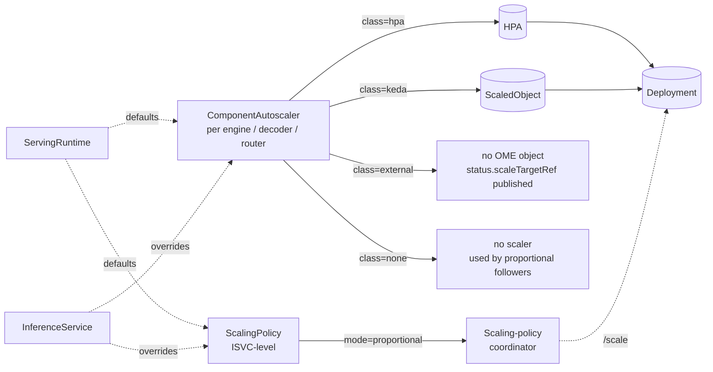

# OEP-0013: Component-Scoped Autoscaling

<!-- toc -->
- [Summary](#summary)
- [Motivation](#motivation)
  - [What's broken today](#whats-broken-today)
  - [Goals](#goals)
  - [Non-Goals](#non-goals)
- [Proposal](#proposal)
  - [User Stories](#user-stories)
  - [Notes/Constraints/Caveats](#notesconstraintscaveats)
  - [Risks and Mitigations](#risks-and-mitigations)
- [Design Details](#design-details)
  - [Object model](#object-model)
  - [API: per-component `autoscaler` block](#api-per-component-autoscaler-block)
  - [Inheritance from ServingRuntime](#inheritance-from-servingruntime)
  - [KEDA: triggers pass-through](#keda-triggers-pass-through)
  - [HPA: metrics pass-through](#hpa-metrics-pass-through)
  - [External mode: published target + `/scale` subresource](#external-mode-published-target--scale-subresource)
  - [Coordinated scaling for PD-disaggregated services](#coordinated-scaling-for-pd-disaggregated-services)
  - [Status surface](#status-surface)
  - [Webhook validation](#webhook-validation)
  - [Backwards compatibility](#backwards-compatibility)
  - [Failure modes](#failure-modes)
  - [Test Plan](#test-plan)
  - [Graduation Criteria](#graduation-criteria)
- [Implementation History](#implementation-history)
- [Drawbacks](#drawbacks)
- [Alternatives](#alternatives)
<!-- /toc -->

## Summary

This OEP replaces the InferenceService autoscaling stack with a per-component model that pass-through KEDA triggers and HPA metric specs verbatim, publishes a documented scale target for user-owned autoscalers, implements a `/scale` subresource on InferenceService, and adds a `scalingPolicy` knob for PD-disaggregated services that need engine/decoder/router to scale in coordination. The new `autoscaler` and `scalingPolicy` blocks are mirrored onto `ServingRuntime` so the common 1:1 runtime-per-workload pairing can carry scaling defaults at the runtime layer with ISVC-level overrides per component.

Mostly additive: `minReplicas`, `maxReplicas`, `scaleMetric`, `scaleTarget`, and the `ome.io/autoscalerClass` annotation keep working with deprecation warnings. The `kedaConfig` field and its hardcoded vLLM-shaped default query are **removed** — `Autoscaler.Keda.Triggers` is strictly more expressive and zero sample manifests use the old field.

## Motivation

OME today wires every InferenceService to exactly one of HPA, KEDA, or no-controller-managed (`external`) — picked by a single annotation on the ISVC. The HPA path supports one resource metric; the KEDA path supports one prometheus trigger with a hard-coded vLLM-shaped default query. Engines, decoders, and routers in a PD-disaggregated ISVC are all forced into the same autoscaler class with no way to coordinate their replica counts.

Production deployments routinely need:
- Multiple triggers on the engine (Prometheus queue depth + GPU utilization via DCGM + cron-based pre-scaling for known traffic peaks).
- Decoder scaled on a *different* signal than engine (e.g., HPA on GPU memory while engine is on a custom KEDA scaler).
- An operator-owned `ScaledObject` that the OME controller doesn't fight — for cases where the autoscaling policy lives outside OME (a platform team standard, a custom controller, an external scaler).
- `kubectl scale isvc/foo --replicas=5` working the same way it works for Deployments and StatefulSets.
- A PD service where the engine drives scaling and the decoder follows in fixed ratio, rather than each component making independent decisions and going out of phase.

None of these are reasonably expressible with the current API.

### What's broken today

A precise reading of the current state, from the code:

| Concern | Current behavior |
|---|---|
| Per-component autoscaler class | **Not supported.** `autoscaler_reconciler.go:70` reads one ISVC-level annotation `ome.io/autoscalerClass`. Engine + decoder + router all forced to the same class. |
| Multi-trigger KEDA | **Not supported.** `keda_reconciler.go:104` emits exactly one prometheus trigger; the default query (lines 202-214) is a hard-coded vLLM TPS-vs-RPS heuristic. |
| HPA on external/object/pods metrics | **Not supported.** `hpa_reconciler.go:83` emits one resource-metric (CPU or memory only). |
| User-owned ScaledObject targeting an ISVC | **Not supported.** OME's reconciler always asserts its own; `external` mode disables OME's autoscaler but offers no documented `scaleTargetRef` for the user to point at. |
| `kubectl scale isvc/foo` | **Not supported.** InferenceService has no `/scale` subresource. |
| Coordinated scaling for PD services | **Not supported.** Each component reconciles independently with no notion of an anchor or ratio. |
| Scheduled / time-based scaling | **Not supported.** KEDA's `cron` trigger is unreachable through OME's API. |
| Status visibility on scaling | **Not surfaced.** `ISVC.status` has no autoscaler info. Operators `kubectl get hpa,scaledobject -A` to debug. |
| `ScaleMetric` enum (`cpu, memory, concurrency, rps, tps`) | **Partially dead.** `concurrency/rps/tps` only meant something under Knative Pod Autoscaler in serverless mode. In `RawDeployment`, the HPA reconciler maps them as if they were Kubernetes resource names — non-functional. |
| Class-switching cleanup | **Fragile.** `deleteExistingScaledObject` / `deleteExistingHPA` run on every reconcile when the class changes. No owner refs, no finalizers — relies on the controller running and observing the transition. |

Additionally, the per-component scaling that *does* work depends on an awkward indirection in `common/deployment_reconciler.go:38-46` that synthesizes an `InferenceServiceSpec` where the decoder or router's `ComponentExtensionSpec` is shoved into `inferenceServiceSpec.Engine.ComponentExtensionSpec` so that `autoscaler_reconciler.go:66` (which always reads from `.Engine.*`) sees the right values. Functional, but a trap for anyone adding a per-component feature.

### Goals

- A per-component `spec.<component>.autoscaler` block that lets engine, decoder, and router each choose their own autoscaler class and configuration independently.
- KEDA triggers as **verbatim pass-through** — operators write the same `[]kedav1.ScaleTriggers` they would write in a hand-authored ScaledObject. Multi-trigger, cron, external scalers all work for free.
- HPA metrics as **verbatim pass-through** — operators write `[]autoscalingv2.MetricSpec`. Resource, external, pods, and object metrics all work.
- `external` mode publishes `status.components.<comp>.scaleTargetRef` so operators can write their own ScaledObject/HPA targeting a stable name without guessing OME's naming conventions.
- InferenceService implements the `/scale` subresource so `kubectl scale isvc/foo --replicas=N` and standard HPA/KEDA `scaleTargetRef: {apiVersion: ome.io/v1beta1, kind: InferenceService, ...}` work natively.
- `spec.scalingPolicy` lets PD-disaggregated operators declare a `proportional` policy: engine autoscales, decoder/router follow as a function of engine replicas. Replaces independent autoscalers for the followers.
- `status.components.<comp>.autoscaler` reports current/desired replicas, last scale time, and propagated conditions from the underlying HPA/ScaledObject so operators don't have to fan-out their debugging.
- Mirror the new `autoscaler` and `scalingPolicy` blocks onto `ServingRuntime` so the 1:1 runtime-per-workload pairing pattern in common use can carry scaling defaults at the runtime layer; ISVC overrides per component via whole-block replace.
- Backwards compatible for `MinReplicas`, `MaxReplicas`, `ScaleMetric`, `ScaleTarget`, and the `ome.io/autoscalerClass` annotation (one release of deprecation warnings). `KedaConfig` is removed — see [Backwards compatibility](#backwards-compatibility) for the migration snippet.

### Non-Goals

- **Not building a prediction engine.** Time-based scaling is delivered via KEDA cron triggers (pass-through). Demand-prediction is left to external metric pipelines that write to Prometheus; OME consumes via the same triggers API.
- **Not replacing KEDA or HPA.** OME continues to generate and manage `ScaledObject` / `HorizontalPodAutoscaler` resources; this OEP is about the API and lifecycle around them, not a new autoscaling engine.
- **Not Serverless / Knative mode.** This OEP is `RawDeployment`-focused. Knative-managed services keep using KPA via the existing serverless path.
- **Not auto-tuning replica policies.** The `proportional` policy expects operators to declare ratios. OME does not infer ratios from observed load.
- **Not removing all legacy fields in Alpha.** `KedaConfig` is removed (zero observed usage); other legacy fields stay through Alpha with deprecation warnings, removal no earlier than Beta+1.

## Proposal

Introduce one new field per component:

```go
type ComponentExtensionSpec struct {
    // ... existing fields kept (MinReplicas, MaxReplicas, etc.) ...

    // +optional — new in OEP-0013. When set, takes priority over the
    // legacy ScaleMetric / ScaleTarget fields and the
    // ome.io/autoscalerClass annotation for this component.
    Autoscaler *ComponentAutoscaler `json:"autoscaler,omitempty"`
}

type ComponentAutoscaler struct {
    // +kubebuilder:validation:Enum=hpa;keda;external;none
    // +kubebuilder:default=hpa
    Class AutoscalerClass `json:"class"`

    // KEDA configuration. Required when Class == "keda".
    // +optional
    Keda *KedaAutoscaler `json:"keda,omitempty"`

    // HPA configuration. Required when Class == "hpa" if non-default
    // metrics are wanted; if Keda/HPA blocks are absent the class
    // determines the autoscaler shape but uses defaults (HPA: CPU=80%).
    // +optional
    HPA *HPAAutoscaler `json:"hpa,omitempty"`
}

type KedaAutoscaler struct {
    // Triggers passed through verbatim to kedav1.ScaledObjectSpec.Triggers.
    // The full surface (prometheus, cron, external, kafka, etc.) is supported.
    // +kubebuilder:validation:MinItems=1
    Triggers []kedav1.ScaleTriggers `json:"triggers"`

    // Advanced ScaledObject behavior — pollingInterval, cooldownPeriod,
    // idleReplicaCount, fallback, advanced.{horizontalPodAutoscalerConfig, restoreToOriginalReplicaCount}.
    // +optional
    Advanced *kedav1.AdvancedConfig `json:"advanced,omitempty"`

    // +optional
    PollingInterval *int32 `json:"pollingInterval,omitempty"`

    // +optional
    CooldownPeriod *int32 `json:"cooldownPeriod,omitempty"`
}

type HPAAutoscaler struct {
    // Metrics passed through verbatim to autoscalingv2.HorizontalPodAutoscalerSpec.Metrics.
    // Supports Resource, ContainerResource, Pods, Object, External metric sources.
    // If empty, defaults to a single CPU=80% Resource metric.
    // +optional
    // +listType=atomic
    Metrics []autoscalingv2.MetricSpec `json:"metrics,omitempty"`

    // Scaling behavior — stabilizationWindowSeconds, policies, selectPolicy.
    // +optional
    Behavior *autoscalingv2.HorizontalPodAutoscalerBehavior `json:"behavior,omitempty"`
}
```

And one new ISVC-level field:

```go
type InferenceServiceSpec struct {
    // ... existing fields ...

    // +optional — when nil, every component autoscales independently
    // (today's behavior).
    ScalingPolicy *ScalingPolicy `json:"scalingPolicy,omitempty"`
}

type ScalingPolicy struct {
    // +kubebuilder:validation:Enum=independent;proportional;pinned
    // +kubebuilder:default=independent
    Mode ScalingMode `json:"mode"`

    // Required when Mode == "proportional". Engine is the conventional
    // anchor for PD; explicit so the controller doesn't have to guess.
    // +optional
    Proportional *ProportionalPolicy `json:"proportional,omitempty"`
}

type ProportionalPolicy struct {
    // +kubebuilder:validation:Enum=engine;decoder;router
    // +kubebuilder:default=engine
    Anchor ComponentType `json:"anchor"`

    // Per-component ratio relative to anchor replicas. A ratio of 1.0
    // means parity; 0.25 means one for every four anchor replicas
    // (rounded up). Components not listed scale independently.
    // +optional
    Ratios map[ComponentType]resource.Quantity `json:"ratios,omitempty"`
}
```

The high-level shape per component when this OEP lands:

```yaml
spec:
  engine:
    minReplicas: 2
    maxReplicas: 50
    autoscaler:
      class: keda
      keda:
        pollingInterval: 15
        triggers:
          - type: prometheus
            metadata:
              serverAddress: http://prometheus.monitoring:9090
              query: |
                avg(rate(vllm:request_queue_size_total[1m])) by (ome_io_inferenceservice)
              threshold: "20"
          - type: prometheus
            metadata:
              serverAddress: http://prometheus.monitoring:9090
              query: |
                avg(DCGM_FI_DEV_GPU_UTIL{exported_pod=~"foo-engine-.*"})
              threshold: "70"
          - type: cron
            metadata:
              timezone: America/Los_Angeles
              start:  "0 7 * * 1-5"
              end:    "0 19 * * 1-5"
              desiredReplicas: "10"

  decoder:
    minReplicas: 2
    maxReplicas: 50
    # follows engine 1:1 via scalingPolicy; no autoscaler block needed

  router:
    minReplicas: 1
    maxReplicas: 4
    autoscaler:
      class: hpa
      hpa:
        metrics:
          - type: Resource
            resource:
              name: cpu
              target: { type: Utilization, averageUtilization: 70 }
        behavior:
          scaleDown:
            stabilizationWindowSeconds: 600

  scalingPolicy:
    mode: proportional
    proportional:
      anchor: engine
      ratios:
        decoder: "1"
```

### User Stories

#### Story 1: Multi-trigger production engine

Operator running vLLM on tier-5 GPUs wants to scale on queue depth + GPU utilization + a daily traffic floor.

```yaml
spec:
  engine:
    minReplicas: 4
    maxReplicas: 80
    autoscaler:
      class: keda
      keda:
        triggers:
          - type: prometheus
            metadata: { query: "avg(vllm:queue_depth)", threshold: "20", serverAddress: "…" }
          - type: prometheus
            metadata: { query: "avg(DCGM_FI_DEV_GPU_UTIL{…})", threshold: "75", serverAddress: "…" }
          - type: cron
            metadata: { timezone: UTC, start: "0 12 * * *", end: "0 22 * * *", desiredReplicas: "20" }
```

Today: not expressible. KEDA's `triggers` array supports this natively but `KedaConfig` only has fields for ONE prometheus trigger.

#### Story 2: User owns the ScaledObject

Operator's platform team manages a fleet-wide `ScaledObject` policy in a separate Helm chart. They want OME to stay out of the way.

```yaml
# OME ISVC
spec:
  engine:
    autoscaler:
      class: external

# Separately, applied by the platform Helm chart:
apiVersion: keda.sh/v1alpha1
kind: ScaledObject
metadata:
  name: foo-engine-platform
spec:
  scaleTargetRef:
    apiVersion: ome.io/v1beta1   # NEW — points at the ISVC, not the Deployment
    kind: InferenceService
    name: foo
  triggers: [...]
```

OME publishes the ISVC's scale target via the new `/scale` subresource so the user-managed ScaledObject can scale-of-record through the ISVC; OME's reconciler refuses to touch any HPA/ScaledObject when class=external. `status.components.engine.scaleTargetRef` documents the underlying Deployment name for users who prefer that target.

#### Story 3: PD-disaggregated with coordinated decoder

Operator's PD service must keep decoder count == engine count (a property of the tensor-parallel sharding they use). Today they manually edit both. Under proportional policy:

```yaml
spec:
  engine:
    minReplicas: 2
    maxReplicas: 20
    autoscaler:
      class: keda
      keda: { triggers: [...] }
  decoder:
    minReplicas: 2
    maxReplicas: 20
    # no autoscaler block — follower
  router:
    minReplicas: 1
    maxReplicas: 4
    autoscaler: { class: hpa }
  scalingPolicy:
    mode: proportional
    proportional:
      anchor: engine
      ratios:
        decoder: "1"   # 1 decoder per engine
```

OME's coordinator watches engine replica count and writes derived decoder replicas via `/scale` on the decoder Deployment. Router is independent.

#### Story 4: `kubectl scale` works

```sh
kubectl scale isvc/foo --replicas=8
# Sets spec.engine.minReplicas = 8 (or whichever component is the anchor)
# HPA/KEDA respects the floor; manual override possible
```

Today: `kubectl scale isvc/foo` fails with "the server doesn't have a resource type 'inferenceservices/scale'".

#### Story 5: Runtime-defined defaults with ISVC override

Platform team authors a ServingRuntime that bundles the right autoscaler for vLLM Llama-70B chat workloads. Most ISVCs binding this runtime inherit; a latency-critical tenant overrides the engine block on its ISVC.

```yaml
# ServingRuntime — carries the default
apiVersion: ome.io/v1beta1
kind: ClusterServingRuntime
metadata:
  name: vllm-llama-70b-chat
spec:
  engine:
    minReplicas: 2
    maxReplicas: 20
    autoscaler:
      class: keda
      keda:
        triggers:
          - type: prometheus
            metadata:
              query: "avg(vllm:num_requests_waiting)"
              threshold: "15"
              serverAddress: "http://prometheus.monitoring:9090"
  scalingPolicy:
    mode: proportional
    proportional:
      anchor: engine
      ratios: { decoder: "1" }

---
# ISVC — inherits autoscaler + scalingPolicy from runtime
apiVersion: ome.io/v1beta1
kind: InferenceService
metadata: { name: foo }
spec:
  runtime: { name: vllm-llama-70b-chat }
  model:   { name: llama-3-70b-instruct }

---
# Different ISVC — overrides engine block for a latency-critical tenant
apiVersion: ome.io/v1beta1
kind: InferenceService
metadata: { name: foo-tenant-a }
spec:
  runtime: { name: vllm-llama-70b-chat }
  model:   { name: llama-3-70b-instruct }
  engine:
    minReplicas: 8
    autoscaler:
      class: keda
      keda:
        triggers:
          - type: prometheus
            metadata:
              query: "avg(vllm:num_requests_waiting)"
              threshold: "5"
              serverAddress: "http://prometheus.monitoring:9090"
```

`status.components.engine.autoscaler.specSource` reports `runtime` for the first ISVC and `isvc` for the second — operators can tell at a glance who's driving scaling for any deployment.

### Notes/Constraints/Caveats

- **`class: none` vs `class: external`.** `none` means "OME and user are both out" — used for proportional-mode followers. `external` means "user owns the scaler" — OME publishes `status.scaleTargetRef` for them to target.
- **Resource quotas matter.** Multi-trigger configs can scale aggressively. Operators dampen via `behavior` / `cooldownPeriod`; OME imposes no safety ceiling.
- **Proportional coordinator is a separate reconciler** under `reconcilers/scaling_policy/`. Watches Deployment status, writes via `/scale`, never touches HPA/ScaledObject for followers.
- **ServingRuntime's responsibility grows** beyond container-spec into workload-shaped defaults. Appropriate for 1:1 pairing; runtime authors managing shared runtimes should know changes propagate to every non-overriding ISVC on next reconcile.

### Risks and Mitigations

1. **Multi-trigger KEDA flap.** KEDA takes the max across triggers; a noisy metric can dominate. Operators dampen via `behavior` / `cooldownPeriod`. OME does not pre-validate operator scaler choices.

2. **`/scale` semantics for multi-component ISVC.** `kubectl scale isvc/foo --replicas=N` writes to the anchor of `scalingPolicy.proportional` (engine if not set); independent-policy services write `spec.engine.minReplicas`. Documented in the field comment; per-component control means scaling the underlying Deployment directly.

3. **PD coordinator ↔ engine autoscaler race.** Engine scales up via KEDA → coordinator updates decoder → KEDA observes lower metric → both scale down → flap. Mitigation: coordinator runs only on engine status changes (no polling), writes through `/scale` so HPA/KEDA see the new floor without racing.

4. **HPA `metrics` pass-through is permissive.** OME does not validate the underlying metric source exists — same risk profile as hand-written HPAs.

5. **`external` ↔ `keda`/`hpa` switch orphans the previous object.** OME deletes its own when class changes; user objects with the same name become user-owned. ISVC deletion does not cascade to user-owned objects. The `external` contract is explicitly "OME hands-off."

6. **Adoption gradient.** Half-migrated ISVCs in the wild during deprecation. Mitigation: `status.components.<comp>.autoscaler.specSource` reports which layer drives each ISVC's scaling.

## Design Details

### Object model



### API: per-component `autoscaler` block

`pkg/apis/ome/v1beta1/component.go`:

```go
type ComponentExtensionSpec struct {
    // Existing fields preserved.
    MinReplicas         *int                          `json:"minReplicas,omitempty"`
    MaxReplicas         int                           `json:"maxReplicas,omitempty"`
    ScaleTarget         *int                          `json:"scaleTarget,omitempty"`  // deprecated, see Autoscaler
    ScaleMetric         *ScaleMetric                  `json:"scaleMetric,omitempty"`  // deprecated, see Autoscaler
    ContainerConcurrency *int64                       `json:"containerConcurrency,omitempty"`
    TimeoutSeconds      *int64                        `json:"timeoutSeconds,omitempty"`
    CanaryTrafficPercent *int64                       `json:"canaryTrafficPercent,omitempty"`
    Labels              map[string]string             `json:"labels,omitempty"`
    Annotations         map[string]string             `json:"annotations,omitempty"`
    MinAvailable        *intstr.IntOrString           `json:"minAvailable,omitempty"`
    MaxUnavailable      *intstr.IntOrString           `json:"maxUnavailable,omitempty"`
    DeploymentStrategy  *appsv1.DeploymentStrategy    `json:"deploymentStrategy,omitempty"`
    OMENative           *OMENativeComponentSpec       `json:"omenative,omitempty"`
    // KedaConfig removed in OEP-0013 — replaced by Autoscaler.Keda.

    // New in OEP-0013.
    // +optional
    Autoscaler *ComponentAutoscaler `json:"autoscaler,omitempty"`
}
```

`pkg/apis/ome/v1beta1/autoscaler.go` (new file):

```go
type AutoscalerClass string

const (
    AutoscalerHPA      AutoscalerClass = "hpa"
    AutoscalerKEDA     AutoscalerClass = "keda"
    AutoscalerExternal AutoscalerClass = "external"
    AutoscalerNone     AutoscalerClass = "none"
)

type ComponentAutoscaler struct {
    // +kubebuilder:validation:Enum=hpa;keda;external;none
    Class AutoscalerClass `json:"class"`

    // +optional
    Keda *KedaAutoscaler `json:"keda,omitempty"`

    // +optional
    HPA *HPAAutoscaler `json:"hpa,omitempty"`
}

type KedaAutoscaler struct {
    // +kubebuilder:validation:MinItems=1
    Triggers []kedav1.ScaleTriggers `json:"triggers"`

    // +optional
    Advanced *kedav1.AdvancedConfig `json:"advanced,omitempty"`

    // +optional
    PollingInterval *int32 `json:"pollingInterval,omitempty"`

    // +optional
    CooldownPeriod *int32 `json:"cooldownPeriod,omitempty"`

    // +optional
    IdleReplicaCount *int32 `json:"idleReplicaCount,omitempty"`

    // +optional
    Fallback *kedav1.Fallback `json:"fallback,omitempty"`
}

type HPAAutoscaler struct {
    // +optional
    // +listType=atomic
    Metrics []autoscalingv2.MetricSpec `json:"metrics,omitempty"`

    // +optional
    Behavior *autoscalingv2.HorizontalPodAutoscalerBehavior `json:"behavior,omitempty"`
}
```

`pkg/apis/ome/v1beta1/inference_service.go`:

```go
type InferenceServiceSpec struct {
    // ... existing fields ...

    // +optional
    ScalingPolicy *ScalingPolicy `json:"scalingPolicy,omitempty"`
}

type ScalingMode string

const (
    ScalingIndependent ScalingMode = "independent"
    ScalingProportional ScalingMode = "proportional"
    ScalingPinned      ScalingMode = "pinned"
)

type ScalingPolicy struct {
    // +kubebuilder:validation:Enum=independent;proportional;pinned
    Mode ScalingMode `json:"mode"`

    // Required when Mode == "proportional".
    // +optional
    Proportional *ProportionalPolicy `json:"proportional,omitempty"`
}

type ProportionalPolicy struct {
    // +kubebuilder:validation:Enum=engine;decoder;router
    // +kubebuilder:default=engine
    Anchor ComponentType `json:"anchor"`

    // Followers map to ratios relative to anchor replicas.
    // resource.Quantity allows fractional ratios like "0.25".
    // +optional
    Ratios map[ComponentType]resource.Quantity `json:"ratios,omitempty"`
}
```

### Inheritance from ServingRuntime

In the common 1:1 pairing pattern — one ServingRuntime authored per workload class, bound to one ISVC — the runtime is the natural home for workload-shaped defaults including scaling. Mirror the new `Autoscaler` and `ScalingPolicy` types onto `ServingRuntime` so the runtime can carry defaults while the ISVC overrides per component.

`pkg/apis/ome/v1beta1/serving_runtime_types.go`:

```go
type ServingRuntimePodSpec struct {
    // ... existing fields ...

    // Autoscaler default for ISVCs binding this runtime. Replaced wholesale
    // by isvc.spec.<component>.Autoscaler when set on the ISVC.
    // +optional
    Autoscaler *ComponentAutoscaler `json:"autoscaler,omitempty"`
}

type ServingRuntimeSpec struct {
    // ... existing fields ...

    // ScalingPolicy default for ISVCs binding this runtime. Replaced wholesale
    // by isvc.spec.scalingPolicy when set on the ISVC.
    // +optional
    ScalingPolicy *ScalingPolicy `json:"scalingPolicy,omitempty"`
}
```

#### Resolution — whole-block replace

Effective autoscaler config is resolved at reconcile time:


`ScalingPolicy` resolves the same way against `isvc.Spec.ScalingPolicy` and `runtime.Spec.ScalingPolicy`. Remaining legacy fields (`MinReplicas`, `MaxReplicas`, `ScaleMetric`, `ScaleTarget`) keep their existing per-field override semantics.

**Why whole-block replace, not deep merge:**

- **Predictable.** When the operator sees `autoscaler:` on an ISVC, it replaces the runtime's entire block. No surprises from arrays merging in non-obvious ways.
- **Mirrors Kubernetes conventions.** `PodSpec` overrides do not merge array elements; this matches that ergonomic.
- **Sidesteps the "name your triggers / metrics" tax.** Upstream `kedav1.ScaleTriggers` and `autoscalingv2.MetricSpec` carry no stable identifier suitable for keyed merge.
- **Matches the 1:1 pattern.** Overrides exist precisely because the workload needs *different* scaling than the runtime default; partial merges are rare and confusing.

Resolution lives in one helper at `pkg/controller/v1beta1/inferenceservice/reconcilers/autoscaler/resolve.go`:

```go
type SpecSource string

const (
    SpecSourceISVC     SpecSource = "isvc"
    SpecSourceRuntime  SpecSource = "runtime"
    SpecSourceLegacy   SpecSource = "legacy"
    SpecSourceDefault  SpecSource = "default"
    SpecSourceExternal SpecSource = "external"
)

func ResolveComponentAutoscaler(
    runtime *v1beta1.ServingRuntimeSpec,
    isvc    *v1beta1.InferenceServiceSpec,
    comp    v1beta1.ComponentType,
) (*v1beta1.ComponentAutoscaler, SpecSource) { ... }
```

Pure, table-testable, called from both the reconciler and the webhook validator. The returned `SpecSource` is propagated into `status.components.<comp>.autoscaler.specSource` (see "Status surface").

### KEDA: triggers pass-through

`reconcilers/keda/keda_reconciler.go` is rewritten to consume `ComponentAutoscaler.Keda.Triggers` verbatim. The legacy `KedaConfig` path and the hardcoded vLLM default query (`getScaledObjectTriggers` at `keda_reconciler.go:202-214`) are deleted along with the field.

```go
func buildScaledObject(meta metav1.ObjectMeta, k *v1beta1.KedaAutoscaler, minR, maxR int32, deployName string) *kedav1.ScaledObject {
    return &kedav1.ScaledObject{
        ObjectMeta: metav1.ObjectMeta{Name: utils.GetScaledObjectName(deployName), Namespace: meta.Namespace, Labels: meta.Labels},
        Spec: kedav1.ScaledObjectSpec{
            ScaleTargetRef:   &kedav1.ScaleTarget{APIVersion: "apps/v1", Kind: "Deployment", Name: deployName},
            MinReplicaCount:  &minR,
            MaxReplicaCount:  &maxR,
            Triggers:         k.Triggers,
            Advanced:         k.Advanced,
            PollingInterval:  k.PollingInterval,
            CooldownPeriod:   k.CooldownPeriod,
            IdleReplicaCount: k.IdleReplicaCount,
            Fallback:         k.Fallback,
        },
    }
}
```

### HPA: metrics pass-through

`pkg/controller/v1beta1/inferenceservice/reconcilers/hpa/hpa_reconciler.go` analogously consumes `ComponentAutoscaler.HPA.Metrics` verbatim. Legacy path generates the same single-resource-metric HPA as today.

```go
func buildHPA(componentMeta metav1.ObjectMeta, componentExt *v1beta1.ComponentExtensionSpec, deploymentName string) *autoscalingv2.HorizontalPodAutoscaler {
    minR := calculateMinReplicas(componentExt)
    maxR := calculateMaxReplicas(componentExt, minR)

    var metrics []autoscalingv2.MetricSpec
    var behavior *autoscalingv2.HorizontalPodAutoscalerBehavior

    if componentExt.Autoscaler != nil && componentExt.Autoscaler.HPA != nil {
        metrics = componentExt.Autoscaler.HPA.Metrics
        behavior = componentExt.Autoscaler.HPA.Behavior
    }
    if len(metrics) == 0 {
        metrics = legacyDefaultMetrics(componentMeta, componentExt)
    }
    if behavior == nil {
        behavior = &autoscalingv2.HorizontalPodAutoscalerBehavior{}
    }

    return &autoscalingv2.HorizontalPodAutoscaler{
        ObjectMeta: componentMeta,
        Spec: autoscalingv2.HorizontalPodAutoscalerSpec{
            ScaleTargetRef: autoscalingv2.CrossVersionObjectReference{
                APIVersion: "apps/v1",
                Kind:       "Deployment",
                Name:       deploymentName,
            },
            MinReplicas: &minR,
            MaxReplicas: maxR,
            Metrics:     metrics,
            Behavior:    behavior,
        },
    }
}
```

### External mode: published target + `/scale` subresource

**Status field.** Every ISVC publishes `status.components.<comp>.scaleTargetRef`:

```yaml
status:
  components:
    engine:
      scaleTargetRef:
        group: apps
        kind: Deployment
        name: foo-engine
      autoscaler:
        managedBy: external
```

Populated unconditionally so operators can use it for user-managed autoscalers regardless of which class is configured.

**`/scale` subresource on InferenceService.** Add a kubebuilder marker on `InferenceService`:

```go
// +kubebuilder:subresource:scale:specpath=.spec.engine.minReplicas,statuspath=.status.components.engine.replicas,selectorpath=.status.components.engine.labelSelector
```

The subresource:
- **GET** returns current/desired replicas reported on `status.components.engine.replicas` (sum-equivalent for proportional mode where decoder/router are derived; engine is the source of truth).
- **PUT** writes to `spec.engine.minReplicas`. Notes:
  - This sets a **floor**, not an absolute count. The autoscaler still tracks metrics and can scale up beyond it.
  - For ISVCs whose autoscaler class is `keda` or `hpa`, the ScaledObject/HPA's `minReplicaCount` reflects the new floor on next reconcile.
  - For `external` mode, the user's autoscaler observes the new floor through the same `spec.engine.minReplicas` field and updates accordingly. If the user-managed scaler ignores the floor (writes directly to the Deployment's replicas), the floor still applies via the engine-component reconciler's standard replica-merge logic.
- **selector** comes from the engine Deployment's label selector, surfaced via `status.components.engine.labelSelector` (string form, per `/scale` subresource convention).

Per-component `/scale` subresources are explicitly out of scope for Alpha; users who need finer control should `kubectl scale deployment/<isvc>-{decoder,router}` directly.

**RBAC.** The `--scale` verb is added to OME's manager role for InferenceService — required for the apiserver to authorize the subresource handler.

### Coordinated scaling for PD-disaggregated services

New reconciler under `pkg/controller/v1beta1/inferenceservice/reconcilers/scaling_policy/`:

```go
type ScalingPolicyReconciler struct {
    Client client.Client
    Log    logr.Logger
}

func (r *ScalingPolicyReconciler) Reconcile(ctx context.Context, isvc *v1beta1.InferenceService) error {
    p := isvc.Spec.ScalingPolicy
    if p == nil || p.Mode != v1beta1.ScalingProportional || p.Proportional == nil {
        return nil
    }

    anchor := p.Proportional.Anchor
    anchorReplicas, err := r.observedReplicas(ctx, isvc, anchor)
    if err != nil { return err }

    for follower, ratio := range p.Proportional.Ratios {
        if follower == anchor { continue }
        target := computeFollowerReplicas(anchorReplicas, ratio)
        if err := r.scaleFollower(ctx, isvc, follower, target); err != nil {
            return err
        }
    }
    return nil
}
```

`observedReplicas` reads `status.replicas` from the anchor's child Deployment. `computeFollowerReplicas` is `ceil(anchorReplicas * ratio.AsApproximateFloat64())`. `scaleFollower` writes through the follower component Deployment's `/scale` subresource (HTTP-level scale write, not a spec patch — keeps replica accounting clean).

The reconciler is wired as a watcher on Deployment status changes (only). It does not poll on a timer; it does not write status itself.

```mermaid
sequenceDiagram
    autonumber
    participant K as KEDA / HPA
    participant E as Engine Deployment
    participant Co as Scaling-policy<br/>coordinator
    participant D as Decoder Deployment
    K->>E: scale to N pods (anchor)
    E-->>Co: status.replicas = N (watch)
    Co->>Co: target = ceil(N × ratio)
    Co->>D: PUT /scale {replicas: target}
    D-->>D: spec.replicas = target
    Note over K,D: Coordinator never touches ScaledObject/HPA;<br/>followers stay autoscaler-free.
```

Validation gates the spec at the webhook:
- `Mode == proportional` requires `Proportional.Anchor` ∈ existing components.
- Followers in `Ratios` must not have `Autoscaler.Class ∈ {hpa, keda}` — they'd fight the coordinator. `none` and `external` are allowed (external users opting out of OME-managed scaling on a follower is legal; they own the outcome).

### Status surface

`pkg/apis/ome/v1beta1/inference_service_status.go`:

```go
type ComponentStatusSpec struct {
    // ... existing fields ...

    // +optional
    Autoscaler *ComponentAutoscalerStatus `json:"autoscaler,omitempty"`

    // +optional
    ScaleTargetRef *ScaleTargetReference `json:"scaleTargetRef,omitempty"`

    // +optional
    Replicas         int32 `json:"replicas,omitempty"`
    // +optional
    LabelSelector    string `json:"labelSelector,omitempty"`
}

type ComponentAutoscalerStatus struct {
    Class             AutoscalerClass `json:"class"`
    ManagedBy         string          `json:"managedBy"` // "ome" or "external"
    CurrentReplicas   int32           `json:"currentReplicas,omitempty"`
    DesiredReplicas   int32           `json:"desiredReplicas,omitempty"`
    LastScaleTime     *metav1.Time    `json:"lastScaleTime,omitempty"`
    Conditions        []metav1.Condition `json:"conditions,omitempty"`
    // SpecSource indicates which layer of resolution drove the autoscaler
    // config for this component during the current reconcile. "isvc" means
    // the ISVC's own Autoscaler block won; "runtime" means it inherited
    // from the bound ServingRuntime; "legacy" means legacy fields drove
    // the spec; "default" means controller defaults applied; "external"
    // means class=external (OME hands-off).
    // +kubebuilder:validation:Enum=isvc;runtime;legacy;default;external
    SpecSource string `json:"specSource"`
}

type ScaleTargetReference struct {
    Group string `json:"group,omitempty"`
    Kind  string `json:"kind"`
    Name  string `json:"name"`
}
```

Populated on each reconcile from:
- `ScaleTargetRef`: the engine/decoder/router Deployment's GVK + name.
- `Autoscaler.{Current,Desired}Replicas`, `LastScaleTime`, `Conditions`: copied from the live HPA's `status` (or ScaledObject's underlying HPA — KEDA generates and manages one internally; we read it).
- `Autoscaler.ManagedBy`: `"ome"` for `hpa`/`keda` classes, `"external"` for `external`, `"none"` for `none`.
- `Autoscaler.SpecSource`: which layer of resolution won — `"isvc"` (ISVC's own `Autoscaler` block), `"runtime"` (inherited from bound ServingRuntime), `"legacy"` (legacy fields on the ISVC), `"default"` (controller defaults — e.g., HPA CPU=80%), or `"external"` (class=external).

### Webhook validation

In `pkg/webhook/admission/isvc/`:

- **Class consistency**: `Autoscaler.Class == keda` requires `Autoscaler.Keda.Triggers` to be set; `Autoscaler.Class == hpa` falls back to default CPU=80% if `Autoscaler.HPA.Metrics` is empty.
- **Annotation-only `keda`**: `ome.io/autoscalerClass: keda` without an `Autoscaler.Keda` block on a component is rejected. There is no longer a default KEDA trigger — the hardcoded vLLM query was removed with `KedaConfig`.
- **`scalingPolicy.proportional` rules**: anchor must be one of the components present in the spec; followers in `Ratios` must not have `Autoscaler.Class ∈ {hpa, keda}`.
- **Bounds sanity**: `MinReplicas <= MaxReplicas` (existing); `IdleReplicaCount < MinReplicaCount` per KEDA's own rules.
- **MinItems on KEDA triggers**: empty triggers list rejected with a clear message.
- **Annotation legacy use**: when `ome.io/autoscalerClass` annotation is present AND any component has an `Autoscaler` block, reject with a "remove the annotation; per-component class wins" message. Mixing them deterministically silently is too error-prone.
- **ServingRuntime-side autoscaler validation**: every rule above that applies to an ISVC's `Autoscaler` block also applies to `ServingRuntime` / `ClusterServingRuntime` admission — class consistency, MinItems on triggers, KEDA/HPA mutual exclusion, `scalingPolicy.proportional` shape. Runs against the same validation helper. Webhook lives at `pkg/webhook/admission/servingruntime/`.

### Backwards compatibility

Two legacy shapes continue to work; one is removed:

| Legacy | Behavior |
|---|---|
| `ome.io/autoscalerClass: hpa` (or unset) + no other fields | Default HPA on CPU=80%. Identical to today. |
| `ome.io/autoscalerClass: external` | OME does not generate HPA or ScaledObject. Same as today, plus `status.scaleTargetRef` populated. |
| ~~`ome.io/autoscalerClass: keda` + `spec.<comp>.kedaConfig`~~ | **Removed in this OEP.** Migrate to `spec.<comp>.autoscaler.keda.triggers`. The `KedaConfig` Go type, the field, and the hardcoded vLLM default query are deleted. |

**Migration from `kedaConfig` → `autoscaler.keda`:**

```yaml
# Before
spec:
  engine:
    kedaConfig:
      scalingMetric: PromMetric
      customPromQuery: "avg(vllm:request_queue_size_total)"
      scalingThreshold: "20"
      promServerAddress: http://prometheus.monitoring:9090

# After
spec:
  engine:
    autoscaler:
      class: keda
      keda:
        triggers:
          - type: prometheus
            metadata:
              query: "avg(vllm:request_queue_size_total)"
              threshold: "20"
              serverAddress: http://prometheus.monitoring:9090
```

Remaining legacy fields (`ScaleMetric`, `ScaleTarget`, annotation) stay through Alpha with deprecation warnings; removal no earlier than Beta+1.

### Failure modes

| Failure | Behavior |
|---|---|
| KEDA CRDs not installed on cluster | Webhook rejects `Autoscaler.Class == keda` with a clear "KEDA not available on this cluster" message; resolver suggests `class: hpa` or `class: external`. |
| User writes an invalid KEDA trigger (e.g., references a nonexistent TriggerAuthentication) | OME passes it through to KEDA; KEDA reports `ScaledObject.status.conditions` Ready=False; OME propagates that into `status.components.<comp>.autoscaler.conditions`. |
| User writes an HPA metric for a metric that doesn't exist in metrics-server / Prometheus Adapter | HPA reports `ScalingActive=False` with the upstream reason; propagated into status. |
| `external` mode + no user-created ScaledObject/HPA | Deployment runs at `spec.<comp>.minReplicas` forever. No scaling. OME emits a warning Event after 5 minutes of no observed scaler. |
| Proportional coordinator: anchor Deployment doesn't exist yet | Coordinator no-ops with debug log; will pick up on the next anchor-Deployment status event. |
| Proportional ratio that yields 0 followers | Coordinator floors at `spec.<follower>.minReplicas` (which is itself floored at 1 by default). |
| `/scale` PUT with `replicas: 0` | Sets `minReplicas: 0`. ISVC scale-to-zero must already be supported by the autoscaler in use (KEDA via `idleReplicaCount`; HPA does not natively scale to zero). |

### Test Plan

#### Prerequisite testing updates

- Refactor the per-component `ComponentExtensionSpec` indirection in `common/deployment_reconciler.go:38-46` so the autoscaler reconciler reads the actual component's spec, not a synthetic Engine-wrapped one. Tests that depended on the synthetic shape get updated.

#### Unit Tests

- `pkg/apis/ome/v1beta1/autoscaler_test.go` — deepcopy for `ComponentAutoscaler`, `KedaAutoscaler`, `HPAAutoscaler`, `ScalingPolicy`.
- `pkg/controller/v1beta1/inferenceservice/reconcilers/keda/` — verbatim pass-through of triggers, advanced, polling/cooldown; ISVC with `class: keda` and no Triggers rejected at admission.
- `pkg/controller/v1beta1/inferenceservice/reconcilers/hpa/` — verbatim pass-through of metrics + behavior; legacy fallback still produces the pre-OEP HPA.
- `pkg/controller/v1beta1/inferenceservice/reconcilers/scaling_policy/` — proportional ratio math (floor, ceil, parity, sub-1 ratios), anchor-deployment-missing no-op, follower with autoscaler class=keda rejected pre-reconcile.
- `pkg/webhook/admission/isvc/` — every rejection path in the validation list.
- `/scale` subresource — GET returns `status.components.engine.replicas`; PUT writes `spec.engine.minReplicas`; selector reflects engine Deployment's selector.
- `ResolveComponentAutoscaler` table tests — every (runtime present/absent, isvc present/absent, legacy present/absent) combination produces the expected `*ComponentAutoscaler` and `SpecSource`.

#### Integration Tests

Under `tests/integration/singlecluster/controller/inferenceservice/`:

- `autoscaler_keda_triggers_test.go` — ISVC with `autoscaler.class=keda` and 3 triggers (prometheus + prometheus + cron) → ScaledObject contains all three verbatim; `MinReplicaCount/MaxReplicaCount` match spec.
- `autoscaler_hpa_metrics_test.go` — ISVC with `autoscaler.class=hpa` and an external-metric MetricSpec → HPA carries the external metric verbatim; legacy CPU default doesn't override.
- `autoscaler_per_component_test.go` — engine on KEDA, decoder on HPA, router on external → each component gets the right resource (or none), all coexist.
- `autoscaler_external_target_test.go` — `class=external` ISVC → `status.components.engine.scaleTargetRef` populated with `{Kind: Deployment, Name: <isvc>-engine}`; OME does not create any HPA/ScaledObject for that component.
- `scaling_policy_proportional_test.go` — PD ISVC with `proportional` policy, ratio 1.0 → updating engine replicas leads to matching decoder replicas via /scale.
- `scaling_policy_proportional_ratio_test.go` — ratio 0.25 with various engine sizes → correct ceiling math.
- `scale_subresource_test.go` — `kubectl scale isvc/foo --replicas=N` (via raw client) → `spec.engine.minReplicas` updated to N; status reflects new desired count.
- `autoscaler_runtime_inheritance_test.go` — ServingRuntime carries `autoscaler` + `scalingPolicy`; ISVC binds without overriding → ScaledObject/HPA emitted with the runtime's config; `status.components.engine.autoscaler.specSource == "runtime"`.
- `autoscaler_isvc_override_test.go` — ServingRuntime carries `autoscaler` defaults; ISVC sets its own `engine.autoscaler` block → ISVC's block fully replaces the runtime's (no array merging); `specSource == "isvc"`.

Under `tests/integration/singlecluster/webhook/inferenceservice/`:

- Each webhook rejection path: empty KEDA triggers, both `Autoscaler.Keda` and `KedaConfig` set, proportional follower with class=keda, missing anchor.

Under `tests/integration/singlecluster/webhook/servingruntime/`:

- Mirror of the ISVC `Autoscaler` rejection paths against ServingRuntime / ClusterServingRuntime admission — same helper, same rejections.

### Graduation Criteria

#### Alpha

- All new fields land in `v1beta1` behind an "alpha" feature gate documented in the CRD descriptions.
- KEDA/HPA pass-through reconcilers wired in.
- `/scale` subresource implemented and tested.
- `status.components.<comp>.{autoscaler, scaleTargetRef}` populated.
- Backwards compatibility verified — every existing ISVC shape produces identical output as before.
- Webhook validation in place.

#### Beta

- Proportional scaling coordinator wired in and tested at integration level.
- One full release cycle of operator feedback on the new fields.
- Status fields stable (no rename / restructuring) for at least one release.
- Deprecation warnings on legacy fields visible in status conditions.

#### Stable

- Two release cycles in Beta with no critical bugs.
- Removal path for remaining legacy fields (`ScaleMetric`, `ScaleTarget`, `ome.io/autoscalerClass` annotation) documented and announced. `KedaConfig` already removed in Alpha.
- Per-component `/scale` subresources considered (for ratios that operators want to override mid-flight).

## Implementation History

- 2026-05-19: OEP drafted.
- TBD: API types added; `KedaConfig` field, type, and hardcoded vLLM query removed.
- TBD: KEDA + HPA pass-through reconcilers.
- TBD: ServingRuntime inheritance + `ResolveComponentAutoscaler` helper.
- TBD: `/scale` subresource + status fields.
- TBD: Webhook validation (ISVC + ServingRuntime).
- TBD: Proportional scaling coordinator.

## Drawbacks

- Adds three new types (`ComponentAutoscaler`, `KedaAutoscaler`, `HPAAutoscaler`) and a top-level `ScalingPolicy` — meaningful CRD growth on `InferenceService` and `ServingRuntime`-adjacent surface.
- KEDA/HPA pass-through couples OME's CRD to upstream type evolution. `kedav1.ScaleTriggers` schema changes propagate automatically when OME bumps the KEDA dep; this is mostly upside (new triggers work for free) but means OME consumers see KEDA type signatures in their CRDs.
- Two valid spec shapes (legacy `ScaleMetric`/`ScaleTarget` + new `Autoscaler` block) coexist on the HPA path through Alpha. Operators reading the API surface have to learn two patterns until removal. `KedaConfig` no longer has this problem — it's removed in this OEP.
- `/scale` subresource interpretation is opinionated — "scale the engine" is a defensible default but doesn't compose well with multi-component services. Operators who want per-component scale subresources have to wait for a follow-up.
- Proportional coordinator is a 4th reconciler on the ISVC critical path. Adds reconcile loop work; partially mitigated by the watch-status-only trigger.
- **Runtime-defined autoscaler defaults can drift silently across ISVCs.** When a ServingRuntime is reused across multiple ISVCs (less common in the 1:1 pairing pattern but legal), updating the runtime's `autoscaler` block changes scaling for every non-overriding ISVC on next reconcile. Documented behavior, not a bug; `status.components.<comp>.autoscaler.specSource == "runtime"` lets operators audit who's inheriting before they commit.

## Alternatives

### Keep the single-trigger KEDA shape; document patterns instead

Operators can write complex prometheus queries that combine signals into one number. Workable for simple cases; falls apart at scale: cron triggers can't be expressed as a query; external scalers (Kafka lag, RabbitMQ depth) can't either. The single-trigger ceiling is a real product limit, not a documentation gap.

### Generate ScaledObjects but allow user override via owner-ref handoff

OME generates a default ScaledObject; user can take ownership by setting an annotation; OME stops reconciling it. Looks clean; falls apart on conflict: who wins if user and controller both think they own it? Audit trail goes through annotations. Rejected in favor of explicit `external` mode + published `scaleTargetRef`.

### `kubectl scale` writes the Deployment directly

Skip the `/scale` subresource on InferenceService; tell users to scale the underlying Deployment. Works today. Rejected because (a) users expect the top-level CR to be the scale-of-record, (b) it leaks implementation detail (the `<isvc>-engine` Deployment naming convention is public API anyway, but it shouldn't be the *only* way to scale), (c) it precludes the proportional coordinator from being driven by an external HPA pointing at the ISVC.

### Build a predictive controller into OME core

OEP-0013 explicitly defers prediction. The alternative is to ship an OME-native predictor that watches metrics and writes `spec.scalingSchedule`. Rejected as scope creep — prediction is its own discipline with no consensus on the right signals or models. KEDA's cron triggers + an external prediction service writing to Prometheus is the right composition.

### Drop `external` mode entirely; always have OME generate the scaler

Forces every operator into OME's reconciler. Operators with their own platform standards lose the ability to apply them. Rejected — `external` is the right escape valve, the current limitation is that it lacks an integration contract; this OEP fixes that.

### Single ISVC-level autoscaler that applies to all components

Simpler API. But every real PD-disaggregated user we've talked to wants per-component knobs: engine on KEDA queue-depth, decoder on GPU memory, router on plain CPU. Forcing a single class precludes the actual use case.
