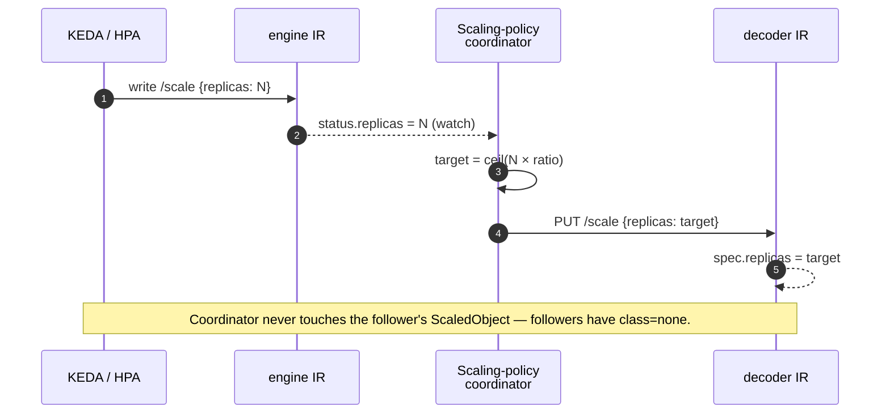
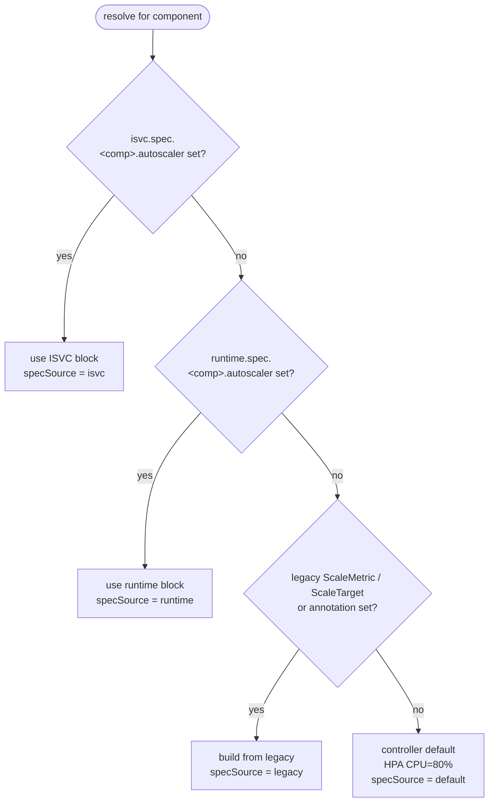

# OEP-0013: Component-Scoped Autoscaling

<!-- toc -->
- [Summary](#summary)
- [Motivation](#motivation)
  - [Goals](#goals)
  - [Non-Goals](#non-goals)
- [Proposal](#proposal)
  - [User Stories](#user-stories)
  - [Open Design Question: Where Does the Autoscaler Block Live?](#open-design-question-where-does-the-autoscaler-block-live)
  - [Notes/Constraints/Caveats](#notesconstraintscaveats)
  - [Risks and Mitigations](#risks-and-mitigations)
- [Design Details](#design-details)
  - [Object model](#object-model)
  - [API: per-component `autoscaler` block](#api-per-component-autoscaler-block)
  - [Scale target: InferenceReplica `/scale`](#scale-target-inferencereplica-scale)
  - [Generated autoscaler resources](#generated-autoscaler-resources)
  - [External mode](#external-mode)
  - [Coordinated scaling for PD-disaggregated services](#coordinated-scaling-for-pd-disaggregated-services)
  - [Lightweight Prometheus in ome-resources chart](#lightweight-prometheus-in-ome-resources-chart)
  - [Status surface](#status-surface)
  - [Inheritance chain: ServingRuntime, InferenceService, InferenceReplica](#inheritance-chain-servingruntime-inferenceservice-inferencereplica)
  - [Webhook validation](#webhook-validation)
  - [Backwards compatibility](#backwards-compatibility)
  - [Failure modes](#failure-modes)
  - [Test Plan](#test-plan)
  - [Graduation Criteria](#graduation-criteria)
- [Implementation History](#implementation-history)
- [Drawbacks](#drawbacks)
- [Alternatives](#alternatives)
<!-- /toc -->

## Summary

Each Component (engine, decoder, router) of an `InferenceService` now
gets its own per-Component runtime CRD called `InferenceReplica`. One
`InferenceReplica` exists per (ISVC, Component) tuple, and each one
already publishes a Kubernetes `/scale` subresource — a small HTTP
endpoint that lets autoscalers read and write a workload's replica
count through a standard contract. This OEP makes that scale target
the anchor for everything autoscaling-related: KEDA (Kubernetes
Event-Driven Autoscaler) and HPA (HorizontalPodAutoscaler, the
in-tree Kubernetes scaler) point at the `InferenceReplica`, not the
parent ISVC.

The operator authors a per-Component `autoscaler` block on the ISVC
specifying class = `hpa | keda | external | none` plus a verbatim
list of KEDA triggers or HPA metric specs. The OME controller
generates one `ScaledObject` (KEDA's CRD that owns triggers and
points at a scale target) or `HorizontalPodAutoscaler` per
`InferenceReplica` and owner-refs it to the IR so garbage collection
is automatic. Cross-Component coordination — "decoder pods should
track engine pods at ratio 1:1" for prefill-decode (PD) disaggregated
services — stays on the ISVC because it is the only object that sees
all Components at once.

Operators with no cluster Prometheus get autoscaling out-of-the-box:
the `ome-resources` Helm chart optionally deploys a single-replica
Prometheus that scrapes only OME-managed pods with short retention.
Operators with an existing Prometheus opt out.

`KedaConfig` (the legacy single-trigger KEDA shape) is removed
because it has zero observed usage. Other legacy autoscaling fields
(`MinReplicas`, `MaxReplicas`, `ScaleMetric`, `ScaleTarget`, the
`ome.io/autoscalerClass` annotation) keep working with deprecation
warnings.

## Motivation

OME today scales an InferenceService through an `HorizontalPodAutoscaler`
(HPA) wired to a single CPU or memory metric. That works for stateless
web services and fails immediately for PD-disaggregated LLM serving:
engine and decoder pods run on different signals (engine watches the
request queue, decoder watches KV-cache and GPU memory) and need to
scale in coordination (decoder count must track engine count or
prefill blocks). There is also no `/scale` subresource for
`kubectl scale isvc/foo` or for operator-owned external autoscalers
to target.

With the `InferenceReplica` per-Component CRD now in place — one
`InferenceReplica` per (ISVC, Component) tuple, with its own
`/scale` subresource declared at the CRD level — the per-Component
scaling problem has an obvious shape: target the IR. KEDA and HPA see
per-Component metrics directly without the ISVC controller acting as
a desugaring layer. `kubectl scale inferencereplica/foo-engine
--replicas=5` becomes a one-liner. The operator's mental model
collapses to "one autoscaler per Component, one Component per IR".

This OEP locks in that anchoring and fills the two remaining gaps:
the API surface (a per-Component `autoscaler` block on the ISVC),
and a way for operators with no cluster Prometheus to actually use
the result.

### Goals

- Per-Component `autoscaler` block with class = `hpa | keda | external | none`,
  authored on the ISVC and projected onto each `InferenceReplica`.
- Verbatim pass-through of `[]kedav1.ScaleTriggers` and
  `[]autoscalingv2.MetricSpec` — operators write the same thing they
  would in a hand-authored ScaledObject or HPA.
- One `ScaledObject` or HPA generated per `InferenceReplica`,
  owner-ref'd to the IR, targeting the IR's `/scale` subresource.
- `spec.scalingPolicy` on the ISVC with `proportional` mode for
  PD-disaggregated coordination (engine autoscales; decoder and
  router follow by ratio).
- Defaults mirrored onto `ServingRuntime` for the common 1:1 pairing
  pattern (one runtime per workload class).
- Optional bundled Prometheus in the `ome-resources` Helm chart for
  operators without an existing one.
- Status surface reports the active autoscaler class, scale target,
  current/desired replicas, and which layer (runtime, ISVC, legacy
  field) drove the resolution.

### Non-Goals

- **No prediction engine.** Time-based scaling is delivered via KEDA
  cron triggers (pass-through), not a custom forecaster.
- **No KEDA or HPA replacement.** OME continues to generate and
  manage `ScaledObject` and HPA resources; this OEP is about the API
  and lifecycle around them.
- **No replica-policy auto-tuning.** Operators declare ratios; OME
  does not infer them from observed traffic.
- **No removal of all legacy fields in Alpha.** `KedaConfig` is
  removed (zero observed usage); the other legacy fields stay
  through Alpha with deprecation warnings.
- **No long-term metrics retention.** The bundled Prometheus is
  short-retention, single-replica, autoscaling-only. Operators who
  need SLO observability run their own stack.

## Proposal

A new `Autoscaler` block on `ComponentExtensionSpec` (so engine,
decoder, and router each get their own), plus a `ScalingPolicy` on
`InferenceServiceSpec` for cross-Component coordination. The ISVC
controller projects the per-Component `Autoscaler` onto each child
`InferenceReplica`; the OME controller then generates exactly one
`ScaledObject` or HPA per IR, owner-ref'd to the IR, with
`scaleTargetRef` pointing at the IR's `/scale` subresource.

Minimal user-facing shape (full Go types are in
[API: per-component `autoscaler` block](#api-per-component-autoscaler-block)):

```yaml
apiVersion: ome.io/v1beta1
kind: InferenceService
spec:
  engine:
    minReplicas: 2
    maxReplicas: 50
    autoscaler:
      class: keda
      keda:
        triggers:
          - type: prometheus
            metadata: { serverAddress: "...", query: "...", threshold: "20" }
  decoder:
    minReplicas: 2
    maxReplicas: 50
    # no autoscaler block — follower under scalingPolicy
  router:
    autoscaler: { class: hpa }   # defaults to CPU=80%
  scalingPolicy:
    mode: proportional
    proportional: { anchor: engine, ratios: { decoder: "1" } }
```

What the OME controller produces, per Component, downstream of that
ISVC:

```yaml
# Per-Component runtime CRD (already exists; this OEP makes it the
# scale anchor).
apiVersion: ome.io/v1beta1
kind: InferenceReplica
metadata:
  name: foo-engine               # ${isvc}-${component}
  ownerReferences: [<ISVC>]
spec:
  parentRef: { name: foo, uid: ... }
  component: engine
  replicas: 2                    # /scale subresource writes this
  autoscaler:                    # projected from ISVC at create time
    class: keda
    keda: { triggers: [...] }
status:
  replicas: 2
  labelSelector: "ome.io/inferenceservice=foo,component=engine"

---
# One ScaledObject per IR; OME-generated; owner-ref to the IR so
# deleting the IR sweeps the ScaledObject.
apiVersion: keda.sh/v1alpha1
kind: ScaledObject
metadata:
  name: foo-engine
  ownerReferences: [<InferenceReplica foo-engine>]
spec:
  scaleTargetRef:
    apiVersion: ome.io/v1beta1
    kind: InferenceReplica
    name: foo-engine
  minReplicaCount: 2
  maxReplicaCount: 50
  triggers: [...]                # verbatim from spec.engine.autoscaler.keda.triggers
```

KEDA reads the IR's `/scale` to learn the current replica count,
writes to `/scale` to change it. `kubectl scale
inferencereplica/foo-engine --replicas=5` works for the same reason.

### User Stories

#### Story 1: Multi-trigger production engine

The operator wants to scale on queue depth plus GPU utilization plus
a daily traffic floor.

```yaml
spec:
  engine:
    minReplicas: 4
    maxReplicas: 80
    autoscaler:
      class: keda
      keda:
        triggers:
          - type: prometheus
            metadata: { query: "<queue-depth-query>", threshold: "20", serverAddress: "…" }
          - type: prometheus
            metadata: { query: "<gpu-util-query>", threshold: "75", serverAddress: "…" }
          - type: cron
            metadata: { timezone: UTC, start: "0 12 * * *", end: "0 22 * * *", desiredReplicas: "20" }
```

Today: not expressible. KEDA's `triggers` array supports this
natively but `KedaConfig` only had fields for one Prometheus trigger.

#### Story 2: Operator owns the ScaledObject

The platform team manages a fleet-wide ScaledObject policy in a
separate Helm chart. They want OME to stay out of the way.

```yaml
# OME ISVC
spec:
  engine:
    autoscaler:
      class: external

# Separately, applied by the platform Helm chart:
apiVersion: keda.sh/v1alpha1
kind: ScaledObject
metadata: { name: foo-engine-platform }
spec:
  scaleTargetRef:
    apiVersion: ome.io/v1beta1
    kind: InferenceReplica           # points at the IR, not the Deployment
    name: foo-engine
  triggers: [...]
```

The operator's ScaledObject scales through the IR's `/scale`
subresource. OME's reconciler refuses to create or touch any
ScaledObject/HPA for that IR when `class: external` is set.
`status.components.engine.scaleTargetRef` documents the IR's identity
for operators who prefer that target.

#### Story 3: Runtime-defined defaults with ISVC override

The platform team authors a ServingRuntime that bundles the right
autoscaler for a workload class. Most ISVCs binding this runtime
inherit; a latency-critical tenant overrides on its ISVC.

```yaml
# ServingRuntime — carries the default
kind: ClusterServingRuntime
metadata: { name: runtime-a }
spec:
  engine:
    minReplicas: 2
    maxReplicas: 20
    autoscaler:
      class: keda
      keda:
        triggers:
          - type: prometheus
            metadata: { query: "...", threshold: "15", serverAddress: "..." }

---
# ISVC — inherits runtime's autoscaler
kind: InferenceService
metadata: { name: foo }
spec:
  runtime: { name: runtime-a }

---
# Different ISVC — overrides engine block for tighter scaling
kind: InferenceService
metadata: { name: foo-tenant-a }
spec:
  runtime: { name: runtime-a }
  engine:
    autoscaler:
      class: keda
      keda:
        triggers:
          - type: prometheus
            metadata: { query: "...", threshold: "5", serverAddress: "..." }
```

`status.components.engine.autoscaler.specSource` reports `runtime`
for the first ISVC and `isvc` for the second.

### Open Design Question: Where Does the Autoscaler Block Live?

The user-facing shape above puts `autoscaler` on
`spec.<component>` of the ISVC. That covers the authoring side. But
the `InferenceReplica` is the runtime resource and the scale target.
There are three viable answers to "where is the autoscaler block the
controller reads from?" and the trade-offs differ enough that this
section flags them explicitly for review.

**Option A — ISVC-only.** `Autoscaler` lives on
`ISVC.spec.<component>` exclusively. The IR has no `autoscaler`
field. On each reconcile, the OME controller reads the ISVC's
autoscaler block, generates the ScaledObject/HPA for the matching
IR, and never writes anything autoscaler-shaped to the IR itself.

- Upside: single source of truth, no projection layer, simplest
  reconciler.
- Downside: contradicts the per-Component ownership shift — the IR
  is supposed to be the per-Component contract, but it is now
  silently missing a per-Component scaling field. Operators who
  `kubectl get inferencereplica` cannot see the autoscaler config.
- Downside: `kubectl edit ir/foo-engine` cannot tune autoscaling.

**Option B (recommended) — ISVC defaults, IR is the live target.**
Both ISVC and IR have an `Autoscaler` field. The ISVC controller
projects ISVC's block onto the IR at IR-create-time (the IR is
controller-managed; operators do not author it). On each ISVC
reconcile, the projection runs again — if the ISVC's block changed,
the IR's block is replaced (whole-block replace, see
[Inheritance chain](#inheritance-chain-servingruntime-inferenceservice-inferencereplica)).
The OME controller reads the **IR's** block when generating the
ScaledObject/HPA, so once the IR exists the IR is authoritative.

- Upside: matches the per-Component ownership model — the IR is the
  contract, the autoscaler config is visible on it.
- Upside: lets a future "advanced operator" workflow allow direct IR
  edits (whole-block replace) for emergency tuning without churning
  the ISVC.
- Downside: two places to look. Mitigated by `status.specSource`
  reporting which layer drove the live config.

**Option C — IR `/scale` only; no OME-generated autoscaler.** OME
exposes `/scale` on the IR (already done) and stops. Operators write
their own ScaledObject or HPA pointing at the IR.

- Upside: smallest OME surface area.
- Downside: every operator now has to author KEDA/HPA YAML by hand,
  duplicating triggers across every ISVC. The whole point of the
  `autoscaler` block is to remove that duplication.
- Effectively this is `class: external` for everyone.

**Recommendation: Option B.** It matches the per-Component ownership
shift the IR represents and supports both authoring patterns
(operators stay on the ISVC; advanced operators can pin a specific
IR's block). The rest of this OEP assumes Option B.

### Notes/Constraints/Caveats

- **`class: none` vs `class: external`.** `none` means "OME and
  operator are both out" — used for proportional-mode followers.
  `external` means "operator owns the scaler" — OME publishes the
  IR's `scaleTargetRef` so operator-managed ScaledObjects/HPAs have
  something to target.
- **Resource quotas matter.** Multi-trigger configs can scale
  aggressively. Operators dampen via `behavior` or `cooldownPeriod`;
  OME imposes no safety ceiling.
- **The proportional coordinator is a separate reconciler** under
  `reconcilers/scaling_policy/`. It watches IR status, writes via
  the follower IR's `/scale`, and never touches HPA or ScaledObject
  for followers.
- **ServingRuntime carries workload-shaped defaults** including
  scaling. Appropriate for the 1:1 pairing pattern (one runtime per
  workload class); runtime authors managing shared runtimes should
  know changes propagate to every non-overriding ISVC on next
  reconcile.

### Risks and Mitigations

1. **Multi-trigger KEDA flap.** KEDA takes the max across triggers;
   a noisy metric can dominate. Operators dampen via `behavior` or
   `cooldownPeriod`. OME does not pre-validate operator scaler
   choices.

2. **`kubectl scale isvc/foo` semantics for multi-Component
   services.** The ISVC does not expose `/scale` — only the IRs do.
   `kubectl scale inferencereplica/foo-engine --replicas=N` is the
   supported pattern, and `kubectl get inferencereplica` lists every
   per-Component target. The ISVC's `spec.<component>.minReplicas`
   acts as the floor at IR-create time.

3. **PD coordinator versus per-Component autoscaler race.** Engine
   scales up via KEDA → coordinator updates decoder → KEDA observes
   lower per-pod metric on the decoder → both scale down → flap.
   Mitigation: the coordinator runs only on IR status changes (no
   polling), writes through the follower IR's `/scale` so its
   ScaledObject sees the new floor without racing.

4. **HPA `metrics` pass-through is permissive.** OME does not
   validate that the underlying metric source exists — same risk
   profile as hand-written HPAs.

5. **`external` to `keda`/`hpa` switch orphans the previous
   object.** OME deletes its own when class changes; operator
   objects with the same name become operator-owned. IR deletion
   does not cascade to operator-owned objects. The `external`
   contract is explicitly "OME hands-off."

6. **Adoption gradient.** Half-migrated ISVCs in the wild during
   deprecation. Mitigation: `status.components.<comp>.autoscaler.specSource`
   reports which layer drives each ISVC's scaling, so operators can
   audit.

7. **Bundled Prometheus down.** KEDA misses scrape windows, holds
   replica count. No autoscaling decisions, no data loss. See
   [Failure modes](#failure-modes).

## Design Details

### Object model

Three layers participate in resolving scaling configuration for one
Component:

```
ServingRuntime           InferenceService            InferenceReplica
(cluster-default        (user-facing intent,        (per-Component
 workload class)         optional override)          runtime, scale
                                                     target)

  spec.engine.            spec.engine.                spec.autoscaler
  autoscaler  ───┐        autoscaler  ───┐          ↑
                 ▼                       ▼            │ projection
              [defaults]              [override]     (ISVC ctrl writes
                 │                       │            on create/update)
                 └────────── pick ──────┘
                            block
                            (whole-block
                            replace)

InferenceReplica.spec.autoscaler is the live block.
                            │
                            │  reconcile
                            ▼
ScaledObject (KEDA) or HorizontalPodAutoscaler (HPA)
- owner-ref → InferenceReplica
- scaleTargetRef → InferenceReplica (via /scale subresource)
```

What gets generated per class:
- `class: keda` → one `ScaledObject` per IR, owner-ref'd to the IR.
- `class: hpa` → one `HorizontalPodAutoscaler` per IR, owner-ref'd
  to the IR.
- `class: external` → no OME object; `status.scaleTargetRef`
  published so operator-managed scalers know what to target.
- `class: none` → no scaler. Used by proportional-mode followers.

The first layer (ServingRuntime → ISVC) is whole-block replace at
ISVC reconcile time. The second layer (ISVC → IR) is whole-block
projection at IR-create time and on subsequent ISVC reconciles that
detect a delta.

The ISVC-level `ScalingPolicy` (mode = proportional) drives a
separate coordinator that writes follower IRs' `/scale` subresource
on anchor status changes — see
[Coordinated scaling](#coordinated-scaling-for-pd-disaggregated-services).

### API: per-component `autoscaler` block

**Principle.** Operators who already know KEDA or HPA should be able
to write the same thing they would write in a hand-authored
ScaledObject or HPA. No OME-specific reshaping of the upstream types.
This argues for verbatim pass-through of `[]kedav1.ScaleTriggers` and
`[]autoscalingv2.MetricSpec`.

`pkg/apis/ome/v1beta1/component.go` — `ComponentExtensionSpec`
gains an optional `Autoscaler` field; the existing `KedaConfig`
field is removed (zero observed usage); the legacy `ScaleTarget` and
`ScaleMetric` are marked deprecated in their godoc:

```go
type ComponentExtensionSpec struct {
    // ... existing fields preserved (MinReplicas, MaxReplicas,
    // ScaleTarget [deprecated], ScaleMetric [deprecated],
    // ContainerConcurrency, TimeoutSeconds, CanaryTrafficPercent,
    // Labels, Annotations, MinAvailable, MaxUnavailable,
    // DeploymentStrategy, Lifecycle) ...
    //
    // KedaConfig removed (replaced by Autoscaler.Keda).

    // +optional
    Autoscaler *ComponentAutoscaler `json:"autoscaler,omitempty"`
}
```

`pkg/apis/ome/v1beta1/autoscaler.go` (new file):

```go
type AutoscalerClass string

const (
    AutoscalerHPA      AutoscalerClass = "hpa"
    AutoscalerKEDA     AutoscalerClass = "keda"
    AutoscalerExternal AutoscalerClass = "external"
    AutoscalerNone     AutoscalerClass = "none"
)

type ComponentAutoscaler struct {
    // +kubebuilder:validation:Enum=hpa;keda;external;none
    Class AutoscalerClass `json:"class"`

    // +optional
    Keda *KedaAutoscaler `json:"keda,omitempty"`

    // +optional
    HPA *HPAAutoscaler `json:"hpa,omitempty"`
}

type KedaAutoscaler struct {
    // +kubebuilder:validation:MinItems=1
    Triggers []kedav1.ScaleTriggers `json:"triggers"`

    // +optional
    Advanced *kedav1.AdvancedConfig `json:"advanced,omitempty"`

    // +optional
    PollingInterval *int32 `json:"pollingInterval,omitempty"`

    // +optional
    CooldownPeriod *int32 `json:"cooldownPeriod,omitempty"`

    // +optional
    IdleReplicaCount *int32 `json:"idleReplicaCount,omitempty"`

    // +optional
    Fallback *kedav1.Fallback `json:"fallback,omitempty"`
}

type HPAAutoscaler struct {
    // +optional
    // +listType=atomic
    Metrics []autoscalingv2.MetricSpec `json:"metrics,omitempty"`

    // +optional
    Behavior *autoscalingv2.HorizontalPodAutoscalerBehavior `json:"behavior,omitempty"`
}
```

`pkg/apis/ome/v1beta1/inferencereplica_types.go` — under
recommended Option B, the IR carries the projected block:

```go
type InferenceReplicaSpec struct {
    // ... existing fields (ParentRef, Component, Replicas, Runners, ...) ...

    // Autoscaler is projected from the parent InferenceService's
    // spec.<component>.autoscaler at IR-create-time and on
    // subsequent ISVC reconciles that detect a delta. The OME
    // controller reads this field when generating the ScaledObject
    // or HorizontalPodAutoscaler. The InferenceReplica webhook
    // rejects direct writes without the ome.io/controller-write
    // annotation (same admission gate as every other IR-spec field).
    // +optional
    Autoscaler *ComponentAutoscaler `json:"autoscaler,omitempty"`
}
```

`pkg/apis/ome/v1beta1/inference_service.go` adds the cross-Component
coordination block:

```go
type InferenceServiceSpec struct {
    // ... existing fields ...

    // +optional
    ScalingPolicy *ScalingPolicy `json:"scalingPolicy,omitempty"`
}

type ScalingMode string

const (
    ScalingIndependent ScalingMode = "independent"
    ScalingProportional ScalingMode = "proportional"
    ScalingPinned      ScalingMode = "pinned"
)

type ScalingPolicy struct {
    // +kubebuilder:validation:Enum=independent;proportional;pinned
    Mode ScalingMode `json:"mode"`

    // Required when Mode == "proportional".
    // +optional
    Proportional *ProportionalPolicy `json:"proportional,omitempty"`
}

type ProportionalPolicy struct {
    // +kubebuilder:validation:Enum=engine;decoder;router
    // +kubebuilder:default=engine
    Anchor ComponentType `json:"anchor"`

    // Followers map to ratios relative to anchor replicas.
    // resource.Quantity allows fractional ratios like "0.25".
    // +optional
    Ratios map[ComponentType]resource.Quantity `json:"ratios,omitempty"`
}
```

### Scale target: InferenceReplica `/scale`

**Principle.** Kubernetes already defines a uniform contract for
"read or write a workload's replica count" — the `/scale`
subresource. Every autoscaler (HPA in-tree, KEDA, custom controllers)
speaks that contract. The IR declares it; this OEP makes it the
anchor and changes nothing about the IR API.

`/scale` is a small HTTP endpoint that the Kubernetes apiserver
exposes on a workload when the CRD asks for it. It supports:
- **GET**: returns a `Scale` object with `spec.replicas`,
  `status.replicas`, and a label selector string.
- **PUT**: writes `spec.replicas` back.

HPA and KEDA only need those three pieces (current desired, current
observed, and a selector to find pods) to do their job. As long as
they all hit the same endpoint, OME does not have to translate
anything.

The IR already declares the subresource at the CRD level:

```go
// +kubebuilder:subresource:scale:specpath=.spec.replicas,statuspath=.status.replicas,selectorpath=.status.labelSelector
```

That marker tells the kubebuilder code-generator to emit the OpenAPI
the apiserver needs to mount
`/apis/ome.io/v1beta1/namespaces/<ns>/inferencereplicas/<name>/scale`.
`.spec.replicas` and `.status.replicas` exist as `int32` fields on
the IR; `.status.labelSelector` exists as a `string` (the standard
`/scale` selector format).

No API changes are needed in this OEP — the IR is already a valid
scale target as merged.

```yaml
# kubectl scale works:
$ kubectl scale inferencereplica/foo-engine --replicas=5
inferencereplica.ome.io/foo-engine scaled

# HPA and KEDA both consume this same endpoint internally — no
# special path for either.
```

**RBAC.** The `--scale` verb is added to OME's manager role for
`InferenceReplica` so the OME controller can write through `/scale`
during proportional coordination. KEDA brings its own RBAC.

### Generated autoscaler resources

**Principle.** One scaler per scale target. Owner-refs make
lifecycle automatic — delete the IR, the apiserver garbage-collects
the ScaledObject or HPA along with it. No reaper logic needed in
OME.

For `class: keda`, the OME controller generates one `ScaledObject`
(KEDA's per-target CRD that bundles trigger config) per IR:

```yaml
apiVersion: keda.sh/v1alpha1
kind: ScaledObject
metadata:
  name: foo-engine                       # same name as the IR
  namespace: <ir-namespace>
  ownerReferences:
    - apiVersion: ome.io/v1beta1
      kind: InferenceReplica
      name: foo-engine
      uid: <ir-uid>
      controller: true
      blockOwnerDeletion: true
spec:
  scaleTargetRef:
    apiVersion: ome.io/v1beta1
    kind: InferenceReplica
    name: foo-engine                     # IR's /scale subresource
  minReplicaCount: 2                     # from ISVC spec.engine.minReplicas
  maxReplicaCount: 50                    # from ISVC spec.engine.maxReplicas
  triggers:                              # verbatim from ir.spec.autoscaler.keda.triggers
    - type: prometheus
      metadata: { ... }
  advanced: { ... }                      # passthrough
  pollingInterval: 30                    # passthrough
  cooldownPeriod: 300                    # passthrough
  idleReplicaCount: 0                    # passthrough (omitted if unset)
  fallback: { ... }                      # passthrough
```

For `class: hpa`, the equivalent shape with
`autoscalingv2.HorizontalPodAutoscaler`:

```yaml
apiVersion: autoscaling/v2
kind: HorizontalPodAutoscaler
metadata:
  name: foo-engine
  namespace: <ir-namespace>
  ownerReferences:
    - apiVersion: ome.io/v1beta1
      kind: InferenceReplica
      name: foo-engine
      uid: <ir-uid>
      controller: true
      blockOwnerDeletion: true
spec:
  scaleTargetRef:
    apiVersion: ome.io/v1beta1
    kind: InferenceReplica
    name: foo-engine
  minReplicas: 2
  maxReplicas: 50
  metrics:                               # verbatim, OR default CPU=80% if empty
    - type: Resource
      resource:
        name: cpu
        target: { type: Utilization, averageUtilization: 80 }
  behavior: { ... }                      # passthrough
```

Both generators live in
`pkg/controller/v1beta1/inferencereplica/reconcilers/autoscaler/`,
sibling to the IR reconciler. Every field on the
`Spec.Autoscaler.{Keda,HPA}` block is copied verbatim into the
corresponding ScaledObject/HPA field; OME adds only the
`scaleTargetRef`, `minReplicaCount`/`maxReplicaCount` (taken from
the ISVC bounds), and the owner reference.

### External mode

**Principle.** Operators with existing fleet-wide autoscaling
policies should be able to wire their tooling at the IR without
OME generating a competing object. `class: external` is the explicit
opt-out.

When `Autoscaler.Class == external`:

- OME does NOT generate a ScaledObject or HPA for the IR.
- OME populates `status.components.<comp>.scaleTargetRef` with the
  IR's GVK + name so operator-written ScaledObjects/HPAs know what
  to target:

```yaml
status:
  components:
    engine:
      scaleTargetRef:
        group: ome.io
        kind: InferenceReplica
        name: foo-engine
      autoscaler:
        class: external
        managedBy: external
```

- After 5 minutes with no observed ScaledObject or HPA referencing
  the IR, OME emits a warning Event ("external autoscaler not
  observed for IR foo-engine") so silent misconfigurations surface.

`status.components.<comp>.scaleTargetRef` is populated regardless of
class — operators using the bundled scaler can also consume it for
ad-hoc scripts.

### Coordinated scaling for PD-disaggregated services

**Principle.** Per-Component scaling is the right shape for one
Component at a time, but PD-disaggregated services have a cross-
Component invariant: a decoder pod runs the decode step for ~N
engine prefill workers, and that ratio is a property of the service,
not of either Component alone. The invariant lives on the ISVC
because the ISVC is the only object that sees all Components at
once.

`Proportional` mode says: one Component is the "anchor" (almost
always engine); others are "followers". The anchor scales freely
(through its own ScaledObject or HPA); when the anchor's observed
replica count changes, the coordinator writes through each follower
IR's `/scale` subresource using a per-follower ratio.

```yaml
spec:
  scalingPolicy:
    mode: proportional
    proportional:
      anchor: engine                     # the one that autoscales
      ratios:
        decoder: "1"                     # decoder.replicas = ceil(engine.replicas * 1.0)
        router:  "0.25"                  # router.replicas  = ceil(engine.replicas * 0.25)
```

The coordinator lives at
`pkg/controller/v1beta1/inferenceservice/reconcilers/scaling_policy/`.
It reads the anchor IR's `status.replicas`, computes each follower's
target as `ceil(anchorReplicas * ratio.AsApproximateFloat64())`
(floored at 1), and writes through the follower IR's `/scale`
subresource — an HTTP-level scale write, not a spec patch, so
replica accounting stays clean for KEDA/HPA observers.

The reconciler is wired as a watcher on IR status changes (only).
It does not poll on a timer; it does not write IR specs other than
via `/scale`; it does not touch the follower's ScaledObject/HPA
(followers are configured `class: none` per validation rules below).



Validation gates the spec at the webhook:
- `Mode == proportional` requires `Proportional.Anchor` to be one of
  the existing Components on the ISVC.
- Followers in `Ratios` must NOT have `Autoscaler.Class ∈ {hpa, keda}`
  — they would fight the coordinator. `none` and `external` are
  allowed (external operators opting out of OME-managed scaling on
  a follower is legal; they own the outcome).

### Lightweight Prometheus in ome-resources chart

**Principle.** Operators without a cluster Prometheus should not
have to bring up the full kube-prometheus stack just to use OME's
KEDA autoscaling. A bundled single-replica Prometheus scraping only
OME-managed pods solves the day-0 path; operators with an existing
Prometheus opt out via a single Helm value.

This is NOT a general observability tool. It exists exclusively to
feed the KEDA `prometheus` trigger for OME-managed workloads.

**Scope.**
- One replica. No HA. No sharding.
- Scrapes only pods carrying the OME-managed selector (currently
  the `ome.io/inferenceservice` label being present is the
  practical marker; the final relabel rule is finalized at
  Helm-template time).
- Default retention 30 min. Configurable 5–60 min.
- Storage: `emptyDir`. Pod restart drops history (acceptable; see
  below).
- No Alertmanager. No remote-write. No federation. No Grafana.

**Why single replica is acceptable.** Worst case: Prometheus pod
restarts mid-scrape, KEDA misses a few scrape windows. KEDA's
behavior on missing data is to hold the current replica count (it
does not scale down to zero on metric absence). The autoscaling
input is back-pressured, not erased. No data loss for any decision
the system makes; SLO measurement was never the goal here.

Operators who care about SLO observability need a real Prometheus
and should set `prometheus.enabled=false`.

**Helm chart values** (`charts/ome-resources/values.yaml`):

```yaml
prometheus:
  enabled: false                         # opt-in; default off
  retention: 30m                         # 5m–60m
  scrapeInterval: 15s                    # 10s–60s
  resources:
    requests: { memory: 256Mi, cpu: 100m }
    limits:   { memory: 512Mi, cpu: 200m }
  storage:
    type: emptyDir
    sizeLimit: 1Gi
  service:
    name: ome-prometheus
    port: 9090
```

**Resources rendered** (when `prometheus.enabled=true`):

- `Deployment` (single replica) running upstream `prom/prometheus`
  image with `--storage.tsdb.retention.time=30m
  --storage.tsdb.path=/prometheus`.
- `Service` of type `ClusterIP` named `ome-prometheus` on port
  9090.
- `ServiceAccount` `ome-prometheus`.
- `ClusterRole` with `pods`, `services`, `endpoints` list/watch (the
  minimum the Prometheus Kubernetes service discovery requires).
- `ClusterRoleBinding` wiring the SA to the role.
- `ConfigMap` holding `prometheus.yml` with a single
  `kubernetes_sd_configs` job that selects pods carrying the
  OME-managed label.

Indicative `prometheus.yml`:

```yaml
global:
  scrape_interval: 15s
scrape_configs:
  - job_name: ome-managed-pods
    kubernetes_sd_configs:
      - role: pod
    relabel_configs:
      - source_labels: [__meta_kubernetes_pod_label_ome_io_inferenceservice]
        action: keep
        regex: .+
      - source_labels: [__meta_kubernetes_pod_annotation_prometheus_io_scrape]
        action: keep
        regex: "true"
      - source_labels: [__meta_kubernetes_pod_annotation_prometheus_io_port]
        action: replace
        target_label: __address__
        replacement: $1:$2
        # ... standard port/path rewrite
```

**KEDA wiring.** The KEDA `prometheus` trigger needs a
`serverAddress`. When the bundled Prometheus is enabled, that
address is the in-cluster Service:

```yaml
spec:
  engine:
    autoscaler:
      class: keda
      keda:
        triggers:
          - type: prometheus
            metadata:
              serverAddress: http://ome-prometheus.ome-system.svc:9090
              query: |
                avg(rate(http_request_duration_seconds_count{
                  inferenceservice="foo", component="engine"
                }[1m]))
              threshold: "20"
```

**Sizing guidance.** Worst-case envelope used to validate the
default `emptyDir` size:

- 500 ISVCs × 3 IRs/ISVC = 1500 workloads.
- ~5 pods/workload × ~20 series/pod = ~150 000 active series.
- Scrape interval 15s → 4 samples/min × 60 min × 1.7 bytes/sample
  (chunked) ≈ 100 MiB/h.
- 30 min retention ≈ 50 MiB of head block on disk.
- Plus ~50 MiB Go heap, ~50 MiB WAL.

The 1 GiB `emptyDir` and 256–512 MiB memory limit are sized to
absorb 5× this envelope (≈ 250 MiB on-disk, 250–500 MiB RAM). Above
~2000 ISVCs the operator should run their own Prometheus regardless.

**What it deliberately does NOT do.**
- No alerting (no Alertmanager).
- No long-term storage (30 min retention by design).
- No replacement for a cluster Prometheus.
- No cross-cluster aggregation.
- No Grafana, no dashboards, no UI exposure outside cluster-local
  curl debugging.

Operators who need any of these run their own observability stack
and set `prometheus.enabled=false`.

**Lifecycle.** The Helm template is the deliverable for this OEP.
Implementation lands in a follow-up PR against
`charts/ome-resources/templates/prometheus*.yaml`. This OEP only
specifies the contract.

### Status surface

`ComponentStatusSpec` (on the ISVC) gains `Autoscaler`,
`ScaleTargetRef`, `Replicas`, `LabelSelector`. The IR's status
already carries the per-Component view; the ISVC mirrors a summary
across all Components for top-level visibility.

```go
type ComponentAutoscalerStatus struct {
    Class           AutoscalerClass    `json:"class"`
    // "ome" for OME-generated; "external" for class=external.
    ManagedBy       string             `json:"managedBy"`
    // CurrentReplicas and DesiredReplicas mirror the IR's
    // /scale subresource.
    CurrentReplicas int32              `json:"currentReplicas,omitempty"`
    DesiredReplicas int32              `json:"desiredReplicas,omitempty"`
    LastScaleTime   *metav1.Time       `json:"lastScaleTime,omitempty"`
    Conditions      []metav1.Condition `json:"conditions,omitempty"`
    // Which layer of resolution won (isvc / runtime / legacy / default / external).
    // +kubebuilder:validation:Enum=isvc;runtime;legacy;default;external
    SpecSource      string             `json:"specSource"`
    // ScaleTargetRef always populated; identifies the IR.
    ScaleTargetRef  *ObjectRef         `json:"scaleTargetRef,omitempty"`
}
```

Per-Component (`status.components.engine.autoscaler.*`) is populated
each reconcile from the live HPA (or the ScaledObject's internal
HPA for KEDA) and from the IR's status. `SpecSource` records which
layer of resolution won.

Cross-Component coordination state lives on the ISVC under
`status.scalingPolicy`:

```go
type ScalingPolicyStatus struct {
    Mode            ScalingMode        `json:"mode"`
    // For proportional mode: last observed anchor replica count
    // the coordinator acted on.
    LastAnchorReplicas int32           `json:"lastAnchorReplicas,omitempty"`
    LastUpdate         *metav1.Time    `json:"lastUpdate,omitempty"`
    Conditions      []metav1.Condition `json:"conditions,omitempty"`
}
```

### Inheritance chain: ServingRuntime, InferenceService, InferenceReplica

**Principle.** Three layers exist (runtime defaults, ISVC intent, IR
runtime) and each step uses **whole-block replace**, not deep merge.
"When the operator sees `autoscaler:` set on the layer below, it
replaces the layer above's entire block." Partial merges of upstream
KEDA trigger arrays produce non-obvious surprises, and there is no
stable identifier inside `kedav1.ScaleTriggers` to key off of.

**Layer 1: ServingRuntime → InferenceService** (resolved at ISVC
reconcile). The ServingRuntime mirrors `Autoscaler` and
`ScalingPolicy` so the runtime can carry defaults:

```go
type ServingRuntimePodSpec struct {
    // ... existing fields ...

    // Default for ISVCs binding this runtime. Replaced wholesale
    // by isvc.spec.<component>.Autoscaler when set on the ISVC.
    // +optional
    Autoscaler *ComponentAutoscaler `json:"autoscaler,omitempty"`
}

type ServingRuntimeSpec struct {
    // ... existing fields ...

    // Default for ISVCs binding this runtime. Replaced wholesale
    // by isvc.spec.scalingPolicy when set on the ISVC.
    // +optional
    ScalingPolicy *ScalingPolicy `json:"scalingPolicy,omitempty"`
}
```

Resolution at ISVC reconcile time:



**Layer 2: InferenceService → InferenceReplica** (resolved at
IR-create-time and on subsequent ISVC reconciles). The ISVC
controller takes the layer-1 result and projects it onto the IR's
`spec.autoscaler` field as a whole-block write. On subsequent ISVC
reconciles, the projection re-runs; if the result differs from the
live IR, the IR's block is replaced.

The IR is controller-managed: a validating webhook
(`pkg/webhook/admission/inferencereplica`) rejects writes lacking
the `ome.io/controller-write` annotation. Operators do not
hand-author IRs; they author ISVCs.

Resolution lives in one pure helper at
`pkg/controller/v1beta1/inferenceservice/reconcilers/autoscaler/resolve.go`,
with signature
`ResolveComponentAutoscaler(runtime, isvc, comp) (*ComponentAutoscaler, SpecSource)`.
`SpecSource` is one of `isvc | runtime | legacy | default | external`,
matching the diagram above. Called from the ISVC reconciler (to
project onto the IR) and from the webhook validator (to pre-flight
resolution at admission time). The returned `SpecSource` is
propagated into the ISVC's status ([Status surface](#status-surface)).

`ScalingPolicy` resolves the same way against
`isvc.Spec.ScalingPolicy` and `runtime.Spec.ScalingPolicy`. Remaining
legacy fields (`MinReplicas`, `MaxReplicas`, `ScaleMetric`,
`ScaleTarget`) keep their existing per-field override semantics.

### Webhook validation

In `pkg/webhook/admission/isvc/`:

- **Class consistency**: `Autoscaler.Class == keda` requires
  `Autoscaler.Keda.Triggers` to be set; `Autoscaler.Class == hpa`
  falls back to default CPU=80% if `Autoscaler.HPA.Metrics` is
  empty.
- **Annotation-only `keda`**: `ome.io/autoscalerClass: keda` without
  an `Autoscaler.Keda` block on a Component is rejected. There is no
  default KEDA trigger — the hardcoded SGLang query was removed with
  `KedaConfig`.
- **`scalingPolicy.proportional` rules**: `Anchor` must be one of
  the Components present in the spec; followers in `Ratios` must NOT
  have `Autoscaler.Class ∈ {hpa, keda}`.
- **Bounds sanity**: `MinReplicas <= MaxReplicas` (existing);
  `IdleReplicaCount < MinReplicaCount` per KEDA's own rules.
- **MinItems on KEDA triggers**: empty triggers list rejected with a
  clear message.
- **Annotation legacy use**: when `ome.io/autoscalerClass`
  annotation is present AND any Component has an `Autoscaler` block,
  reject with a "remove the annotation; per-Component class wins"
  message.
- **ServingRuntime-side validation**: every rule above that applies
  to an ISVC's `Autoscaler` block also applies to ServingRuntime /
  ClusterServingRuntime admission, against the same shared helper.
  Webhook at `pkg/webhook/admission/servingruntime/`.

In `pkg/webhook/admission/inferencereplica/`:

- **Controller-write annotation gate** (already in place from the
  IR foundation): direct writes to IR spec lacking the
  `ome.io/controller-write` annotation are rejected. Autoscaler
  resources generated by OME are owner-ref'd to the IR so garbage
  collection sweeps them when the IR is deleted; the webhook does
  not need to gate that path.
- **Class consistency on projected blocks**: same checks as the
  ISVC webhook, applied to the IR's projected block, as a defense
  against a misbehaving controller writing a malformed projection.

### Backwards compatibility

Two legacy shapes continue to work; one is removed:

| Legacy | Behavior |
|---|---|
| `ome.io/autoscalerClass: hpa` (or unset) + no other fields | Default HPA on CPU=80%, targeting the IR. Identical behavior to today aside from the scale target moving from Deployment to IR — same metric, same threshold. |
| `ome.io/autoscalerClass: external` | OME does not generate HPA or ScaledObject. Same as today, plus `status.scaleTargetRef` populated with the IR's identity. |
| ~~`ome.io/autoscalerClass: keda` + `spec.<comp>.kedaConfig`~~ | **Removed in this OEP.** Migrate to `spec.<comp>.autoscaler.keda.triggers`. The `KedaConfig` Go type, the field, and the hardcoded SGLang default query are deleted. |

**Migration from `kedaConfig` → `autoscaler.keda`:**

```yaml
# Before
spec:
  engine:
    kedaConfig:
      scalingMetric: PromMetric
      customPromQuery: "avg(sglang:num_requests_waiting)"
      scalingThreshold: "20"
      promServerAddress: http://prometheus.monitoring:9090

# After
spec:
  engine:
    autoscaler:
      class: keda
      keda:
        triggers:
          - type: prometheus
            metadata:
              query: "avg(sglang:num_requests_waiting)"
              threshold: "20"
              serverAddress: http://prometheus.monitoring:9090
```

**ISVC `minReplicas` interaction with the IR.** Pre-OEP, operators
wrote `spec.engine.minReplicas` and the controller treated it as
authoritative. Post-OEP, the IR's `spec.replicas` is authoritative
once the IR exists — KEDA and HPA write through `/scale`, which
writes that field. `spec.engine.minReplicas` on the ISVC becomes the
**default** at IR-create-time and the **floor** propagated into the
generated ScaledObject's `minReplicaCount`. Operators who want to
change replica count post-create do so via `kubectl scale
inferencereplica/...` or by editing the autoscaler bounds, not by
editing ISVC `minReplicas`.

Remaining legacy fields (`ScaleMetric`, `ScaleTarget`,
`ome.io/autoscalerClass` annotation) stay through Alpha with
deprecation warnings; removal no earlier than Beta+1.

### Failure modes

| Failure | Behavior |
|---|---|
| KEDA CRDs not installed on cluster | Webhook rejects `Autoscaler.Class == keda` with a clear "KEDA not available on this cluster" message; resolver suggests `class: hpa` or `class: external`. |
| Operator writes an invalid KEDA trigger (e.g., references a nonexistent TriggerAuthentication) | OME passes it through to KEDA; KEDA reports `ScaledObject.status.conditions` Ready=False; OME propagates that into `status.components.<comp>.autoscaler.conditions`. |
| Operator writes an HPA metric that does not exist in metrics-server / Prometheus Adapter | HPA reports `ScalingActive=False` with the upstream reason; propagated into status. |
| `external` mode + no operator-created ScaledObject/HPA observed for 5 minutes | OME emits a warning Event ("external autoscaler not observed for IR <name>") so the silent misconfiguration surfaces; replica count holds at IR.spec.replicas. |
| Proportional coordinator: anchor IR does not exist yet | Coordinator no-ops with debug log; will pick up on the next anchor-IR status event. |
| Proportional ratio yields 0 followers | Coordinator floors at `spec.<follower>.minReplicas` (which is itself floored at 1 by default). |
| `/scale` PUT with `replicas: 0` | Sets IR's `spec.replicas: 0`. Scale-to-zero must be supported by the autoscaler in use (KEDA via `idleReplicaCount`; HPA does not natively scale to zero). |
| Bundled Prometheus pod restarts | KEDA misses scrape windows; KEDA holds current replica count (default behavior on metric absence); no scaling decisions made until scrapes resume. Pod restart loses in-memory history (acceptable; 30-min retention by design). |
| Bundled Prometheus pod OOMs | Same behavior as restart. Helm chart's default memory limit (512Mi) is sized 5× the worst-case envelope (see [Lightweight Prometheus](#lightweight-prometheus-in-ome-resources-chart) sizing guidance); operators above ~2000 ISVCs should run their own Prometheus. |
| KEDA trigger cannot reach bundled Prometheus (Service unresolvable) | KEDA reports `False` condition on the ScaledObject; OME surfaces the condition on the IR's status (`status.autoscaler.conditions`) and on the ISVC's `status.components.<comp>.autoscaler.conditions`. |

### Test Plan

**Prerequisite refactor**: drop the synthetic Engine-wrapped
`ComponentExtensionSpec` in `common/deployment_reconciler.go` so the
autoscaler reconciler reads the actual Component spec.

**Unit**:
- DeepCopy for the new API types.
- `ResolveComponentAutoscaler` table tests covering every (runtime,
  isvc, legacy) combination.
- ISVC → IR autoscaler projection: tests that a delta on the ISVC
  block triggers a whole-block replace on the IR; idempotent
  projection when nothing changed.
- KEDA + HPA generators: tests that the generated object has the
  correct `scaleTargetRef` (IR, not Deployment), owner-ref to the
  IR, verbatim trigger/metric pass-through.
- Scaling-policy reconciler: ratio math (floor / ceil / parity /
  sub-1) plus anchor-missing no-op.
- Webhook: every rejection rule on both ISVC and ServingRuntime
  admission.

**Integration** (envtest, under
`tests/integration/singlecluster/controller/inferenceservice/`):
- IR `/scale` round-trip: GET, PUT, observe `spec.replicas` change.
- Generated ScaledObject correctness: KEDA multi-trigger
  (prometheus + cron) survives apiserver round-trip; HPA
  external-metric likewise.
- Per-Component dispatch: engine on KEDA, decoder on HPA, router on
  external coexist on the same ISVC.
- `external` class publishes `scaleTargetRef` (pointing at the IR)
  and emits no scaler object; 5-minute warning Event fires when no
  external scaler observed.
- Proportional policy with ratios 1.0 and 0.25; coordinator writes
  follower IR `/scale` on anchor changes.
- `kubectl scale inferencereplica/foo-engine --replicas=N` writes
  IR `spec.replicas`.
- Runtime-inherited vs ISVC-overridden autoscalers each surface the
  right `specSource`.

**Helm chart**:
- `helm template` with `prometheus.enabled=true` renders Deployment,
  Service, ServiceAccount, ClusterRole, ClusterRoleBinding,
  ConfigMap with valid `prometheus.yml`.
- `helm template` with `prometheus.enabled=false` renders zero
  Prometheus resources.

**Webhook integration**: every rejection path on ISVC,
ServingRuntime, and IR admission, against the shared validation
helper.

### Graduation Criteria

#### Alpha

- All new fields land in `v1beta1` behind an "alpha" feature gate
  documented in the CRD descriptions.
- KEDA/HPA generators wired in, targeting the IR via `/scale`.
- ISVC → IR autoscaler projection logic in place.
- `status.components.<comp>.{autoscaler, scaleTargetRef}` populated.
- Backwards compatibility verified — every existing ISVC shape
  produces output equivalent to today's (with the scale target
  moved from Deployment to IR; metrics and thresholds unchanged).
- Webhook validation in place on ISVC, ServingRuntime, and IR.

#### Beta

- Proportional scaling coordinator wired in and tested at
  integration level (KIND, against real KEDA).
- Bundled Prometheus Helm template shipped and exercised in
  `helm template` tests.
- One full release cycle of operator feedback on the new fields.
- Status fields stable (no rename or restructuring) for at least one
  release.
- Deprecation warnings on legacy fields visible in status
  conditions.

#### Stable

- Two release cycles in Beta with no critical bugs.
- Removal path for remaining legacy fields (`ScaleMetric`,
  `ScaleTarget`, `ome.io/autoscalerClass` annotation) documented and
  announced. `KedaConfig` already removed in Alpha.

## Implementation History

- 2026-05-19: OEP drafted.
- 2026-05-27: InferenceReplica CRD foundation merged (per-Component
  scale target now exists; declares `/scale` subresource).
- 2026-05-28: OEP-0013 revised to anchor on InferenceReplica; added
  Lightweight Prometheus section; restated three-layer inheritance
  chain (ServingRuntime → ISVC → IR).
- TBD: API types added (`ComponentAutoscaler`, `KedaAutoscaler`,
  `HPAAutoscaler`, `ScalingPolicy`); `KedaConfig` field, type, and
  hardcoded SGLang query removed.
- TBD: KEDA + HPA generators emitting one resource per IR with IR
  `scaleTargetRef` and owner-ref.
- TBD: ServingRuntime inheritance + ISVC → IR projection +
  `ResolveComponentAutoscaler` helper.
- TBD: Status surface (per-Component and ISVC-level).
- TBD: Webhook validation (ISVC + ServingRuntime + IR).
- TBD: Proportional scaling coordinator.
- TBD: Bundled Prometheus Helm template under
  `charts/ome-resources/templates/prometheus*.yaml`.
- 2026-06-01: **Legacy fields hard-deleted.**
  `ComponentExtensionSpec.ScaleTarget`, `ComponentExtensionSpec.ScaleMetric`,
  and the `ScaleMetric` enum (`MetricCPU` / `MetricMemory` / `MetricTPS`
  constants) are removed from `pkg/apis/ome/v1beta1/component.go`. The
  CRDs lose three `scaleTarget`/`scaleMetric` property pairs per
  Component (engine / decoder / router) on `inferenceservices`,
  `clusterservingruntimes`, and `servingruntimes` (72 lines net across
  the three CRDs). The Raw Deployment HPA generator now reads the
  Autoscaler.HPA block as the canonical source; the
  `ome.io/targetUtilizationPercentage` annotation remains as the
  no-Autoscaler-block CPU-target override. The
  `validation.ValidateLegacyAutoscalerFieldsRaw` helper is wired into
  the ISVC webhook as defense-in-depth — clients with a stale local
  CRD that submit the deleted fields get a friendly
  `LegacyAutoscalerFieldsRejected` error pointing at the new
  Autoscaler block (this path will normally never trigger because the
  API server's structural-schema pruning drops the unknown fields
  server-side before they reach the webhook). The `ome.io/autoscalerClass`
  annotation is still consulted by the legacy Raw Deployment
  dispatch and its removal is deferred to the Stable graduation per
  the Stable criteria above.

## Drawbacks

- Adds three new types (`ComponentAutoscaler`, `KedaAutoscaler`,
  `HPAAutoscaler`) and a top-level `ScalingPolicy` — meaningful CRD
  growth on ISVC, ServingRuntime, and (under recommended Option B)
  InferenceReplica.
- KEDA/HPA pass-through couples OME's CRD to upstream type
  evolution. `kedav1.ScaleTriggers` schema changes propagate
  automatically when OME bumps the KEDA dep; this is mostly upside
  (new triggers work for free) but means OME consumers see KEDA
  type signatures in their CRDs.
- ~~Two valid spec shapes (legacy `ScaleMetric` / `ScaleTarget` + new
  `Autoscaler` block) coexist on the HPA path through Alpha.~~
  Resolved 2026-06-01: the legacy fields were hard-deleted. The
  per-Component `Autoscaler` block is now the only authoring surface
  (the `ome.io/autoscalerClass` annotation is still consulted for the
  Raw Deployment dispatch; its removal is deferred to Stable
  graduation). `KedaConfig` was already removed in Alpha.
- Under recommended Option B, the autoscaler block lives in two
  places (ISVC for authoring, IR for runtime). Mitigated by
  `status.specSource` and by the fact that operators never
  hand-author IRs (the IR webhook enforces controller-write).
- Proportional coordinator is an additional reconciler on the ISVC
  critical path. Partially mitigated by the watch-status-only
  trigger.
- **Runtime-defined autoscaler defaults can drift silently across
  ISVCs.** When a ServingRuntime is reused across multiple ISVCs
  (less common in the 1:1 pairing pattern but legal), updating the
  runtime's `autoscaler` block changes scaling for every
  non-overriding ISVC on the next reconcile. Documented behavior,
  not a bug; `status.components.<comp>.autoscaler.specSource ==
  "runtime"` lets operators audit who is inheriting before they
  commit.
- **Bundled Prometheus is single-replica.** Restart loses
  in-memory series; KEDA holds during the gap. Acceptable for the
  day-0 path; operators with reliability requirements use their own
  Prometheus.

## Alternatives

### Keep the single-trigger KEDA shape; document patterns instead

Operators can write complex Prometheus queries that combine signals
into one number. Workable for simple cases; falls apart at scale:
cron triggers cannot be expressed as a query; external scalers
(Kafka lag, RabbitMQ depth) cannot either. The single-trigger
ceiling is a real product limit, not a documentation gap.

### Generate ScaledObjects but allow operator override via owner-ref handoff

OME generates a default ScaledObject; operator takes ownership by
setting an annotation; OME stops reconciling it. Looks clean; falls
apart on conflict: who wins if operator and controller both think
they own it? Audit trail goes through annotations. Rejected in
favor of the explicit `external` mode plus published
`scaleTargetRef`.

### Anchor `/scale` on the ISVC instead of the IR

The pre-IR design. Required the ISVC controller to desugar `/scale`
writes into per-Component decisions, fight with `kubectl scale`
semantics for multi-Component services, and pick a "default
Component" for ambiguous writes. The IR's per-Component identity
makes the multi-Component-`/scale` question go away — there is no
ambiguity because there is one scale target per Component.

### `kubectl scale` writes the Deployment directly

Skip the `/scale` subresource entirely; tell operators to scale the
underlying Deployment. Works today. Rejected because (a) operators
expect the workload CR to be the scale-of-record, (b) the underlying
Deployment is not the per-Component contract — the IR is, (c) it
precludes operator-managed autoscalers from targeting a stable OME
API surface (Deployment names are implementation detail; IR names
are first-class).

### Bundle a multi-replica Prometheus

Three replicas, persistent volume, alerting. Rejected: this OEP's
Prometheus is sized for autoscaling input, not SLO measurement.
Operators who care about SLO observability should not be inheriting
OME's opinions on the topic. The bundled stack stays minimal so it
does not compete with a real Prometheus deployment in any
meaningful dimension.

### One ScaledObject per ISVC instead of per IR

Single ScaledObject with multiple `scaleTargetRef` entries — does
not exist in KEDA's API; not feasible. Rejected for the obvious
reason.
