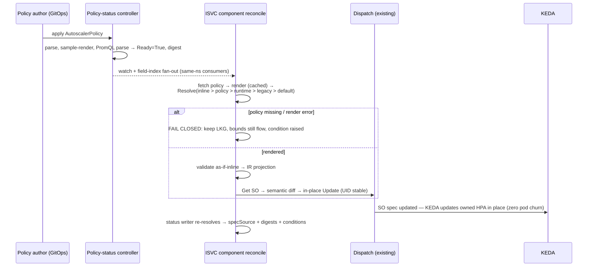
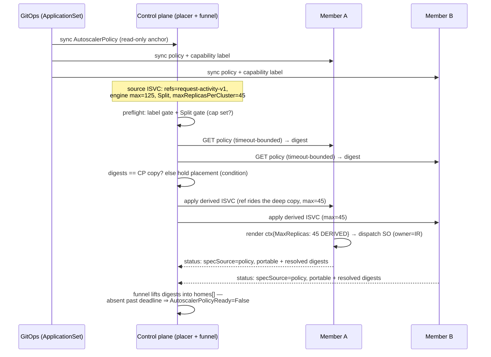

# OEP-0013.1: Reusable Autoscaler Policies

> **Status: provisional.** Follow-up to OEP-0013 (component-scoped
> autoscaling). Additive: one new layer in 0013's resolution chain; its
> verbatim pass-through contract is preserved. Nothing here is implemented.
> Source line references are as of `main@a17f709a` (2026-09-01).

<!-- toc -->
- [Summary](#summary)
- [Motivation](#motivation)
  - [Goals](#goals)
  - [Non-Goals](#non-goals)
- [Proposal](#proposal)
  - [Terminology](#terminology)
  - [The API at a glance](#the-api-at-a-glance)
  - [What must be true](#what-must-be-true)
  - [Anticipated objections](#anticipated-objections)
- [Design Details](#design-details)
  - [API](#api)
  - [Attachment and precedence](#attachment-and-precedence)
  - [Templates and parameters](#templates-and-parameters)
  - [Rendering facts (verified)](#rendering-facts-verified)
  - [Metric providers and SSRF](#metric-providers-and-ssrf)
  - [Resolution and controller model](#resolution-and-controller-model)
  - [Failure semantics](#failure-semantics)
  - [Status and digests](#status-and-digests)
  - [Lifecycle](#lifecycle)
  - [Multi-cluster](#multi-cluster)
  - [Security and RBAC](#security-and-rbac)
  - [Migration and rollout](#migration-and-rollout)
  - [Implementation plan](#implementation-plan)
- [Test Plan](#test-plan)
- [Graduation Criteria](#graduation-criteria)
- [Drawbacks](#drawbacks)
- [Alternatives](#alternatives)
- [Open Questions](#open-questions)
<!-- /toc -->

## Summary

**Tl;dr:** define an autoscaling behavior once, as data, in a namespaced
`AutoscalerPolicy`; attach it to each component with one line
(`spec.<component>.autoscalerPolicyRef`); OME renders it — per component, per
cluster, at reconcile time — into the verbatim `ComponentAutoscaler` block
OEP-0013 already dispatches. The inline block stays, stays first in
precedence, and stays the escape hatch.

- **`AutoscalerPolicy`** (namespaced, `ome.io/v1beta1`): one parameterized
  KEDA/HPA template per policy. Parameters are a closed, controller-derived
  set (ISVC identity + the component's *effective* replica bounds), so
  service-specific values are never copy-pasted into PromQL.
- **Per-component ref**, same-namespace, a sibling of the inline `autoscaler`
  block — ref + inline may coexist (inline wins; that is the preview
  mechanism). A component with no ref is untouched; router exclusion is a
  missing line, not code.
- **Resolution:** inline > policy > runtime > legacy > default, with
  `specSource: "policy"` on the existing status field (open string — no
  schema change).
- **Metric providers are logical names** bound per cluster in
  `inferenceservice-config`; endpoints are unrepresentable in policies.
- **In-use deletion is denied at admission** (exemptions: zero refs,
  break-glass annotation, terminating namespace).
- **Fail closed, degraded-not-error:** a missing/broken policy freezes the
  component on its last-known-good scaler and raises a condition; consumer
  reconciles keep succeeding and never fall back to the default CPU-80% HPA.
- **Multi-cluster:** policies are GitOps-distributed like runtimes/models;
  each home renders from its *derived* per-home bounds; the control plane
  preflights capability + a portable digest, read-only. Demand evaluation is
  cluster-local in v1.

## Motivation

The motivating fleet needs one behavior on every backend component: one
replica while idle; scale to the component's own `maxReplicas` on any request
activity; on Prometheus failure fall back to that max (never scale down on
missing data); 600s scale-down stabilization; routers untouched. With
OEP-0013's inline blocks this is **24 ISVCs, 30 component autoscalers, 31
files, ~1,157 lines** — the same KEDA block with three values hand-interpolated:
the service name in the query, the component max in the query's multiplier,
and the same max again in `fallback.replicas`.

That repetition is three live failure modes:

1. **Silent desync.** Raise `maxReplicas` 8→16 and forget the query literal:
   the scaler pins at 8 under load while the spec says 16. Nothing warns.
2. **Fleet changes are 30-block sweeps** — review noise proportional to fleet
   size, and a half-applied sweep is invisible to status.
3. **Multi-cluster divergence exists today.** `DeriveISVC` copies the spec
   verbatim (`placement/derive.go:24-36`) while `setDerivedReplicas` rewrites
   per-home bounds (`derive.go:92-109`) — so a query multiplying by the
   *global* max rides unchanged onto every Split home. Source max 125 across 3
   homes = 3 scalers that each believe the ceiling is 125, the exact outcome
   OEP-0018.1 forbids ("per-cluster autoscalers do NOT own N… ceiling is its
   share", 0018.1 README:479-488).

One service in the same fleet legitimately scales on a different, bespoke
metric — so any fix that hardcodes the standard query into OME breaks the
exception *and* bakes org-specific PromQL into an upstreamed binary (the
repo's hardest blocker).

Why not the existing mechanisms: inline blocks are the escape hatch, not a
fleet surface (above). Runtime-carried defaults have the wrong ownership axis
(vendor family ≠ fleet policy), cross namespaces via cluster runtimes, and are
verbatim — per-component fallback counts would need a runtime fork per max
value. A ConfigMap store is the Knative `config-autoscaler` lesson: no schema,
no status, no review unit; a typo changes every service silently.
Admission-time expansion creates permanent Argo drift; OME deliberately never
writes autoscaler blocks into stored ISVC specs, and this OEP keeps that.

### Goals

1. Define once, reuse unchanged across many ISVCs and clusters.
2. Interpolate identity and *effective* bounds at render time — on members,
   the derived per-home bounds (this fixes today's Split hazard).
3. Keep inline blocks as a first-precedence escape hatch with atomic rollback.
4. Keep the policy body cluster-portable: no endpoints, no credentials.
5. Fail closed; never a silent scaler-class flip.
6. Hold OEP-0018.1's rule: a home's ceiling is its derived bound, never the
   global max.
7. Observable provenance: `specSource`, policy name/generation/digest on the
   status surfaces OEP-0013 already writes.

### Non-Goals

- Replacing KEDA/HPA, global demand evaluation, or a fleet-level autoscaler
  (cluster-local only in v1).
- Apportioned per-home max under Split — this OEP *gates* the unsafe
  combination; the rewrite is an OEP-0018.x follow-up.
- Selector/namespace-default attachment, `Required` enforcement semantics,
  a cluster-scoped twin, per-ISVC template parameters (reserved or rejected;
  rationale inline).
- Auto-tuning, metric inference from images, scrape-config ownership, or any
  change to traffic, placement apportioning, Kueue admission, or quota.

## Proposal

### Terminology

- **Component** — an InferenceService's (ISVC's) engine, decoder, or router;
  each resolves its own autoscaler (OEP-0013).
- **InferenceReplica (IR)** — the OMENative per-component replica object: owns
  the component's pods, is the ScaledObject's owner and scale target, floors
  `minReplicas` to 1 (why fallback-from-zero is moot here, and why
  `ir.Spec.Autoscaler` can store the last-known-good).
- **OMENative / RawDeployment** — the two deployment modes a policy renders
  into: IR-based vs plain Deployment with no IR (why Raw needs an annotation
  for last-known-good). MultiNode, the third mode, has no autoscaler dispatch.
- **Home / placement modes** — a *home* is a workload cluster running a
  derived ISVC (OEP-0018). `Single`: one race-elected home. `All`: every
  admitting home. `Split`: replica bounds apportioned across homes — why a
  global-max literal is wrong on every Split home.
- **Watch-funnel** — the OEP-0018.2 pipeline streaming member status back into
  the source ISVC's `status.placement.homes[]`.
- **Render** — pure function: policy template + ISVC identity + effective
  component bounds + provider binding → one concrete `ComponentAutoscaler`.
- **Effective bounds** — component min/max after the defaulting/clamping
  dispatch already applies (min nil/≤0 → 1; `component_dispatch.go:251-264`);
  on a derived ISVC, the per-home bounds placement wrote.
- **Fail closed / last-known-good (LKG)** — on policy-machinery failure, the
  existing scaler is left untouched and a condition is raised; the last
  successful render remains the standing configuration.
- **Portable / resolved digest** — hash of the canonicalized policy spec
  (equal across clusters iff specs match) vs hash of one component's rendered
  output + bounds + provider (differs per home by design).

### The API at a glance

The standard fleet policy, once:

```yaml
apiVersion: ome.io/v1beta1
kind: AutoscalerPolicy
metadata:
  name: request-activity-v1        # versioned name: deploy everywhere, then flip refs
  namespace: llm-serving
spec:
  class: KEDA
  keda:
    triggers:
    - type: prometheus
      providerRef:
        name: cluster-prometheus   # logical name; URL/auth bound per cluster
      metricType: AverageValue     # desired-count query => AverageValue, never Value
      queryReturnsDesiredReplicas: true
      metadata:
        threshold: "1"
        ignoreNullValues: "false"  # no-series must ERROR into fallback
        query: |
          ((sum({__name__=~"sglang:num_running_reqs|vllm:num_requests_running|sglang:num_queue_reqs|vllm:num_requests_waiting",
                 job="ome-inferenceservice-pods",
                 namespace="{{ .Namespace }}",
                 inferenceservice="{{ .ISVCName }}",
                 component=~"engine|decoder"}) > bool 0) * {{ .MaxReplicas }})
    fallback:
      failureThreshold: 3
      replicas:
        fromComponent: MaxReplicas # typed source — the EFFECTIVE per-home max
    advanced:
      horizontalPodAutoscalerConfig:
        behavior:
          scaleDown:
            stabilizationWindowSeconds: 600
```

A consumer adds one line per backend component (inline blocks deleted):

```yaml
apiVersion: ome.io/v1beta1
kind: InferenceService
metadata: { name: llm-a, namespace: llm-serving }
spec:
  engine:
    minReplicas: 1
    maxReplicas: 8                 # the only place max is authored
    autoscalerPolicyRef: { name: request-activity-v1 }
  decoder:
    minReplicas: 1
    maxReplicas: 4                 # scales to ITS OWN max on the shared signal
    autoscalerPolicyRef: { name: request-activity-v1 }
  router: { minReplicas: 1, maxReplicas: 1 }   # no ref: untouched
```

What dispatch produces for `llm-a`'s engine — identical in shape to an inline
block's output; the policy changes where the block comes from, not what
dispatch does with it (query reflowed for width; the real render is
byte-verbatim template output):

```yaml
spec:
  scaleTargetRef: { apiVersion: ome.io/v1beta1, kind: InferenceReplica, name: llm-a-engine }
  minReplicaCount: 1
  maxReplicaCount: 8
  fallback: { failureThreshold: 3, replicas: 8 }
  advanced:
    horizontalPodAutoscalerConfig:
      behavior: { scaleDown: { stabilizationWindowSeconds: 600 } }
  triggers:
  - type: prometheus
    metricType: AverageValue
    metadata:
      serverAddress: http://ome-prometheus.ome.svc:9090   # bound from cluster config
      threshold: "1"
      ignoreNullValues: "false"
      query: |
        ((sum({__name__=~"sglang:num_running_reqs|vllm:num_requests_running|sglang:num_queue_reqs|vllm:num_requests_waiting",
               job="ome-inferenceservice-pods", namespace="llm-serving",
               inferenceservice="llm-a", component=~"engine|decoder"}) > bool 0) * 8)
```

Behavior: idle ⇒ series at 0 ⇒ desired ceil(0) → min 1. Activity ⇒ `{} 8` ⇒
desired 8. Prometheus down or no series at all ⇒ consecutive failures ⇒
fallback serves the max on the 4th failure, ~45-60s in. Scale-down waits out
the 600s window. On a Split home with derived max 3, the same policy renders
`* 3` / `replicas: 3` / `maxReplicaCount: 3`.

### What must be true

1. Exactly one effective autoscaler per component, chosen by a deterministic
   chain — never two writers on one ScaledObject.
2. The rendered block is a normal OEP-0013 block: ownership (SO owner = IR on
   OMENative, ISVC on Raw), GC, whole-block replace, and verbatim KEDA
   pass-through all hold unchanged.
3. Derived numeric values use the *effective* bounds — after runtime merge,
   after multi-cluster derivation.
4. No silent class flip: a missing/invalid policy must not resolve to the
   default CPU-80% HPA (for a GPU fleet pinned at max, that is scale-to-min
   during a policy outage). Fail closed, condition up, reconcile succeeds.
5. Policy updates never recreate workloads: in-place SO update, UID stable,
   zero pod churn.
6. Namespace isolation: no cross-namespace references exist to grant.
7. Multi-cluster: bounds are placement's; the policy reads them, never writes
   them.
8. Old controllers fail loudly, not differently: no-feature clusters reject
   the ref at admission; skewed members are detected within a bounded window.

### Anticipated objections

**Q. OEP-0011 rejected a policy CRD and chose a typed field. Why is this
different?**

A. Cardinality. 1:1 config (one ISVC, one traffic intent) belongs in the spec;
N:1 config earns a referenced object. This is N:1 by its whole point: the 1:1
encoding was tried (1,157 duplicated lines, three desync-prone values, a live
multi-cluster hazard); reuse-by-reference is already the repo convention
(ServingRuntime, AcceleratorClass, AcceleratorQuota); a typed `strategy:`
field would compile org PromQL into an upstreamed binary — a cost 0011 never
faced; and the ecosystem is converging on the same shape (KServe
`LLMInferenceServiceConfig`; kedacore/keda#2757 has asked for exactly this
templating since 2022). The inline field is not displaced — which is also
GEP-713's own 2025 conclusion ("in many cases it will be better to include
configuration directly inside upstream APIs").

**Q. Why per-component refs instead of one ISVC-level ref?**

A. Everything in OEP-0013 is per-component — resolution, dispatch, status —
so the ref rides the same axis, with no policy-side targeting sub-language to
get wrong. It composes freely (PD prefill/decode on different policies; the
exception service attaches engine only). Cost: two lines per ISVC, and a
forgotten decoder ref falls down the ordinary chain — visible as
`specSource: default` next to the engine's `policy`, and enforced by the CI
ratchet (stage 6).

**Q. Isn't a policy edit the same blast radius as the rejected ConfigMap?**

A. Similar radius, different failure mode: schema'd and admission-validated
(a typo is rejected, not applied), versioned by convention (new `-v2` object
first, then flip refs), previewable (ref + retained inline = zero behavior
change), observable (conditions, digests, counts). The ConfigMap had none of
these.

**Q. In All mode, N homes × per-home max can exceed any global budget.**

A. True, and it is All-mode semantics today, not a policy defect — every All
home autoscales independently. Need a global budget? Use Split. The genuinely
dangerous case — Split *without* a per-home cap — is held at preflight.

## Design Details

### API

Types land in `pkg/apis/ome/v1beta1` beside the kinds they extend; maturity is
tracked by this OEP's stage (alpha), as with OEP-0013 itself. The kind is
`AutoscalerPolicy` — the stem matches the `autoscaler` block family it renders
into; `AutoscalingPolicy` would collide conceptually with `spec.scalingPolicy`
(ratio coordination), `AutoscalerClass` collides with the existing Go type.

```go
type AutoscalerPolicySpec struct {
    // v1 admits only "Default"; "Required" is a reserved shape rejected at
    // admission, so an old controller can never misread Required as Default.
    // No runtime Audit mode: previewing = keeping the inline block, which
    // outranks the policy.
    // +kubebuilder:validation:Enum=Default;Required
    // +kubebuilder:default=Default
    Enforcement PolicyEnforcement `json:"enforcement,omitempty"`

    // Exactly one template, selected by Class (CEL-enforced coherence).
    // External and None are inline-only: "someone else scales this" is a
    // per-service statement, not a reusable behavior. Different behaviors for
    // different components = different policies; components compose by ref.
    // +kubebuilder:validation:Enum=HPA;KEDA
    Class AutoscalerClass `json:"class"`
    Keda  *KedaPolicyTemplate `json:"keda,omitempty"`
    HPA   *HPAAutoscaler      `json:"hpa,omitempty"` // verbatim; no templating in v1
}

type KedaPolicyTemplate struct {
    // +kubebuilder:validation:MinItems=1
    // +listType=atomic
    Triggers         []KedaTriggerTemplate  `json:"triggers"`
    Advanced         *kedav1.AdvancedConfig `json:"advanced,omitempty"` // verbatim
    PollingInterval  *int32                 `json:"pollingInterval,omitempty"`
    CooldownPeriod   *int32                 `json:"cooldownPeriod,omitempty"`
    IdleReplicaCount *int32                 `json:"idleReplicaCount,omitempty"`
    Fallback         *FallbackTemplate      `json:"fallback,omitempty"`
}

type KedaTriggerTemplate struct {
    Type string `json:"type"` // "prometheus" in v1
    // Required for network-endpoint trigger types ("prometheus" in v1);
    // pointer only so future non-endpoint types can omit it.
    ProviderRef *MetricProviderRef `json:"providerRef,omitempty"`
    // +kubebuilder:validation:Enum=AverageValue;Value
    MetricType autoscalingv2.MetricTargetType `json:"metricType,omitempty"`
    // Declares the query's result IS the desired replica count. When true,
    // admission requires AverageValue: the HPA's Value math is
    // ceil((metric/threshold) × readyPods), which breaks desired-count queries.
    QueryReturnsDesiredReplicas bool `json:"queryReturnsDesiredReplicas,omitempty"`
    // Values may contain {{ .Var }} templates over the closed variable set
    // (Namespace, ISVCName, Component, MinReplicas, MaxReplicas, TargetName).
    // Admission rejects the keys "serverAddress" and "authModes", and
    // requires "ignoreNullValues" to be explicit on prometheus triggers.
    Metadata map[string]string `json:"metadata"`
}

type MetricProviderRef struct{ Name string `json:"name"` }

type FallbackTemplate struct {
    FailureThreshold int32              `json:"failureThreshold"`
    Replicas         ReplicaValueSource `json:"replicas"`
}

// Exactly one of Value/FromComponent (CEL one-of). kedav1.Fallback.Replicas
// is an int32; round-tripping it through a string template would add a parse
// failure mode for no expressiveness.
type ReplicaValueSource struct {
    Value         *int32          `json:"value,omitempty"`
    FromComponent *ComponentField `json:"fromComponent,omitempty"` // MaxReplicas|MinReplicas
}
```

Consumer side — additive to `ComponentExtensionSpec`:

```go
// Names a same-namespace AutoscalerPolicy that renders this component's
// autoscaler. Deliberately a SIBLING of Autoscaler, not a field inside it:
// ref and inline block may coexist (inline wins) — the preview/rollback
// mechanism.
// +optional
AutoscalerPolicyRef *AutoscalerPolicyRef `json:"autoscalerPolicyRef,omitempty"`

type AutoscalerPolicyRef struct {
    Name string `json:"name"`
    // Reserved: v1 admission accepts only "AutoscalerPolicy";
    // "ClusterAutoscalerPolicy" is the reserved cluster-scoped twin.
    // +kubebuilder:default=AutoscalerPolicy
    // +optional
    Kind string `json:"kind,omitempty"`
}
```

Deliberate non-fields (reserve only shapes with a named consumer): no `params`
on the ref, no `optOut`, no ISVC-level ref, no namespace-default attachment,
no `decisionScope` enum. Reserved shapes are exactly two: `ref.kind` and
`enforcement: Required`.

### Attachment and precedence

Per-component ref, evaluated in the existing resolver
(`reconcilers/autoscaler/resolve.go:76-88`):

1. Inline `spec.<component>.autoscaler` — `specSource: isvc`
2. The component's referenced policy — `specSource: policy`
3. Runtime component block — `specSource: runtime`
4. Legacy annotations (Raw-only; substitutes the default branch, as today) —
   `specSource: legacy`
5. Default `{Class: HPA}` → CPU-80% — `specSource: default`

Policy sits below inline so restoring an inline block is an atomic,
policy-edit-free rollback, and so preview is free: add the ref, keep the
inline block — behavior unchanged *by construction*, status shows
`shadowedPolicyRef` plus what the policy would render. There is no runtime
`mode: Audit` field: after migration, flipping to "audit" would mean "use the
pre-policy chain", i.e. one field edit detaches the fleet onto default CPU
HPAs. Policy sits above runtime because a runtime block is a vendor-family
default; the policy is a deliberate fleet decision. Both Raw and OMENative go
through the same shared chain (`ResolveRawComponentAutoscaler` delegates,
`resolve.go:96-115`) — one code change covers both.

**Opt-out:** remove the ref, or author an inline block (class `None` disables
OME scalers, `External` hands off). Authorization = ISVC update rights; GitOps
review is the governance layer. `Required` is admission-rejected reserved
shape until upstream override semantics stabilize (all Experimental in
GEP-713); consequence: v1 cannot stop an inline opt-out.

**Conflicts** are structural non-events in v1: one ref per component (two
policies on one component is unrepresentable); different components on
different policies is composition, not conflict; inline + ref is precedence,
reported via `shadowedPolicyRef`. Designated future rule, recorded now: if
selectors/defaults ever land, same-level conflicts resolve by admission
uniqueness + alphabetical-name backstop, loser marked
`Accepted=False/Conflicted` — never creationTimestamp, which GitOps recreation
resets differently per cluster.

### Templates and parameters

Go `text/template`, `Option("missingkey=error")` — a typo'd variable must fail
the render rather than interpolate `<no value>` into a query. The render code
is a pure, K8s-free package (`pkg/autoscalerpolicy/render`) shared by
controller, webhook, and the `ome-policy` CLI, so CI preview and runtime
cannot disagree. The webhook walks each parse tree and rejects any node other
than field access and text — no functions, pipelines, or control flow.
Templates are parsed once per (policy UID, generation) into an immutable
cache.

| Variable | Type | Source |
|---|---|---|
| `{{ .Namespace }}`, `{{ .ISVCName }}` | string | ISVC identity (DNS-safe) |
| `{{ .Component }}` | string | engine\|decoder\|router |
| `{{ .MaxReplicas }}`, `{{ .MinReplicas }}` | int32 | effective bounds (derived, on members) |
| `{{ .TargetName }}` | string | `<isvc>-<component>` (the scale-target/IR name) |

No user-supplied strings enter the context, so there is no PromQL-escaping
layer to get wrong; the injection surface is the policy body itself
(namespace-RBAC'd, GitOps-reviewed). Numeric derived fields use the typed
`ReplicaValueSource`, never string templates.

**No per-ISVC `params` — rejected, not deferred.** Parameters turn one
reviewable object into N partially-evaluated variants. The concrete trap:
overriding only the metric name for the probe exception inherits the shared
template's `job=`/`component=~` matchers, which the probe metric lacks — the
query matches nothing, `ignoreNullValues: "false"` errors every evaluation,
and the service pins at max forever with green status. Exceptions are a
separate policy (full query authored fresh) or an inline block.

Validation, four layers: (1) CRD schema + CEL (enums, class↔template, one-of);
(2) policy webhook — template parse + node allowlist, sample render, PromQL
parse of the render (catches the precedence trap below),
`queryReturnsDesiredReplicas` ⇒ AverageValue, explicit `ignoreNullValues`,
forbidden metadata keys, providerRef required, `Required` rejected; (3)
reconcile re-validation — render re-checks everything, and the output passes
the same `pkg/validation/isvc.go` checks an inline block faces; (4) CI
(`ome-policy check`) renders every policy × ISVC pair and posts the would-be
ScaledObject diff per PR.

### Rendering facts (verified)

Five facts pinned against primary sources (KEDA v2.18.3 as in go.mod, the
Kubernetes HPA replica calculator, the Prometheus 3.4.2 engine — empirically):

1. **AverageValue, never Value, for desired-count queries.** Value math is
   `ceil((metric/threshold) × readyPods)`; AverageValue with threshold `"1"`
   is `ceil(metric)`. Admission enforces this via
   `queryReturnsDesiredReplicas`.
2. **Empty aggregations return an empty vector** (every aggregation, `count`
   included), so `ignoreNullValues: "false"` is what turns no-series into an
   error that counts toward fallback — the default (`true`) would read empty
   as a healthy 0 *and reset the failure counter*. No `or vector(0)`: an
   explicit zero would defeat fail-to-max.
3. **Parenthesize the multiplication.** `sum(x) > bool 0 * N` parses as
   `sum(x) > bool (0*N)` → returns 1, not N. Canonical:
   `((sum(...) > bool 0) * N)`. Pinned by the admission PromQL parse + golden
   tests.
4. **Fallback timing:** consecutive failed evaluations at the HPA fetch
   cadence (~15s); trips on the (threshold+1)-th → ~45-60s at threshold 3;
   fabricates target×replicas ⇒ desired = rendered per-home max. KEDA ≤2.18
   cannot fall back from zero (moot: IR floors min to 1).
5. **Updates are non-disruptive:** KEDA updates its owned HPA in place and
   never touches pod templates; OME updates the SO in place (semantic diff,
   UID preserved). A policy edit converges with zero pod churn.

Known residual: a wedged vendor gauge (SGLang idle-freeze; vLLM V1 deadlocks)
pins replicas at max until liveness probes recycle the pod — wedge recovery
belongs to probes, not the trigger.

### Metric providers and SSRF

The Prometheus URL is the most cluster-local value in the design, so the
policy names a logical provider and each cluster binds it in the
`inferenceservice-config` ConfigMap (key `autoscalerPolicy`; typed loader;
30s-TTL hot reload; **no in-code default** — the chart supplies it, per the
`canaryAnalysis.bundledPrometheusAddress` pattern):

```json
{
  "metricProviders": {
    "cluster-prometheus": { "serverAddress": "http://ome-prometheus.ome.svc:9090" }
  },
  "preflight": { "memberGetTimeoutSeconds": 5, "skewDeadlineSeconds": 900 }
}
```

Providers may carry an optional `authSecretRef` (SecretKeySelector); OME
materializes a KEDA TriggerAuthentication in the consumer's namespace and
wires `authenticationRef`. Secrets never appear in specs, status, or digests.

SSRF is closed structurally: `providerRef` is admission-required on endpoint
triggers, and the `serverAddress` metadata key is admission-rejected in policy
bodies (render refuses it too, against skew). Policy authors can only *name*
providers; only cluster admins define name→URL bindings; an unknown name is a
render error → fail closed. Inline blocks keep today's verbatim
`serverAddress` freedom — existing surface, flagged, not widened.

### Resolution and controller model

Rendering is a resolver extension inside the existing component reconcile —
after runtime fetch, before IR projection:

```go
policy, _ := fetchReferencedPolicy(ctx, c, isvc, comp)    // nil if no ref
bounds := EffectiveComponentBounds(isvc, comp)            // one read, shared with dispatch
rendered, renderErr := render.Render(policy, render.Context{
    Namespace: isvc.Namespace, ISVCName: isvc.Name, Component: comp,
    MaxReplicas: bounds.Max, MinReplicas: bounds.Min,
    Provider: providerBinding,
})                                                        // pure; parse-cached
block, source := autoscaler.ResolveComponentAutoscaler(rt, isvc, comp, rendered)
// renderErr != nil, or ref set with policy == nil  =>  fail-closed branch:
// keep the last-known-good scaler; bounds stamping still flows.
```

`EffectiveComponentBounds` is called once per component reconcile and feeds
*both* the render context and the SO/HPA bounds stamping — rendered literals
and stamped bounds cannot disagree within a reconcile. The status writer
re-resolves the same chain (`components/base.go:774-823`), so status and
dispatch cannot disagree about which layer won.

- **Watches:** one ISVC field index collecting the distinct per-component ref
  names; a policy event enqueues same-namespace consumers (24 in the
  motivating fleet; a 1,000-consumer convergence rangespec is pinned in the
  Test Plan). The reverse direction is the ISVC reconcile's own fetch; a
  safety requeue (order minutes, interval TBD/config-driven) backstops watch
  races.
- A small **policy-status controller** owns policy status only (Ready,
  portable digest, attached-component count).
- **Gating:** one Helm value installs CRD + controller + webhook together
  (never install-but-dormant); the controller also gates on CRD discovery
  (the LWS/KEDA/Volcano pattern). On a non-enabled cluster the ISVC webhook
  rejects any ref outright.
- **MultiNode** is handled at reconcile, not admission (mode is derived from
  the runtime; an ISVC-webhook check would go stale on runtime edits): no-op +
  `AutoscalerResolved=False (UnsupportedDeploymentMode)`. The control-plane
  preflight repeats the check for multi-cluster.
- **Rollout non-interference is pinned:** policy output enters only via the
  resolver; dispatch's tracked-keys metadata ownership (which canary pause
  state rides on) is untouched, and a KIND spec asserts pause metadata
  survives a policy edit.

### Failure semantics

Governing rule: a missing/invalid policy must never silently resolve to a
materially different scaler class — the lower layers produce a CPU-80% HPA,
which would scale a max-pinned GPU fleet to min during a policy outage.
Fail closed = skip the policy-owned portion of dispatch, keep the existing
scaler untouched, raise a condition.

**Degraded, not an error.** `NotFound` (or a render failure) must not be
returned as a reconcile error — that would requeue-with-backoff forever and
stall *everything else* the reconcile owns (image updates, replica edits, IR
projection) across every consumer. The resolver returns a hold sentinel, the
autoscaler concern alone degrades, and the reconcile succeeds; recovery is
watch-driven when the policy reappears. Only *transient* fetch errors take the
error-requeue path. Build this deliberately: the autoscaler path has precedent
for hard-erroring reconciles (legacy annotations, foreign-owner scalers), and
`PolicyNotFound` must not route through it.

**In-use deletion is denied.** The policy webhook handles DELETE: while any
component references the policy, deletion is rejected with the referencing
components named. Exemptions: zero refs; a terminating namespace (teardown
deletes objects in arbitrary order and must not wedge); an explicit
break-glass annotation (`ome.io/allow-in-use-delete: "true"`, set by a prior
update so it is reviewable). Webhook-deny over a finalizer because a finalizer
*accepts* the delete and parks the object in Terminating — GitOps prune hangs,
operators learn to strip finalizers, a dead controller wedges teardown; a
refusal is immediate and names its reason. Versioned names keep GitOps clean:
prune deletes `…-v1` only after refs flipped to `…-v2` (count 0 → admitted).
LKG stays regardless — admission is UX, LKG is the invariant: break-glass,
skew, a webhook-outage window, and the check's TOCTOU all still end with a
referenced policy gone, and each must land on the freeze, never on a default
HPA.

**LKG store, per mode:** OMENative — `ir.Spec.Autoscaler` (the store exists;
the *freeze* is new: today the projector whole-block-replaces it every
reconcile, so the fail-closed branch must suppress that replace or the chain
falls through and overwrites). RawDeployment — no IR; dispatch stamps the
rendered block into an `ome.io/last-rendered-autoscaler` annotation on the
Deployment, with a recovery branch (scaler deleted externally while policy
missing ⇒ re-dispatch from the annotation).

**Bounds keep flowing during a freeze** (they are not policy-owned): a bounds
edit lands on the live SO while trigger content stays frozen. The SO's own
`maxReplicaCount` clamps a stale-high fallback; a stale-low one errs
conservative; the condition message states the lag.

| Failure | Behavior | Condition (reason) |
|---|---|---|
| Ref names a missing policy | Fail closed; LKG stands. First reconcile ever (no LKG): dispatch nothing — pods keep their authored count; no default HPA | `AutoscalerResolved=False` (PolicyNotFound) |
| Invalid policy update | Webhook rejects; if bypassed (skew), render fails ⇒ keep previous render | (PolicyInvalid); policy `Ready=False` |
| Delete attempted while referenced | Denied at admission; error names the referencing components | admission error only |
| Policy gone anyway (break-glass, skew, outage) | As missing: LKG; reconciles keep succeeding | (PolicyNotFound) |
| KEDA CRDs absent | Fail closed — never render policy KEDA into an HPA | (ClassUnavailable) |
| Unknown provider / missing auth Secret | Render error ⇒ fail closed | (PolicyInvalid / AuthNotFound) |
| Prometheus down | KEDA fallback ⇒ desired = rendered max in ~45-60s | scaler-level only |
| No metric series | `ignoreNullValues: "false"` ⇒ error ⇒ fallback ⇒ max | — |
| Series present at 0 (idle) | Success; resets failure counter; HPA converges to min=1 | — |
| MultiNode component with a ref | No-op at reconcile; CP preflight repeats for MC | (UnsupportedDeploymentMode) |
| Effective max ≤ 0 | Render error ⇒ fail closed | (PolicyInvalid) |
| Wedged vendor gauge | Pins at max until probes recycle the pod | pod health surfaces |

Residual windows, claimed as residuals in the risk section rather than solved:
(1) a single-cluster controller downgrade below the feature while
`specSource: policy` exists — no in-cluster actor survives to detect it;
procedural gate (stage R: restore inline first), plus the multi-cluster
ResolveTimeout backstop; (2) a mislabeled member runs default HPA silently
until `skewDeadlineSeconds` expires, then loud; (3) during an LKG freeze a
*raised* max reaches SO bounds while the frozen fallback lags it.

### Status and digests

Policy status is bounded (counts and digests, never name lists), and the chart
ships an Argo Lua health check keyed on `Ready` (CRs are Healthy-by-default in
Argo — a Progressive-Sync wave gating on vacuous health is false-green):

```yaml
status:
  observedGeneration: 4
  portableDigest: "pv1:9f3a1c20b7d4"
  attachedComponents: 30
  conditions:
  - { type: Ready, status: "True", observedGeneration: 4 }
  - { type: InUse, status: "True", reason: Attached }
```

ISVC side, additive on the existing per-component surface:

```yaml
status.components.engine.autoscaler:
  class: KEDA
  managedBy: ome
  specSource: policy              # or "isvc" when an inline block shadows the ref
  policy:
    name: request-activity-v1
    observedGeneration: 4
    portableDigest: "pv1:9f3a1c20b7d4"
    resolvedDigest: "rv1:31c88a02e6f1"   # differs per home BY DESIGN
  shadowedPolicyRef:              # only when specSource=isvc AND a ref is set
    name: request-activity-v1
    portableDigest: "pv1:9f3a1c20b7d4"
    wouldRenderDigest: "rv1:aa10f4d2"    # the preview surface
```

**Two digests, two jobs.** *Portable*: the shared render package applies the
API's own defaulting to the spec, then hashes sorted-key JSON.
Defaulting-first is load-bearing — the apiserver stores a defaulted object
(`enforcement: Default`) while the raw GitOps file omits it; hashing raw bytes
would make identical files mismatch their own stored objects. `ome-policy`
links the same package, so CI, members, and the control plane compute it
independently; a CI test pins raw-file == live-object. *Resolved*: hash of the
rendered block + effective bounds + provider URL, computed at dispatch —
differs per home; its job is "did my edit land *here*?".

| Object | Condition | True reasons | False reasons | Writer |
|---|---|---|---|---|
| AutoscalerPolicy | `Ready` | TemplatesValid | ParseError, ForbiddenTemplateNode, ForbiddenMetadataKey, ProviderUnknown, PromQLInvalid | policy-status controller |
| AutoscalerPolicy | `InUse` | Attached | NoConsumers | policy-status controller |
| ISVC component autoscaler | `AutoscalerResolved` | RenderedFromPolicy, InlinePrecedence | PolicyNotFound, PolicyInvalid, AuthNotFound, ClassUnavailable, UnsupportedDeploymentMode | component status writer |
| ISVC (top level) | `AutoscalerPolicyAffected` | Attached (breadcrumb: first attach / last detach) | — | component status writer |
| Source ISVC (MC) | `PlacementPolicyPreflight` | Passed | UnboundedSplitCeiling, DigestMismatch, PolicyMissingOnMember, MemberGetTimeout, CapabilityMissing | placement controller |
| Source ISVC (MC) | `AutoscalerPolicyReady` | AllHomesResolved | ResolveTimeout, FieldPruned, MemberFailedClosed | watch-funnel |

Conditions are written on first reconcile even if Unknown; per-condition
`observedGeneration` throughout; fan-out ≤ consumers-per-namespace.

### Lifecycle

| Event | Behavior |
|---|---|
| Policy created | `Ready` computed; dangling refs re-enqueued via index; fail-closed components recover |
| Policy updated (valid) | Cache invalidated by generation; SO updated in place, UID stable, zero pod churn; `resolvedDigest` changes per home |
| Policy updated (invalid) | Webhook rejects; if bypassed, LKG freeze |
| Delete attempted | Denied while referenced (exemptions: zero refs, break-glass, terminating namespace); through an exempt path ⇒ LKG, reconciles keep succeeding |
| Inline block added | Resolver flips to inline next reconcile; KEDA→KEDA = in-place SO update; HPA↔KEDA uses the existing XOR delete+create |
| Inline block removed | Reverse swap to policy rendering, same reconcile |
| ISVC re-placed | Old home's SO dies with the derived ISVC (IR owner chain); new home preflights + re-renders; HPA stabilization state resets (~10 min later scale-down possible — accepted) |
| Controller rollback below the feature | Old resolver ignores refs ⇒ would resolve runtime/default. Procedural: restore inline blocks first (stage R); MC gets the ResolveTimeout backstop |
| Policy lands after placement (GitOps lag) | The failed-closed home recovers when the policy syncs; the funnel clears the condition |

### Multi-cluster

**Decision scope: cluster-local in v1.** Each home's scaler evaluates its own
Prometheus and writes only its local IR `/scale`. The one real global-demand
precedent (Karmada FederatedHPA) assumes traffic ∝ replica distribution and
degrades unpredictably on member disconnect; OEP-0018.1 lists global
autoscaling as an open non-goal. Nothing in the policy shape encodes "local",
so a future global-evaluation OEP consumes the same objects.

**Split contract: placement-owned bounds win.** `setDerivedReplicas` keeps
sole ownership of per-home min/max; the policy renders *from* derived bounds
and never writes them. Walkthrough: source max 125, 3 homes,
`maxReplicasPerCluster=45` ⇒ each home renders `* 45`, `fallback: 45`,
`maxReplicaCount: 45`; worst case all-homes-in-fallback = 135, bounded by the
max band each scaler itself carries. Note: the SO clamp is the bound, not
Kueue — Kueue gates admission at placement time only; OEP-0018.1's dynamic
clamp is unimplemented. Today's inline blocks produce the 375 outcome.

**Distribution: worker-local render + GitOps policies + CP preflight.**
Members hold the policy at the same `(namespace, name)` (`DeriveISVC`
preserves both — the ref resolves symmetrically with zero identity mapping).
The same ApplicationSet also syncs a read-only CP copy, the digest anchor.

| | Worker-local + GitOps + preflight (chosen) | Central materialization | CP-replicated policies | GitOps only, no preflight |
|---|---|---|---|---|
| Per-home bounds | automatic (renders from derived) | only if CP re-renders every re-apportion | ok once replicated | ok |
| Provider/auth locality | member-local | CP must hold every member's URL+auth | member-local | member-local |
| Policy fix during CP outage | members keep reconciling | reaches zero homes | stalled | unaffected |
| Drift detection | portable digest vs CP anchor + per-home resolved digest | invisible without extra digests | two-writer fight with GitOps | none |
| Write-plane | CP gains read-only `get` | none new | CP writes policies on members | none |
| Ownership fit (runtimes/models) | matches | breaks | breaks (MultiKueue keeps cluster config GitOps-owned) | matches, unverified |

**Preflight** (placement-controller step; the ISVC webhook is disabled on the
CP):

1. **Capability label:** candidate WorkloadCluster carries
   `ome.io/autoscaler-policy: v1beta1` in labels — the existing matching
   surface (`WorkloadCluster.status` is reachability-only by invariant).
   Stamped by the same GitOps commit that enables the member.
2. **Presence + digest:** for each distinct referenced policy, a live GET per
   candidate via the member kubeconfig (the remote cache stays derived-ISVC
   scoped: widening it would scale CP watch load with every policy on every
   member for a placement-time-only check). Digest must equal the CP copy's.
   NotReady members are skipped; each GET carries
   `preflight.memberGetTimeoutSeconds`, and a timeout makes that member
   ineligible. `PlacementPolicyPreflight` flips False (`MemberGetTimeout`)
   only when no eligible candidate remains; otherwise the skipped member is
   named in the condition message.
3. **Structural checks** the disabled webhook would have done (ref shape,
   Required rejection, MultiNode).
4. **Split hard gate:** `Split` + a referenced policy consuming `MaxReplicas`
   on a bounds-rewritten component + `maxReplicasPerCluster` unset ⇒ placement
   holds (`UnboundedSplitCeiling`). Without the cap, each home keeps the
   *global* ceiling, so a fleet-wide Prometheus outage drives every home's
   fallback to global max — N×125 against a 125 budget. The hold is loud and
   reversible in one field; inline blocks bypass this preflight and keep
   today's pre-existing behavior (no parity regression). The real fix —
   apportioned per-home max — is the OEP-0018.x follow-up; this is the bridge.

**Skew matrix** (every row has a detection):

| Member state | Label | Preflight | If reached anyway | Detection |
|---|---|---|---|---|
| New CRDs + controller + policy | yes | eligible | — | — |
| Policy missing (GitOps lag) | yes | ineligible / fails closed | safe, stuck, loud | `PolicyNotFound` via funnel |
| New ISVC CRD, old controller (mislabeled) | yes | passes | ref ignored ⇒ would default-HPA | no `resolvedDigest` within `skewDeadlineSeconds` ⇒ `AutoscalerPolicyReady=False (ResolveTimeout)` |
| Old ISVC CRD (ref pruned at apply) | must be absent | ineligible | THE forbidden silent case; the label gate exists for it | CP re-stamps the derived spec every pass ⇒ 3 prune-reverts ⇒ `(FieldPruned)` |
| CRD present, feature disabled | absent | ineligible | member webhook rejects the ref | — |

Versioned policy names are the skew instrument: behavior changes ship as a new
object everywhere first, then refs flip per ISVC. In-place edits are
emergency-only (widest skew window, bounded by `skewDeadlineSeconds`).

**Per mode:** *Single* — preflight filters before the Kueue race, so a home
that would mis-scale can never win; losers' derived ISVCs (and their SOs, via
the IR chain) are deleted wholesale. Named race: policy deleted on the winner
between preflight and first reconcile ⇒ fails closed at min, loudly; no
automatic re-race. *All* — every home renders from its own bounds; N×max is
All-mode semantics ("need a global budget? use Split"); per-home digests make
divergence visible. *Split* — the payoff: placement re-apportions at will and
the next worker reconcile re-renders from the new bounds, in-place.





### Security and RBAC

| Actor | AutoscalerPolicy | ISVC | inferenceservice-config | Secrets |
|---|---|---|---|---|
| Policy author (platform team) | CRUD in namespace | read | — | — |
| ISVC author | read only | update (ref / inline) | — | — |
| Workload OME manager | get/list/watch | as today | read | read (authSecretRef, ns-local, live reader) |
| Management-plane OME (member kubeconfig) | **get only, by name** | derived RW as today | — | — |
| GitOps (Argo) | apply in ns (+ CP copy) | apply | apply (chart) | TriggerAuth materials |
| Cluster admin | — | — | provider map (the SSRF gate) | TriggerAuth secrets |

Hard lines: credentials only via TriggerAuthentication/SecretKeySelector;
template variables are a closed allowlist of controller-derived values;
template parse trees are field-access + text only; endpoints unrepresentable
in policies. A compromised policy author is confined to one namespace; a
compromised control plane cannot write member policies. Webhook wiring follows
the house checklist (handler package, `--webhook` registration, chart
ValidatingWebhookConfiguration, cert-manager CA injection, failurePolicy Fail).

### Migration and rollout

Each stage individually reversible; only stage 4 changes behavior, and its
rollback is one `git revert`.

- **0** — land API + resolver behind the Helm gate (disabled). No rollback
  needed.
- **1** — enable CRD + controller + webhook everywhere (members first, CP
  last); capability labels stamped in the same per-member commit.
- **2** — distribute `request-activity-v1` + provider bindings via the
  bootstrap ApplicationSet (incl. the CP copy); install the Argo health check;
  verify one identical `portableDigest` on every cluster.
- **3 — preview, one low-risk ISVC:** add refs, *keep* inline blocks. Inline
  wins (zero behavior change by construction); status shows
  `shadowedPolicyRef` + `wouldRenderDigest`; CI posts the rendered-vs-live SO
  diff. Rollback: remove the refs.
- **4 — cutover that ISVC:** delete its inline blocks in the same PR. Assert
  SO UID unchanged, only spec drifted, pods untouched, `specSource: policy`.
  Rollback: revert the PR.
- **5** — sweep the remaining standard components in batches (Argo RollingSync
  gated on health + the stage-4 assertions). The exception service stays
  inline.
- **6** — CI ratchet: `ome-policy check --require-ref` forbids new inline KEDA
  blocks in the fleet directory without an exemption marker; validates every
  ref; renders every pair.
- **7** — the exception graduates only when a second consumer appears: a
  sibling policy authored from its live inline block, verified by the
  stage-3/4 diff protocol. (Its `probe_requests_total` is a *counter*: the
  activity term must be a windowed `rate()` — a bare `sum(counter) > bool 0`
  latches true forever.)
- **R** — global rollback any time: revert the cutover PRs; inline precedence
  restores atomically; policies may stay installed. Controller-rollback rule:
  restore inline blocks *first*, never downgrade past the feature while any
  `specSource: policy` exists.

### Implementation plan

1. API + codegen: types in `pkg/apis/ome/v1beta1`, the ref field on
   `ComponentExtensionSpec`, CEL rules. No behavior.
2. `pkg/autoscalerpolicy/render`: pure package — templates + allowlist,
   ValueSource, canonicalization + digests, parse cache; golden tests.
3. Webhooks: policy validator (incl. in-use DELETE denial) + ISVC webhook
   additions; envtest suite.
4. Resolver + dispatch integration: seam extension, fail-closed branches, Raw
   LKG annotation, `EffectiveComponentBounds`, status + conditions,
   policy-status controller, watches/indexes; envtest suite.
5. Config: the `autoscalerPolicy` block + chart values.
6. Multi-cluster: preflight, homes[] fields, funnel lift, ResolveTimeout +
   FieldPruned detectors; MC integration tests.
7. KIND specs (classified in `KIND_SPEC_GROUPS`) + perf rangespecs.
8. `ome-policy` CLI (`cmd/ome-policy`, thin over the render package) + CI
   wiring docs + the Argo health-check snippet.

The OEP itself lands first (provisional → implementable before PR 1 merges).

## Test Plan

| Layer | Suite | Cases |
|---|---|---|
| Unit | render package | parse/exec; missingkey=error; node-allowlist rejection; ValueSource typing; cache invalidation by generation; max ≤ 0; provider-missing; digest canonicalization (defaults applied, field order); golden renders incl. parenthesization + PromQL parse |
| Unit | reconcilers/autoscaler | precedence × {inline, runtime, legacy, default} × Raw/OMENative parity; fail-closed branches; bounds-stamp-during-freeze; Raw annotation LKG recovery |
| envtest webhook | `singlecluster/webhook/autoscalerpolicy` | class↔template coherence; `Required` rejection; template + metadata-key rules; providerRef required; AverageValue force; explicit ignoreNullValues; feature-disabled ref rejection; ref+inline coexistence admitted; in-use DELETE denied / admitted at zero refs / break-glass / terminating ns; Split+ref+unset-cap warning |
| envtest controller | `singlecluster/controller/autoscalerpolicy` | policy status (Ready, digest, count); index fan-out; LKG freeze on delete/invalid; dangling-ref ISVC still converges unrelated spec changes (success on NotFound, no requeue storm); preview digests; MultiNode condition |
| KIND | new specs in `KIND_SPEC_GROUPS` | cutover SO-UID stability; in-place SO update, zero pod churn; KEDA-absent fail-closed; fake-Prometheus outage ⇒ fallback pins max; paused-canary tracked-keys survive a policy edit |
| Multi-cluster | `tests/integration/multicluster` | label gate; digest mismatch ⇒ ineligible; member GET timeout ⇒ member ineligible, placement proceeds; Split derive ⇒ per-home literals, never global; Split hard gate holds; FieldPruned; ResolveTimeout; Single race among capable homes only |
| Perf (rangespec) | `tests/perf` | render p99 <1ms cached / <20ms cold; 1,000-consumer policy-edit convergence <2min; zero SO writes on no-op reconciles |
| CI (GitOps repo) | `ome-policy check` | all policies × ISVCs rendered + PromQL-parsed; SO-diff PR artifact; `--require-ref`; digest equality raw-file == live object |

Behavioral acceptance (idle→1, activity→max, outage→max in ~60s, no-series→max,
scale-down ≥600s) is asserted on rendered SO fields — KEDA's runtime behavior
is upstream-tested; we pin the contract inputs.

## Graduation Criteria

- **Alpha (this OEP):** explicit per-component ref; `Default` enforcement;
  KEDA + HPA template classes; prometheus providers; all placement modes with
  the Split gate; full test plan green; the motivating fleet migrated.
- **Beta:** the 0018.x apportioned-max follow-up replaces the Split gate;
  scrape-job portability resolved (open question 8); KEDA ≥2.20 bump; a second
  namespace adopts a policy; fan-out re-validated at ≥500 consumers.
- **Stable:** `Required` decided against a stabilized upstream override
  convention; the cluster twin shipped or its reservation retired; selectors
  shipped with the recorded conflict rule or rejected.

## Drawbacks

1. A new CRD + webhook + controller — the largest build of the scored options,
   and one more kind to learn. Mitigated by strict alpha scope and by carrying
   the observability the alternatives lack.
2. The resolution chain grows to five layers; `specSource` keeps "which layer
   won" one status read away.
3. Multi-cluster correctness now depends on GitOps distribution — the digest
   machinery exists because that dependency will eventually be violated.
4. A policy edit is a fleet edit: bounded, versioned, previewable — but still
   one object touching every consumer.
5. Two hazards are documented, not fixed: All-mode N×max (mode semantics) and
   inline blocks' verbatim endpoints (pre-existing surface).

## Alternatives

Scored 0-10 per criterion by three independent evaluation passes against the
verified evidence base (weighted means; weights in parentheses):

| Criterion (weight) | A | B | C | D | E | F | **G1** | G2 | G3 | H |
|---|--:|--:|--:|--:|--:|--:|--:|--:|--:|--:|
| Safety & ownership (20) | 5.3 | 6.7 | 8.3 | 5.3 | 5.0 | 4.3 | **9.0** | 6.0 | 7.3 | 2.3 |
| Genericity (15) | 9.7 | 9.7 | 4.0 | 8.7 | 8.7 | 1.7 | **9.7** | 9.7 | 9.7 | 8.7 |
| Multi-cluster correctness (15) | 2.0 | 3.0 | 7.7 | 5.3 | 3.7 | 3.7 | **8.0** | 6.0 | 7.0 | 3.3 |
| Ergonomics (12) | 1.3 | 6.0 | 5.0 | 4.7 | 3.3 | 3.7 | **8.3** | 7.0 | 6.0 | 3.7 |
| Validation/observability (10) | 3.3 | 5.0 | 7.7 | 2.3 | 3.7 | 2.0 | **9.0** | 7.0 | 8.3 | 3.3 |
| Backward compat (8) | 10.0 | 10.0 | 5.3 | 6.7 | 9.0 | 5.7 | 6.7 | 5.7 | 6.7 | 6.3 |
| Op complexity (8) | 6.0 | 6.3 | 8.0 | 7.3 | 4.7 | 6.3 | 6.0 | 5.0 | 5.7 | 3.0 |
| Impl complexity (7) | 10.0 | 8.7 | 6.3 | 7.7 | 8.7 | 6.0 | 5.0 | 4.0 | 5.0 | 6.7 |
| Ecosystem (5) | 5.0 | 5.3 | 7.7 | 3.0 | 2.3 | 2.3 | **8.3** | 4.0 | 6.0 | 3.3 |
| **Weighted total** | 5.54 | 6.63 | 6.68 | 5.77 | 5.43 | 3.80 | **8.13** | 6.42 | 7.16 | 4.42 |

- **A — keep inline blocks (5.54):** the problem statement itself; stays as
  the escape hatch.
- **B — repo generator `--write/--check` (6.63):** cannot know Split's
  derive-time per-home bounds; no runtime provenance. Survives as the
  `ome-policy check` CLI inside G1.
- **C — inline semantic field (6.68):** compiles the org query shape into OME
  (hard blocker); fleet changes stay 24-file sweeps; old-apiserver field
  pruning ⇒ silent default-HPA. Its typed-ValueSource idea is absorbed.
- **D — ConfigMap store (5.77):** the Knative anti-lesson — no schema, status,
  or review unit; invisible to Argo health.
- **E — ServingRuntime inheritance (5.43):** wrong ownership axis; verbatim
  block ⇒ a runtime fork per max value; an explicit non-goal.
- **F — namespace label → built-in strategy (3.80):** org behavior compiled
  into Go; invisible attachment; violates the hardcode blocker outright.
- **G1 — namespaced CRD, explicit ref (8.13): chosen.** Wins every top-weight
  criterion; loses only the two cost axes.
- **G2 — selector attachment (6.42):** conflict machinery, invisible binding,
  selector-typo fleet detach, derived-ISVC label double-match on members.
  Deferred with a recorded conflict rule.
- **G3 — cluster-scoped CRD (7.16):** RBAC disproportionate to a
  one-namespace need; loses (ns,name) member symmetry. Twin reserved via
  `ref.kind`.
- **H — external engine, Kyverno/Argo (4.42):** documented two-writer fights,
  policy-deletion deletes downstream, ArgoCD ServerSideDiff friction; an
  untyped shadow controller.

Distribution alternatives are scored in the multi-cluster head-to-head table
above.

## Open Questions

1. **Apportioned per-home max under Split** — the real fix behind the hard
   gate. Owner: placement maintainers (OEP-0018.x).
2. **Cluster-scoped twin** — trigger: first cross-namespace consumer. Owner:
   API reviewers.
3. **`Required` enforcement** — blocked on upstream override semantics
   stabilizing. Owner: this OEP's author.
4. **Fallback-from-zero** — needs KEDA ≥2.19/2.20; moot while IR floors min
   to 1. Experiment: the 2.20 bump + a KIND spec with `idleReplicaCount: 0`.
5. **Wedged vendor gauges** — probe territory; track the upstream SGLang fix;
   ship a liveness-probe recipe in chart docs. Owner: runtime owners.
6. **PromQL parser in the manager binary** — default IN (it catches the
   precedence trap at admission); fallback: CI-mandatory parse only.
   Experiment: dependency/binary-size audit.
7. **Digest pin annotation** (guards the uniformly-stale-fleet case) — owner:
   release engineering; trial during stage 5, drop if the CP anchor suffices.
8. **Scrape-job portability** — `job="ome-inferenceservice-pods"` is chart
   scrape config; policy data must match each fleet's job label. Candidate:
   read-only provider `properties` as template variables. Owner: this OEP's
   author.
9. **Blast-radius ceiling** — is per-namespace fan-out enough at 500+
   consumers, or add a max-consumers admission ceiling? Owner: perf/scale
   maintainers; input: the 1,000-consumer rangespec trend.

Next action: review of this OEP; implementation starts at stage 0 of
[Migration and rollout](#migration-and-rollout) only after the API,
precedence, and multi-cluster contracts are agreed.
