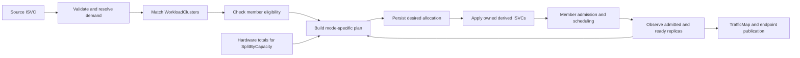

# OEP-0018.4: Cluster affinity and replica allocation for placement

> Implementation update: the Legacy placement compatibility window is closed.
> [Legacy retirement](#legacy-retirement) supersedes the compatibility behavior
> described below; it requires migration before the schema or controllers change.

**Implementation status, 2026-09-29.** Single keeps
its admission race, overlapping weighted terms add, capacity means total
eligible hardware, and static Split preserves ratios during an admission
shortfall. Cluster changes trigger bounded, gradual rebalancing. The confirmed
implementation contracts require OMENative members, nominal whole-replica
capacity, and a derived surge allowance of one full desired allocation that
pauses new rollout and autoscaler growth during moves. General autoscaling redesign remains deferred.
Outstanding review and operational decisions are in
[Open Questions](#open-questions); this status does not claim deployment or
production graduation.

<!-- toc -->
- [Summary](#summary)
- [Motivation](#motivation)
  - [Current design and implementation](#current-design-and-implementation)
  - [Goals](#goals)
  - [Non-Goals](#non-goals)
- [Proposal](#proposal)
  - [Terms and Kubernetes correspondence](#terms-and-kubernetes-correspondence)
  - [API and recipes](#api-and-recipes)
  - [Affinity matching](#affinity-matching)
  - [Weights and allocation](#weights-and-allocation)
  - [Replica counts and autoscaling](#replica-counts-and-autoscaling)
  - [Supported member backends](#supported-member-backends)
  - [Capacity contract](#capacity-contract)
- [Design Details](#design-details)
  - [Scheduling and reconciliation](#scheduling-and-reconciliation)
  - [Placement lifetime](#placement-lifetime)
  - [Status and routing](#status-and-routing)
  - [Validation](#validation)
  - [Implementation sequence](#implementation-sequence)
  - [Migration](#migration)
- [Test Plan](#test-plan)
- [Graduation Criteria](#graduation-criteria)
- [Drawbacks](#drawbacks)
- [Alternatives](#alternatives)
- [Open Questions](#open-questions)
<!-- /toc -->

## Summary

The legacy placement API cannot express an exact even or weighted replica split.
Its selector strings also combine labels with a synthetic `metadata.name` label,
and omitting both selectors prevents placement altogether. This OEP replaces
those selectors with `clusterAffinity`, makes an omitted affinity unconstrained,
and separates two allocation contracts:

- `Split` assigns exact integer replica targets using equal or authored weights.
- `SplitByCapacity` assigns targets in proportion to each matching cluster's
  total eligible hardware capacity, without subtracting usage or quota.

`Single` keeps the existing fan-out admission race. `All` continues to clone the
full service onto every eligible cluster. Clusters are always identified by
`WorkloadCluster.metadata.name` and selected using that object's labels and name.

The explicit `spec.placement.policy: ClusterAffinity` opt-in changes parts of
OEP-0018.3's API and Split semantics. Without it, the Legacy policy retains
selector strings, annotation precedence, mode defaults, and admission-driven
Packed/spread allocation through controller and CRD upgrades. It also
relaxes OEP-0018/0018.1's prohibition on capacity reads **for SplitByCapacity**.
Member admission remains authoritative: an allocation is desired state, not a
reservation or proof that pods can run. A manual migration is specified below.

## Motivation

A service owner asking for 10 replicas across three clusters should be able to
ask for targets `4,3,3`. The current balanced path requests `4,4,4`. An owner
asking for weights `3,3,2,1` should get `6,6,4,2` for 18 replicas, independently
of which cluster happens to admit first. Neither contract is expressible today.

Hardware-proportional allocation is a separate intent. For example, clusters
with total eligible capacities `12,6,0` should receive shares `2/3,1/3,0`.
Whether their existing workloads or quotas leave room for those targets is a
separate admission decision. A fixed ratio and a hardware-derived ratio should
not be confused with the current admission-driven fill behavior.

### Current design and implementation

This section records the design baseline audited on 2026-09-24. The proposal
and implementation contracts below describe its replacement.

The following is a source audit as of 2026-09-24. Older prose contains historical
API shapes and unfinished plans; its status label alone is insufficient evidence
that every described behavior shipped.

| Design record | Contribution | Current evidence and limits |
|---|---|---|
| [0018](../0018-multi-cluster-placement/README.md) | Source ISVC on a control plane; derived ISVCs on members; Single admission race; ownership and GC | `reconcileSingle`, `DeriveISVC`, and origin-guarded apply/delete implement this. A winner needs at least one admitted instance of **each declared component**, not all requested replicas. Near-simultaneous admissions can briefly run on multiple clusters. |
| [0018.1](../0018.1-multicluster-scaleout/README.md) | Fractional admission, whole-gang placement, per-home accounting | `reconcileSplit` observes member InferenceReplica status and allocates from admitted counts. Historical `scaleOut`, `homes[]`, and `spec.replicas` examples are not the shipped API. |
| [0018.2](../0018.2-multi-cluster-performance/README.md) | Connection caching, bounded calls, watch funnel, dispatcher, endpoint publisher | Cache and funnel are wired when enabled in `cmd/manager/multicluster.go`; `dispatcher.go` implements AllAtOnce and Incremental. Some sections still call these planned. Keep these mechanisms. |
| [0018.3](../0018.3-placement-modes/README.md) | Typed `Single`, `All`, `Split`; selectors; common candidate status | All three modes ship despite the README's provisional opening. `placement_types.go` and the controller switch are authoritative. |

Relevant implementation details:

1. [`placement_types.go`](../../pkg/apis/ome/v1beta1/placement_types.go) exposes
   `requirements`, `clusterSelector`, `split.{replicas,spread,minReplicasPerCluster,maxReplicasPerCluster}`,
   and the deprecated routing alias `capacityFactors`.
2. [`match.go`](../../pkg/controller/v1beta1/placement/match.go) ANDs the two
   selector strings and matches Ready WorkloadClusters. A present placement
   block takes precedence over the legacy annotations as a whole. No selector
   means no candidates, including for `{mode: Single}`. The matcher injects the
   real name as a synthetic label, overriding any label named `metadata.name`.
3. [`controller.go`](../../pkg/controller/v1beta1/placement/controller.go)'s
   `splitApportion` defaults to Packed: over-request the remaining deficit,
   observe admissions, then trim in candidate order. Balanced always requests
   `ceil(N / candidateCount)` on every candidate, so it can exceed N and does
   not redistribute a capacity-constrained share.
4. [`derive.go`](../../pkg/controller/v1beta1/placement/derive.go)'s
   `setDerivedReplicas` writes the assigned floor to Engine and Decoder in a
   1:1 ratio. Router is not split. A per-cluster ceiling overrides maxReplicas;
   otherwise each home retains the source maximum, raised if needed for its
   floor. This is not a fleet-wide maximum.
5. [`inference_service_status.go`](../../pkg/apis/ome/v1beta1/inference_service_status.go)
   exposes `status.placement.candidates[]` with admitted/ready counts. It does
   not persist requested counts, effective affinity weights, or the shortfall.
   A Split placement can report `Placed` after admitting only part of its floor.
6. [`workloadcluster_types.go`](../../pkg/apis/ome/v1beta1/workloadcluster_types.go)
   has connection-health status only. Quota's
   [`capacity.Sum`](../../pkg/quota/capacity/capacity.go) sums allocatable
   accelerators on Ready, uncordoned nodes by flavor; it neither subtracts pod
   requests nor proves a workload's topology fits. Its result is not free
   capacity for an ISVC.
7. [OEP-0025](../0025-multi-cluster-routing/README.md) and
   [`placement/routing`](../../pkg/controller/v1beta1/placement/routing)
   own traffic weights. Their reported serving capacity measures already
   deployed service capacity; it cannot size a placement on an empty cluster.

The original OEPs require Kueue gating. The current derivation leaves queue
labels unset when no queue resolves, and manager wiring logs that quota is then
bypassed. This proposal must validate that prerequisite where it relies on
admission; a Ready WorkloadCluster alone does not establish it.

### Goals

1. Make cluster selection a structured, validated API with Kubernetes-style
   selector terms and explicit object-field matching.
2. Support all five recipes below, with deterministic integer allocation.
3. Preserve Single's admission race and All's full per-home replica policy.
4. Define capacity, pending replicas, overlapping weights, zero targets, and
   rescheduling precisely enough that two implementations agree.
5. Keep placement intent separate from quota enforcement and traffic routing.
6. Provide an auditable migration, including users whose old behavior has no
   exact equivalent.

### Non-Goals

- Replacing member kube-scheduler, OME's gang scheduler, or Kueue; global quota
  borrowing, preemption, and fairness remain outside this proposal.
- Splitting a gang across clusters, independent Engine/Decoder placement, or
  introducing cross-cluster prefill/decode communication.
- Soft cluster preferences for Single, cluster taints/tolerations, topology
  spread constraints, or a general scheduler plugin API.
- Apportioning a global autoscaling ceiling or computing fleet demand from
  traffic. These decisions belong to a future autoscaling OEP; local autoscaling
  above a Split allocation requires an explicit per-cluster ceiling.
- Supporting Packed allocation within ClusterAffinity or silently translating
  old manifests at runtime. Legacy remains a separate compatibility contract.

## Proposal

### Terms and Kubernetes correspondence

A **source** is the user-authored ISVC on the control plane. A **derived ISVC**
is its owned copy on a workload cluster. A **home** is a cluster with an admitted
copy. A **replica unit** is one complete Engine instance and, when present, one
complete Decoder instance; each instance can itself contain an indivisible
multi-pod gang. Router remains shared within each home.

The **matched set M** contains registered WorkloadClusters satisfying affinity.
The **eligible set E** is the subset passing connection and member preflight
checks. Keeping these sets distinct lets status explain a requested cluster
that is temporarily unreachable without pretending it stopped matching.

| Kubernetes scheduling primitive | OME correspondence |
|---|---|
| Pod, Node | Source ISVC, WorkloadCluster |
| Node labels and `metadata.name` | WorkloadCluster labels and `metadata.name` |
| Required node-affinity terms | OR of cluster-affinity terms; requirements inside a term are ANDed |
| Filter before scoring/binding | Resolve M, run eligibility checks, then choose race targets or replica allocations |
| Sum of matching preferred-affinity weights | Sum of matching Split term weights, with OME interpreting the result as a replica ratio |
| Binding versus actual pod readiness | Requested per-home allocation versus member admission and serving readiness |
| Scheduling queue and event-driven retries | Pending source/allocations requeued on member, policy, capacity, and source changes |

This is a correspondence, not wire compatibility with `NodeAffinity`. Kubernetes
preferred affinity affects ranking; it does not promise proportional replica
counts. OME's weighted terms **also constrain eligibility**, because every home
must match at least one term. Kubernetes preferred terms alone do not do that.
Single deliberately retains distributed admission rather than adopting
kube-scheduler's choose-one-then-bind execution.

Reference behavior was checked against Kubernetes v1.35.8's
[node-affinity helper](https://github.com/kubernetes/kubernetes/blob/v1.35.8/staging/src/k8s.io/component-helpers/scheduling/corev1/nodeaffinity/nodeaffinity.go).
The [scheduling framework](https://kubernetes.io/docs/concepts/scheduling-eviction/scheduling-framework/)
provides the separation of filtering, scoring, and binding; this OEP does not
claim distributed member writes are an atomic Kubernetes Binding.

### API and recipes

`spec.placement.policy: ClusterAffinity` explicitly selects the new contract.
Omitting `policy`, or setting it to `Legacy`, retains the existing contract.
The `clusterAffinity` field selects clusters and, in Split mode, assigns
replica weights. The existing `mode` field supplies the placement context:

```yaml
spec:
  placement:
    policy: ClusterAffinity
    mode: Split                  # Single | All | Split | SplitByCapacity
    clusterAffinity:             # optional, atomic list of selector terms
    - weight: 3                  # optional; permitted only in Split
      matchExpressions:          # WorkloadCluster labels
      - key: region
        operator: In
        values: [west]
      matchFields:               # WorkloadCluster object fields
      - key: metadata.name
        operator: In
        values: [cluster-a, cluster-b]
    - weight: 1                  # optional; permitted only in Split
      matchExpressions:          # WorkloadCluster labels
      - key: region
        operator: NotIn
        values: [west]
```

This fragment highlights the new affinity API. Existing replica-count and
local-ceiling controls are described in
[Replica counts and autoscaling](#replica-counts-and-autoscaling). `mode` is
required for ClusterAffinity. Legacy retains its implicit Single mode.
Each Split recipe below assumes a fleet floor N=18 unless stated otherwise.
Targets describe the assigned floor and default maximum. An explicit local
ceiling permits autoscaling above that allocation.

**Recipe 1: one cluster, no affinity required.**

```yaml
placement:
  policy: ClusterAffinity
  mode: Single
```

All eligible registered clusters may participate in the existing admission race.
An affinity may narrow that set. No term may carry a weight in Single.

**Recipe 2: full service on every matching cluster.**

```yaml
placement:
  policy: ClusterAffinity
  mode: All
  clusterAffinity:
  - matchFields:
    - key: metadata.name
      operator: In
      values: [cluster-a, cluster-b, cluster-c]
```

Each eligible cluster receives the source's complete replica policy. With a
source floor of 18, the desired fleet floor is 54, not 18. Unreachable or
quota-blocked matches remain pending; healthy homes continue serving. A weight
is an admission error, not an ignored field.

**Recipe 3.1: even split.**

```yaml
placement:
  policy: ClusterAffinity
  mode: Split
  clusterAffinity:
  - matchFields:
    - key: metadata.name
      operator: In
      values: [cluster-a, cluster-b, cluster-c]
```

18 replicas produce `6,6,6`; 10 produce `4,3,3` in lexical cluster-name order.

**Recipe 3.2: weighted split.**

```yaml
placement:
  policy: ClusterAffinity
  mode: Split
  clusterAffinity:
  - weight: 3
    matchFields:
    - key: metadata.name
      operator: In
      values: [cluster-a, cluster-b]
  - weight: 2
    matchFields:
    - key: metadata.name
      operator: In
      values: [cluster-c]
  - weight: 1
    matchFields:
    - key: metadata.name
      operator: In
      values: [cluster-d]
```

Weights apply **per matching cluster**. The denominator is `3+3+2+1=9`, giving
shares `3/9,3/9,2/9,1/9`. Targets for 18 replicas are `6,6,4,2`; targets for 10
are `4,3,2,1`. Affinity list order does not confer priority.

**Recipe 4: split by schedulable capacity.**

```yaml
placement:
  policy: ClusterAffinity
  mode: SplitByCapacity
  clusterAffinity:
  - matchFields:
    - key: metadata.name
      operator: In
      values: [cluster-a, cluster-b, cluster-c]
```

For a floor of 12 replicas and total eligible hardware capacities equivalent
to `8,4,0` replicas, targets are `8,4,0`. A floor of 15 yields `10,5,0`: capacity
defines the **ratio**, not an admission cap. Replicas that cannot fit remain
pending under member scheduling/quota. Authored weights are invalid in this
mode; otherwise two competing sources would define the distribution.

### Affinity matching

1. **Omitted affinity imposes no cluster restriction**, in all four modes.
   Explicit `clusterAffinity: []`, null, and empty terms are rejected. This
   distinguishes omission from malformed intent and avoids an empty-term typo
   widening placement to the fleet.
2. Terms are ORed. All `matchExpressions` and `matchFields` requirements in one
   term are ANDed. A cluster that matches two terms remains one cluster.
3. `matchExpressions` reads actual WorkloadCluster labels. It supports `In`,
   `NotIn`, `Exists`, `DoesNotExist`, `Gt`, and `Lt`, using Kubernetes node-label
   selector semantics, including the treatment of absent keys for `NotIn`.
4. `matchFields` supports **only `metadata.name`**, with `In` and `NotIn` and
   nonempty lists of valid WorkloadCluster names. Matching reads the real object
   name, independently of labels. For example, a label `metadata.name: forged`
   cannot make a WorkloadCluster named `cluster-a` pass a name match for `forged`.
   A label expression with that key still matches the real label.
5. Multi-value field requirements are an intentional extension: Kubernetes'
   node-affinity helper requires exactly one value for field `In`/`NotIn`.
   Implement membership against the name directly; do not pass this API
   unchanged to that helper. Label requirements can reuse Kubernetes parsing.
6. Affinity never grants access or bypasses model/runtime, policy, queue, or
   member-capability checks. WorkloadCluster labels are operator-maintained
   selection metadata; actual member readiness/admission remains separate.

Names in a selector need not exist when the source is created. Only registered
WorkloadClusters enter M; an unmatched name does not create a phantom target.
Report zero-match terms so operators can distinguish an inventory typo from a
member that exists but cannot admit work.

### Weights and allocation

With no explicit weight anywhere, Split is **unweighted**: every distinct
matched cluster has weight 1, even if it matches multiple terms. This preserves
Recipe 3.1 when two selectors happen to overlap.

If any term has an explicit weight, Split is **weighted**. Omitted weights in
other terms are 1; each cluster's effective weight is the sum of all matching
term weights. A cluster matching a weight-3 region term and a weight-2 name term
has weight 5. This additive overlap rule is confirmed. Duplicate terms have the
same additive effect and should be visible in the normalized plan.

Preserve omitted versus explicit weight in the API type; do not apply a stored
weight default. Otherwise admission defaulting would turn unweighted overlapping
selectors into weighted allocation and change their meaning.

Term weights are positive integers with no upper bound. They are replica
ratios, not a scheduling score, so Kubernetes' 1..100 preferred-term range does
not apply: a cap that low cannot express shares counted in accelerator units
without rounding whole replicas between clusters. Weight 0 is rejected; exclude
a cluster with affinity instead. Effective sums are int64, and arithmetic uses
checked wide integers.

For a fixed count N and effective weights w over M, let W be their sum:

1. Assign `floor(N * w[c] / W)` to each cluster.
2. Assign the remaining replicas by descending fractional remainder.
3. Break equal remainders by ascending WorkloadCluster name.

Use integer quotient/remainder arithmetic, not floating point. For nonempty M,
targets sum to **exactly N**. A target can be zero; for two replicas across three
equal clusters the targets are `1,1,0`. No minimum home count is promised.

**Confirmed shortfall rule:** static Split computes over M, so a matching cluster
that is temporarily unready or cannot admit its share keeps that desired share.
OME reports a shortfall and retries; it does not change the ratio by spilling to
other homes. Removing a WorkloadCluster from the registry or changing affinity
changes M and therefore the plan. Exact ratios trade availability for fidelity
to the placement request. The guarantee is about assigned floors, not actual
admitted or autoscaled counts.

SplitByCapacity uses the same integer apportionment with hardware capacity
weights C over M. For positive total capacity, targets sum to N even if N
exceeds that capacity. Known zero-capacity clusters receive zero; all-zero
capacity leaves N unassigned. A quota shortfall never changes C or causes
spillover. Missing capacity is unknown, not zero; the handling is defined below.

### Replica counts and autoscaling

**Confirmed scope decision: defer autoscaling redesign.** This OEP allocates
the fleet's requested **floor**, using the existing source of N:
`placement.split.replicas` when set, otherwise the explicitly declared
`engine.minReplicas`. If neither provides a positive count, report
`ReplicaCountUnresolved`; do not invent a floor.

Retain `split.replicas` with its current floor semantics. In both Split modes,
each derived Engine and Decoder defaults to `minReplicas = maxReplicas =` its
current allocation. Copying the source maximum to every home would multiply
the available autoscaling budget: a source with bounds `20/20` split equally
across two homes must produce `10/10` on each home. An omitted source maximum
also becomes the assigned count, so runtime inheritance cannot widen it.

`split.maxReplicasPerCluster` remains an explicit optional local autoscaling
ceiling. When set, the member maximum is the greater of that ceiling and its
current allocation, so a retained allocation stays valid during a bounded
reduction. Explicit local ceilings can change the observed ratio and total
above N; they do not promise a fleet-wide maximum. Without that override,
changing N is how the owner changes the steady-state replica count.
AutoscalerPolicy preflight accepts policies that consume these member maxima without
requiring an explicit ceiling. Legacy placement keeps its existing ceiling rules.

Exact allocation requires one clarification to the existing cap behavior:
if a computed target exceeds a configured maxReplicasPerCluster, hold the new
plan with `TargetExceedsPerClusterLimit`. Do not silently clip or redistribute
its targets, which would violate the requested ratio or total. The owner can
change N, the limit, weights, or matched set. Existing allocations remain while
the invalid transition is reported.

The Engine/Decoder 1:1 replica unit and Router's per-home policy are the existing
implementation boundary. This OEP does not generalize independent component
ratios. Surface that limitation during validation/review rather than claiming
arbitrary component-count preservation. A future autoscaling OEP must decide
fleet-wide versus local min/max, dynamic quota clamps, and independent component
ratios together.

`split.spread` is removed because mode and weights define allocation.
`split.minReplicasPerCluster` is removed because dropping a small admitted home
would violate static ratios. There is no new anti-sliver or packing algorithm.

### Supported member backends

**Confirmed decision: require OMENative for participating homes.** OMENative
manages workload instances through InferenceReplicas, which provide the
identity, gang membership, and reservation accounting required for admission
and bounded movement. Every resolved Engine, Decoder, and Router component at
a target home must use this backend, including components inherited from the
member runtime. Checking only the source's explicit mode is insufficient.

A resolved RawDeployment, MultiNode, or other backend produces
`PlacementBackendReady=False` with `UnsupportedPlacementBackend`. Unreadable
runtime inputs produce an unknown condition. The controller withholds writes
to an unverified target and retains existing allocations. Other verified
targets may progress in Single, All, and static Split; SplitByCapacity requires
usable inputs for the entire matched set before accepting a new plan.

An ordinary workload-cluster service without multicluster intent retains its
existing deployment modes, replica policy, and rollout behavior. Membership in
a workload cluster does not opt a service into placement. Member growth guards
require derived ownership and matching placement authority; the shared CRD
and controller rollout must not impose those guards on local services.

The member protocol accepts explicit zero floors in an unpaused version 3
execution policy and preserves them through projection and external scaling.
Single can nominate a complete home with zero floors, with equal Engine/Decoder
counts when both exist. A nominee with no admitted replicas does not win:
external scaling must request replicas and member admission must succeed first.
An established winner retains its service and scaling authority when its
components return to zero. Its zero floor grants no ready or routable capacity.
Pending policy acknowledgements and scale-down cleanup retain that winner;
unreadable inventory holds placement. Positive pending demand still follows the
admission-loss grace policy.

A deliberate Single move requires positive floors for every component. If a
retained home has a zero floor, the controller reports `PositiveFloorRequired`.
After a positive floor is configured, it applies that floor to the retained
home before beginning the bounded move. Observed autoscaled replicas do not
substitute for the configured guarantee. Zero-floor race losers must be
physically absent before their contracts can leave movement accounting.

All retains a full home on each eligible member even when its resolved floor
is zero. Idle homes keep their services and external scaling authority; only
actual admission and readiness grant traffic. Initial fan-out can combine zero
and positive runtime floors, and a known home can progress independently while
another matched member's initial inventory is unknown.

With no active move, changing a retained home's floor is local scaling. Retiring
a home or adding a positive allocation after initial fan-out requires positive
component floors on participating homes. The controller reports
`PositiveFloorRequired` while those guarantees are absent. Once configured, it
applies the positive floors to retained homes before starting shared movement
accounting. A zero-floor update during a paused move holds the accepted plan.
These limits do not reject zero targets produced by Split apportionment or
change local services' zero-floor behavior.

### Capacity contract

**Confirmed decision: use total eligible hardware capacity.** In this OEP,
"schedulable capacity" means total allocatable accelerator resources on eligible
Ready, uncordoned nodes, including resources already occupied by workloads.
It does **not** mean currently free resources, unused quota, or measured GPU
utilization. Changing another service's usage or quota does not change this
service's placement weights.

For comparable hardware and replica shapes, raw accelerator totals give the
ratio directly: 96 and 48 eligible GPUs yield weights 2:1. To compare clusters
where a replica needs different hardware quantities, normalize to nominal whole
replica units before apportionment. For cluster c and each required accelerator
resource/flavor r, let A[c,r] be its total eligible allocatable hardware and
D[c,r] the resolved demand of one placement unit. Use:

`C[c] = min over required resource/flavor pairs r of floor(A[c,r] / D[c,r])`.

Combine Engine and Decoder demand when they use the same resource pool; do not
count that pool twice. Never add GPU and TPU counts as interchangeable numbers,
or double-count one node through overlapping flavors. If the runtime/demand
mapping is unresolved or resource pools cannot be attributed unambiguously,
return `CapacityUnknown` with the missing input. Supporting an alternative
normalization needs an explicit contract, not an implicit conversion factor.

Example: cluster A has 96 eligible GPUs and needs eight per replica; B has 48
and needs four. C is `12,12`, so a floor of 18 assigns `9,9`. With eight GPUs per
replica on both clusters, C is `12,6`, giving `12,6`. Neither calculation
subtracts existing pods or the team's reserved quota.

These are **hardware-derived weights, not a physical fit guarantee**. Aggregate
counts cannot prove that a gang fits one topology domain, that CPUs/memory are
available, or that Kueue will grant quota. Member schedulers retain those checks.
For example, 16 GPUs scattered across incompatible domains may produce a
positive weight for a 16-GPU gang that remains pending. Preserve the target and
report the failure to admit; do not call it a successful placement.

The confirmed adapter reads the observed, per-cluster
`AcceleratorQuota.status.capacity[].perCluster[].{allocatable,observedAt}`
reports from OEP-0024 through an internal capacity-reader interface. Use
**allocatable**, not highWaterMark, budget nominal, admitted, reserved, or
routing-reported serving capacity. Existing quota collection already excludes
NotReady/cordoned nodes and attributes configured accelerator flavors. Validate
that the report's flavor mapping is compatible with the resolved workload.
A dedicated reporter can implement the same interface later; no new capacity
field on WorkloadCluster is required by this OEP.

Capacity samples and normalized plans must record cluster identity, report
provenance/time, and the demand fingerprint used for normalization. A recreated
WorkloadCluster must not inherit the previous cluster's sample; the capacity
adapter must verify identity even if the current upstream report keys by name.
A changed runtime, accelerator flavor, or demand invalidates old normalization.

Require usable reports for the matched set before committing a new capacity
plan. Missing/stale/incompatible input holds the last-good plan and surfaces
`CapacityUnknown`; on first placement the source waits. An explicit fresh zero
participates as zero. This conservative rule avoids redistributing a healthy
home's share because its reporter temporarily disappears. Quota reporting is
therefore an operational prerequisite for this first capacity-reader adapter;
without it, other modes still work and SplitByCapacity remains pending.

Recompute capacity proportions when accepted hardware totals or source intent
change, not when usage changes. Debounce hardware changes with configured
stability/freshness policy so one transient node report does not repeatedly move
serving replicas. Configure the following fields in the `multicluster` block
of `inferenceservice-config`, or the chart's `ome.multicluster.config` values:

| Field | Contract |
|---|---|
| `placement.memberOperatorNamespace` | Explicit member namespace for runtime revisions and operator configuration; required when capacity placement is configured. |
| `placement.capacity.rootName` | Control-plane AcceleratorQuota containing the per-cluster hardware reports. |
| `placement.capacity.maxAge` | Positive maximum accepted report age. Choose it to cover the configured report heartbeat and expected delivery delay. |
| `placement.capacity.stabilityWindow` | Positive period during which changed hardware inputs must remain stable before acceptance. |
| `placement.capacity.refreshInterval` | Positive recheck interval, strictly shorter than `maxAge`. |

The capacity block is optional. When present, every field above is required;
there are no Go defaults for these inputs. When absent, SplitByCapacity waits
with an actionable condition. The manager reads this configuration at startup;
direct ConfigMap edits require a restart, and the chart rolls the manager when
its rendered configuration changes.

## Design Details

### Scheduling and reconciliation

The implementation can share one controller without confusing allocation with
execution:



For Single, the desired plan records race candidates, then commits the observed
winner. Preserve the existing admission predicate, lexical tie-breaking among
simultaneously observed winners, sticky placement, loser sweep, and failure
handling. It promises one retained home after convergence, not absence of
transient duplicate admission. New eligible clusters do not displace a healthy
winner.

For All, ensure the full source policy exists on each eligible member. Retry
missing members independently; one blocked member does not hold other homes.
For static Split, apply the assigned band only when its matched member is
eligible. For SplitByCapacity, obtain hardware reports and normalize their
weights before assigning targets. Zero-target homes are cleaned up through the
ordinary ownership and finalizer path after the transition permits removal.

An assignment is not a cross-cluster transaction. Persist a source-generation
and demand/plan identity before member writes, observe member application, and
retry partial writes idempotently. A stale plan cannot overwrite a newer one.
Owned-object and UID checks remain mandatory on every mutation.

No new reservation ledger is required for hardware weights: concurrent sources
intentionally see the same hardware totals. Each source gets its own ratios;
Kueue decides which requests it can admit. Do not subtract one source's planned
replicas from the next source's weights. Partial admission is visible as a
shortfall, not treated as a reason to alter either ratio.

### Placement lifetime

Kubernetes' `requiredDuringSchedulingIgnoredDuringExecution` does not evict a
running Pod when a Node label changes. OME reconciles a long-lived service's
placement intent, so copying that lifetime rule silently would be misleading.
**Confirmed decision:** label, membership, and accepted hardware-total changes
reconcile the target ratios with bounded, gradual movement. The service contract
is:

| Event | Action |
|---|---|
| Source changes affinity or weights | Recompute targets; move toward the new declared placement. |
| A WorkloadCluster label changes or registry membership changes | Recompute M. All and static Split converge to the new membership; Single keeps its winner only while still matching. |
| Transient connection failure | Re-read the member within the reconcile as `placement.memberReadRetry` allows. If reads still fail, mark the observation unknown and preserve owned allocations. The home keeps its last ready count for `placement.observationGrace`, then loses it. Do not count a read error as freed capacity. |
| Static Split member cannot admit its share | Keep the assigned share pending; preserve weights and report the deficit. |
| Other workloads start/stop, or quota changes | Hardware weights stay unchanged; admission/shortfall status may change. |
| Accepted hardware totals or membership change in SplitByCapacity | Recompute the hardware-proportional targets and converge through a bounded transition. |
| Admission loss on a still-matching member | Keep its target and report the shortfall; admission loss alone does not change either Split mode's weights. |
| Same spec and same accepted input snapshot | Produce the same plan across reconciles and restarts. |

For SplitByCapacity, proportionality applies to the accepted hardware snapshot.
Hardware additions/removals can therefore rebalance existing floors. Changes in
utilization do not rebalance them. A stable accepted snapshot and unchanged N
produce a stable plan.

For any deliberate move between healthy homes, retain the old serving replicas
until replacements are ready and routable. Then drain and reduce the old
allocation. The plan records old and new assignments separately so transient
surge is visible.

The transition allowance is one full copy of the desired allocation. A move may
occupy at most `max(original floor, desired floor) + desired floor` whole
replicas, counting existing rollout reservations and replicas whose removal is
still in progress. The allowance is derived, not configured, because a
configured count could not be chosen reliably. The limit is anchored at the
larger floor, so a move that shrinks the total gets the difference as free
headroom, and one value is inert for one move and a crawl for another. Under a
count of two, moving 12 replicas on two homes to 8 on four retires the 4
surplus replicas first and then grows both new homes in full. Moving the same 12
to four homes instead takes three grow-then-ready cycles of two.
With one copy of the desired allocation, a Split or All move grows every new
home to its target at once, and old homes shrink as replacements become ready.
`spec.placement.maxSurge` is deprecated: admission warns and the placer ignores
it. When a destination lacks capacity, its replacements stay pending and the
original homes keep serving.

Before moving replicas, the source persists the plan and waits for member
acknowledgements that new rollout surge and autoscaler-driven growth are paused.
Placement-authorized growth and physical cleanup can continue. Existing
reservations still consume the allowance; a pause does not erase them. This
coordination prevents a member's independent growth from spending capacity
already promised to the move. Releasing the pause requires a new accepted plan
revision after the allocation and cleanup have converged.

For Single, a **replacement probe** is a complete candidate home started while
the current winner continues serving. Probes share the transition allowance
with existing rollout reservations and occupied replicas. With an original
floor of two and two-replica candidates, the limit is four, so one replacement
races at a time beside a serving original. Once the original is verified
absent, its floor funds a second probe. A probe that does not fit waits; the
allowance cannot create a partial home.
For different candidate floors, each grant must fit the budget of every active
probe that could become the winner.

One admitted instance of every component selects a replacement, preserving the
Single admission predicate. Selection alone cannot retire the current winner:
the replacement must reach its complete Engine, Decoder, and Router floors and
have positive routing intent in the current source-owned `TrafficMap` for the
accepted plan. Publisher acknowledgement is independent of placement; a requested
drain requires zero weight in that table, not proof of external propagation.
The persisted serving winner changes with the request
to drain the original, or after verifying the original is absent. Unselected
probes receive no traffic. A cancelled selection that already serves retains
its route until the allocator can safely drain it. Physical cleanup
of the original and losing probes precedes release of the shared surge pause.

If the original disappears during an accepted move, verify that its derived
service, InferenceReplicas, and Pods are absent before releasing its current
allocation. Keep the original floor as the transition's budget baseline.
Cancelling that move can recreate an eligible original home from freshly
resolved policy, using the same shared allowance. Any serving replacement stays
protected until the restored home reaches every component floor and is routable.
Missing connections, failed inventory reads, and remaining resources cannot
authorize this recovery. This continues the accepted move; it does not bypass
the winner-loss grace period to start a new placement race.

Complete loss can also occur after a handoff while original-home cleanup is
still in progress. When every retained or newly registered home is physically
empty, wait the configured winner-loss grace, persist removal of the old move's
authority, then start Single's ordinary admission race using current affinity.
Any remaining service, InferenceReplica, Pod, or unknown inventory interrupts
that empty-home grace. The fresh admission race therefore cannot overlap
surviving movement resources.

A terminally failed selected replacement keeps the original winner retained
and reports `PlacementConverged=False`, reason `ReplacementFailed`. Selection
stays fixed while its configuration is repaired or the move is cancelled; this
does not introduce automatic retries of terminal failures on other clusters.

A probe waiting indefinitely for admission can monopolize a small allowance.
An optional positive `spec.placement.replacementTimeout`, valid only for Single,
bounds that wait; omission keeps the pending probe. For example, `5m` permits
rotation after five minutes without full component admission. The controller
persists the probe's start time and nomination cursor, retires an expired probe,
and waits for physical removal before reusing its allowance. A controller
restart cannot restart that timer or increase the original floor. The timeout
does not apply to a selected replacement waiting for full readiness.

A disconnected home can still be serving. Automatic replacement after an
unreachable grace period cannot promise strict global at-most-N without a
fencing mechanism. The first implementation preserves unknown allocations;
automated forced failover/fencing is not added here. Single retains its current
failure semantics rather than acquiring a new failover guarantee.

### Status and routing

Extend the existing `status.placement`, rather than introducing a second home
list. The proposed status must distinguish intent from observation:

- Plan identity and source observed generation; requested fleet floor, assigned
  total, and unassigned floor for the two Split modes. A fleet ceiling is outside
  this OEP.
- Per candidate: cluster name and UID, matching term indexes, effective Split
  weight or capacity sample provenance, assigned floor, applied plan identity,
  admitted/ready counts, and the reason a requested allocation cannot progress.
- Conditions for valid input, allocation satisfaction, and capacity freshness.
  `PlacementSatisfied=True` requires every assigned floor to be admitted and
  no unassigned floor. Serving readiness remains independent: some homes may
  serve while the placement has a shortfall. `All` can likewise serve while
  reporting that a matched home is missing.

Exact status field names are to be finalized with API review. The distinctions
are required: `Placed` plus three admitted replicas must not imply satisfaction
of an 18-replica request. Unknown observations remain unknown, not zero.

A home whose reads fail keeps its last known counts. Its ready count is the
routing weight, so it is kept only for `placement.observationGrace`, counted
from the first failed read. The candidate records that time in
`observationFailingSince`, so a controller restart neither restarts nor ends
the grace. A successful read clears it. With the grace unset, the first failed
read withdraws the ready count. A home that was already unknown but has no
stored start gets no grace, so a CRD that drops the field cannot keep a grace
running forever. During the grace the home still counts as
unknown: it does not make the source Ready, and allocation moves wait for it.
Before a read counts as failed, `placement.memberReadRetry` can repeat it
within the reconcile after a timeout, a dropped connection, throttling, or a
server error. It also repeats a read that finds no connection to a member the
controller has not yet tried to connect since it started, which happens when a
new leader starts reading before its member connections are up. A member whose
connection the controller already tried and dropped is not read again. Each
read has its own `placement.fanoutTimeout`, and the controller requeues no later
than the end of the earliest grace.

Compute satisfied floor per home as `min(assignedFloor, admittedReplicas)` using
observations belonging to the applied plan. Extra autoscaled replicas on one
home cannot cover a missing share on another. For targets `6,6,6` and admissions
`12,2,6`, the floor shortfall is four even though total admission is 20. If a
required observation is unknown, satisfaction is Unknown rather than True.

Keep `spec.routing` and the OEP-0025 TrafficMap contract. Allocation weight 3
means three shares of replicas, not HTTPRoute weight 3. Routing continues to use
admitted/ready/optional reported serving capacity, configured capacity factors,
and health policy. `SplitByCapacity` must propagate through TrafficMap's mode
enum and every consumer; an unsupported mode must not silently behave as Single.

### Validation

Admission validates syntax; reconciliation revalidates persisted objects and
resolved member/runtime-dependent constraints. The control-plane deployment
currently disables some ISVC webhook paths, so webhook-only enforcement is not
a sufficient implementation.

| Input | Rule and reason |
|---|---|
| Placement absent | Honor legacy selector annotations when present; otherwise no multi-cluster intent. Control-plane role does not imply local execution. |
| Policy omitted or Legacy | Preserve typed-over-annotation precedence, implicit Single, and no-selector/no-match semantics. Reject affinity, maxSurge, and SplitByCapacity without opt-in. |
| Policy ClusterAffinity | Require a supported explicit mode. Reject legacy fields and selector annotations, including zero-valued presence. |
| Policy removal after opt-in | Reject with CRD transition validation and webhook validation. Drain and recreate the source to return to Legacy. |
| Affinity omitted | Unconstrained matching; still subject to preflight. |
| Empty/null affinity or empty term | Reject; do not interpret a malformed restriction as the whole fleet. |
| Label requirement | Kubernetes key/operator/value validation; In/NotIn need values, Exists/DoesNotExist forbid them, Gt/Lt need one integer value. |
| Field requirement | Only metadata.name and In/NotIn with one or more valid names. Unknown fields/operators are errors. |
| Weight | Positive integer, no upper bound; allowed only in Split, including when its value is 1. |
| Split settings | Retain replicas (positive when present) and maxReplicasPerCluster (nonnegative; zero is uncapped), for both Split modes. Reject a computed target above a declared cap. |
| Legacy fields/annotations | Honor under Legacy; reject under ClusterAffinity. Never silently ignore restrictions or Packed intent. |
| Unresolved floor or capacity normalization | Hold with an actionable condition; never invent counts or a hardware conversion. |
| Empty match or no usable capacity | Valid request that waits with a reason; fleet state is not a schema error. |

Use an atomic list for affinity terms so server-side apply replaces the selector
expression as a unit. Merging an independently managed term would widen the OR
and could unexpectedly add homes. The CRD permits at most 64 affinity terms,
64 requirements in each term's expression or field list, and 64 values per
requirement. Reconciliation rejects oversized expressions rather than
truncating them. Candidate status reuses the existing per-cluster list and
grows with matched and retained homes; these expression bounds are not a fleet
size limit.

### Implementation sequence

1. **Schema and matcher.** Add the policy discriminator, new mode, and affinity term types.
   Keep the Legacy path isolated through the compatibility window. Implement one
   normalized matcher shared by reconciliation, eligibility indexing, cluster
   change handling, routing, and endpoint ownership. `IsPlacementEligible`
   becomes based on explicit placement intent, so Recipe 1 is indexed.
2. **Allocation and status.** Extract pure integer allocation, persist plans,
   and expose shortfalls. Implement exact equal/weighted floor allocation.
   Keep the confirmed Single race and All behavior.
3. **Member compatibility.** Strip the whole control-plane placement block from
   derived ISVCs, in addition to the existing routing/directive stripping.
   Members need concrete bounds and provenance. Both Split modes default the
   maximum to the current allocation; an explicit local ceiling permits growth.
   Autoscaler preflight recognizes these bounded maxima; proportional global
   autoscaling maxima remain deferred.
4. **Capacity integration.** Adapt existing quota hardware reports; implement
   normalization, identity/freshness checks, and hardware-proportional allocation.
   Report absent or incompatible data explicitly; never fall back to equal Split.
5. **Transitions and consumers.** Add bounded plan transitions, update all
   mode switches and TrafficMap schemas, and prove migration/rollback. Run
   `make manifests` and `make generate` for API changes and update SDKs/samples.

These layers are implemented across the allocator, member protocol, capacity
resolution, and placement controllers. Integration tests cover admission,
bounded movement, migration, recovery, physical gang fit, and zero-floor source
activation. Operational graduation remains open. New capacity timing inputs
and transition allowances are explicit configuration; existing controller and
transport timing fallbacks require separate compatibility review before removal.

The generated Rust client preserves placement intent, persisted allocations,
member execution policies, and TrafficMap modes. Serialization fixtures cover
ClusterAffinity intent and execution authority; API-server tests verify that
typed spec and status updates retain their raw JSON representation. CI checks
the four placement protocol clients against the generated CRDs.

### Legacy retirement

Placement requires `policy: ClusterAffinity` and an explicit supported `mode`.
The Go API, generated CRD, and Rust client omit `requirements`,
`clusterSelector`, `capacityFactors`, `split.spread`, and
`split.minReplicasPerCluster`. Routing factors belong under `spec.routing`.
The Legacy reconciler, selector precedence, Packed/spread allocation,
anti-sliver handling, and routing-factor alias are removed. Strict API field
validation rejects retired fields; clients using non-strict validation can
have unknown fields pruned, so admission is not a substitute for auditing
manifests before this upgrade.

Before deploying this schema or binary, audit every source, derived copy, and
writer, including resources outside GitOps. Every source must use the explicit
policy and mode, and every derived copy must carry matching source ownership,
`ome.io/placement-policy: ClusterAffinity`, and a valid
`ome.io/placement-execution` envelope. Remove both selector annotations. Verify
accepted plans and Ready status after migration, and compare workload identities
to detect unintended replacement. Reject retired input in GitOps validation so
subsequent promotions cannot restore it.

Origin-marked members without execution authority stop before workload writes.
Ordinary local services retain their execution behavior. Direct adoption keeps
the origin handoff: the hub may observe a member before it has stamped execution
authority, while the member controller waits for that authority. Deletion still
permits cleanup. Execution envelopes v1, v2, and v3, ownership fencing, status
recovery, and endpoint-publisher cleanup are separate contracts and remain
supported. The policy metric exposes `policy` and `mode`; selector/spread labels
and the per-cluster minimum metric are removed.

Rollback must use a ClusterAffinity-capable release. Restoring an older schema
does not restore removed restrictions or authorize a Legacy writer.

### Migration

The following procedure describes the compatibility release used before
Legacy retirement.

The field audit covers every field in the existing
[`PlacementSpec` and `SplitSpec`](../../pkg/apis/ome/v1beta1/placement_types.go):

| Existing Go field | Proposed disposition |
|---|---|
| `PlacementSpec.Mode` | Retain; add SplitByCapacity and require an explicit mode. |
| `PlacementSpec.Requirements` | Remove; express its label/name requirements in clusterAffinity. |
| `PlacementSpec.ClusterSelector` | Remove; combine its requirements with Requirements in the same affinity term to preserve AND. |
| `PlacementSpec.Split` | Retain the container for the two existing controls below. |
| `PlacementSpec.CapacityFactors` | Remove this already-deprecated alias; use spec.routing.capacityFactors. |
| `SplitSpec.Replicas` | Retain the fleet-floor override pending the replica/autoscaling follow-up. |
| `SplitSpec.Spread` | Remove; unweighted Split is even, and weights express other ratios. Packed has no equivalent. |
| `SplitSpec.MaxReplicasPerCluster` | Retain as an optional local ceiling; without it, member minimum and maximum both follow the allocation. |
| `SplitSpec.MinReplicasPerCluster` | Remove; dropping an admitted sliver would violate the requested allocation. |

The dispositions above apply to the ClusterAffinity contract. During the
compatibility window, both schemas remain available and Legacy remains fully
functional: source updates, placement, failover, Packed/spread allocation,
anti-sliver behavior, and routing-factor aliases continue. A typed placement
block still overrides selector annotations as a whole. Mode-only Legacy intent
still matches nothing. No controller restart, feature deployment, or elapsed
time opts a service into ClusterAffinity.

The new contract rejects old fields rather than translating them. Opt-in members
carry their policy separately from the stripped source placement block; backend
and execution guards must distinguish them from Legacy copies. Ordinary local
services retain their existing behavior. Removing Legacy requires a separate
migration/removal decision and an audited inventory; there is no timed cutoff.

**No automatic conversion can preserve every old Split deployment.** Packed has
no equivalent, and balanced rounding and anti-sliver behavior change. Inventory
and choose the intended recipe explicitly.

| Existing input | Manual conversion |
|---|---|
| `requirements` and `clusterSelector` | Parse both and put their combined requirements in **one term**, preserving their AND. Putting them in separate terms would change AND to OR. |
| Virtual `metadata.name` selector | Move the requirement to matchFields; all other selector keys go to matchExpressions. Convert `=`/`==` to In and `!=` to NotIn. |
| Legacy placement annotations with no placement block | Convert the effective selectors and add an explicit mode. Remove both annotations. |
| Both placement and annotations present | Convert the placement block only, matching today's precedence; remove the ignored annotations. |
| Single or All | Retain the mode and convert the selectors. Single still races; All still replicates the complete policy. |
| Split with spread=true | Choose unweighted Split; expect exact totals rather than ceil-per-cluster over-request. |
| Split with spread=false or omitted | No Packed equivalent. Choose static ratios or SplitByCapacity deliberately; capacity-proportional allocation is not Packed. |
| split.replicas | Retain as the fleet floor override; autoscaling semantics are unchanged. |
| split.maxReplicasPerCluster | Retain the local ceiling. Verify every new weighted target fits; raise the cap, reduce N, or adjust membership/weights if it does not. |
| split.minReplicasPerCluster | Removed. Integer weights can produce zero/small homes; use explicit home selection/counts or retain a manual per-cluster deployment if an anti-sliver floor is required. |
| placement.capacityFactors | Move to spec.routing.capacityFactors, preserving values. Never turn these traffic factors into replica weights. |
| Mode-only placement currently matching nothing | Remains no-match under Legacy. Affinity omission becomes unconstrained only after explicit policy opt-in. |

For example, old selectors `requirements: accelerator=gb300` and
`clusterSelector: metadata.name in (cluster-a,cluster-b)` become:

```yaml
placement:
  policy: ClusterAffinity
  mode: Single
  clusterAffinity:
  - matchExpressions:
    - key: accelerator
      operator: In
      values: [gb300]
    matchFields:
    - key: metadata.name
      operator: In
      values: [cluster-a, cluster-b]
```

A name-existence selector needs special care: metadata.name always exists.
Removing `metadata.name` Exists would leave a wildcard; DoesNotExist was an
intentional no-match. Inventory these cases rather than replacing them with an
empty affinity. Reject contradictory deprecated/new routing factor fields and
resolve the discrepancy before migration.

**Upgrade procedure:**

1. Ship the schema and both policy implementations together. Retain old fields
   in the schema. Upgrading existing sources must not change their selected
   policy, candidate set, derived workloads, or ability to accept updates.
2. Upgrade member controllers before enabling ClusterAffinity. Keep every old
   hub placement/routing writer stopped before any source opts in: an old binary
   cannot interpret the new policy discriminator.
3. Inventory each source before opting it in. Export its manifest, status,
   allocations, and routing configuration. Choose a new recipe explicitly,
   including rounding and anti-sliver changes. Packed has no equivalent.
4. Update that source atomically: set `policy: ClusterAffinity`, specify `mode`,
   convert selectors, and remove legacy fields and annotations. Verify the
   stored object, accepted plan, admitted/ready counts, and published routing.
   Existing identity, observation, and surge checks may hold adoption or moves;
   opting in does not grant permission to discard serving capacity.
5. Maintain Legacy until its removal is explicitly approved after inventory and
   migration. Never prune legacy restrictions before all legacy writers and
   manifests have been retired.

**Rollback:** Before any opt-in, exporting and restoring the matching legacy
schema and binary is sufficient; existing services still use the old contract.
After opt-in, do not run a legacy binary against a ClusterAffinity source. Drain
and recreate it with a legacy manifest and compatible allocations, or restore a
coordinated fleet snapshot during maintenance. CRD transition validation blocks
removing the opt-in on a live source, including on hubs without an ISVC webhook.
Reverting compatibility support itself removes Legacy reconciliation and must
not be deployed while legacy sources remain.

## Test Plan

Implementation tests must verify behavior rather than only mirror the allocator:

- Matcher conformance against Kubernetes label requirements; AND/OR composition;
  multi-name fields; spoofed name labels; absent keys; rejected empty terms;
  invalid weights in other modes. Exercise a mode-only source through indexing,
  cluster events, routing, and endpoint eligibility, not just the matcher.
- Allocation invariants across counts/weights: exact floor total, whole replicas,
  deterministic ties, order independence, additive weighted overlap, unweighted
  deduplication, zero targets, overflow, and local-cap conflicts. Pin the five
  recipes, including 10 across three clusters and weights `3,3,2,1` across four.
- Static shortfall: `6,6,6` with one home admitting only two must retain its
  requested targets and report four missing admissions. The hardware mode must
  likewise retain its ratio when usage/quota changes without a hardware change.
- Capacity adapter: Ready/cordoned nodes, allocatable versus highWaterMark,
  ambiguous flavors, heterogeneous resource normalization, shared Engine/Decoder
  pools, zero versus missing reports, stale samples, cluster recreation, and
  demand-fingerprint invalidation. Deploying a workload must not reduce its own
  hardware-derived weight.
- Concurrent sources and restart: the same hardware supports the same ratios;
  member quota gates aggregate admission; persisted plans retry partial writes
  without lost ownership or falsely reporting request satisfaction.
- Real member admission and scheduling: complete gangs stay together; hardware
  totals do not override physical fit; autoscalers retain their current local
  bounds. Envtest alone cannot prove gang execution or physical scheduling.
- Migration fixtures: AND-preserving selector conversion, old annotation
  precedence, bridge-schema rejection before pruning, old/new writer exclusion,
  derived adoption, bounded transition, and rollback without field loss.
- Routing regression: the new mode survives schema/projection; only ready,
  admitted, health-qualified serving capacity receives traffic; placement weights
  never bypass the OEP-0025 routing contract.

The implementation's real-cluster tests run member OME controllers, Kueue, and
the OME scheduler with synthetic accelerator resources and serving fixtures.
They verify complete gang admission, topology-dependent physical scheduling,
bounded moves, and retained targets through failures. They do not establish
accelerator-device execution or model performance. Migration fixtures verify
bridge-schema and webhook behavior, writer exclusion, and lossless rollback
storage; they do not claim a rolling upgrade between deployed operator binaries.

Documentation changes validate metadata, local links, embedded YAML, example
arithmetic, and the generated OEP status index.

## Graduation Criteria

- **Implementable:** finalize normalized hardware capacity inputs, status/list
  bounds, and the mechanics of bounded rebalance and migration.
- **Alpha:** the five recipes and shortfall reporting pass behavioral tests;
  SplitByCapacity consumes real hardware reports; migration and rollback have
  been exercised. Autoscaling redesign is not an Alpha dependency.
- **Beta:** concurrent placement, restart, real multi-cluster gang scheduling,
  bounded transitions, and routing regressions pass under member/report failures.
- **Stable:** fleet measurements establish configured freshness/stability
  windows and transition durations, with runbooks for missing reports, quota shortfalls, and
  workloads needing removed Packed/anti-sliver behavior.

## Drawbacks

Both authored and hardware-derived ratios can leave replicas pending in a full
cluster while another has free capacity. That follows the confirmed ratio and
hardware-total contracts. This OEP does not optimize current utilization.

Kubernetes-shaped fields with OME-specific weighted allocation and multi-value
name matching need explicit documentation. Continuous affinity enforcement and
hardware reweighting can move serving replicas; bounded movement needs spare
resources or a maintenance window. Capacity collection becomes a dependency
for SplitByCapacity, even though the other modes need no hardware reports.

Explicit local autoscaling ceilings can change running ratios and do not impose
a global maximum. Migration also remains real work for Packed
placements and deployments relying on sliver removal.

## Alternatives

1. **Keep strings and add a weights-by-cluster map.** Small implementation, but
   it retains the synthetic-name convention and cannot express weighted label
   groups without copying cluster inventory into every source. Prefer structured
   terms because labels and object identity are the requested selection surface.
2. **Copy required/preferred NodeAffinity verbatim.** Familiar Kubernetes API,
   but preferred terms select a better node rather than allocate a replica
   fraction, and field matching rejects the requested multi-name examples.
   Prefer the smaller explicit clusterAffinity contract, documenting differences.
3. **Always use the admission race for Split.** Reuses existing machinery but
   cannot guarantee exact equal/weighted targets. Keep the race for Single;
   use explicit allocations for the two Split modes.
4. **Weight by free resources or unused quota.** Improves instantaneous fit,
   but needs reservation accounting and can change ratios whenever another
   workload runs. Rejected for this API: the owner chose total eligible hardware.
   Hardware totals are simpler and more stable but can leave an admission deficit.
5. **Use routing capacity factors as replica weights.** Reuses an existing map,
   but it confuses relative serving throughput with hardware inventory and
   scheduling intent. Keep routing and placement weights separate.
6. **Combine legacy knobs with affinity.** Creates interactions between weights,
   packing, per-home floors/caps, and capacity redistribution. Keep Legacy
   isolated; its knobs cannot be mixed into the ClusterAffinity contract.

## Open Questions

Confirmed in the design discussion:

- Single keeps its existing admission race.
- Overlapping weighted terms add their weights.
- SplitByCapacity uses total eligible hardware, without subtracting usage/quota.
- Static Split preserves target ratios and reports admission shortfalls.
- Autoscaling changes are deferred to a future autoscaling OEP.
- Label, membership, and accepted hardware-total changes trigger automatic
  rebalancing with bounded, gradual movement.
- Capacity normalization uses nominal whole-replica equivalents from resolved
  Engine/Decoder demand, with verified resource/flavor and cluster provenance.
- Participating homes require OMENative for every resolved component. Local
  services retain their existing backend choices.
- Explicit per-service surge is shared with existing rollout occupancy and
  reservations. Participating members pause new rollout and autoscaler growth
  during moves, while allowing placement growth and cleanup.

Remaining work:

**Operational graduation:** calibrate report freshness, stability windows,
and movement allowances against fleet measurements. Choose a compatibility
window for removing the bridge schema and rehearse deployed-binary upgrades
and rollback. Owner: deployment and placement owners.

Next action: validate deployment-specific settings and migration procedures.
Local tests do not establish a production soak or complete operational graduation.
