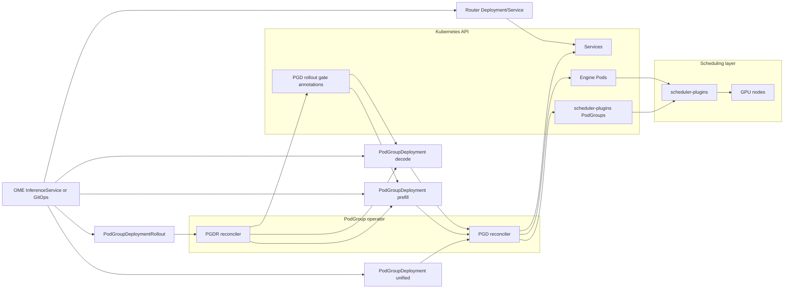

# RFC: PodGroup Operator For Inference Engine Deployments

Status: Implemented draft

## Summary

This RFC describes the current PodGroup operator direction as the Kubernetes
control plane for inference engine PodGroup lifecycle. The operator supports
both unified engines and prefill/decode disaggregated engines while preserving
the properties we care about most: gang scheduling, topology-aware groups,
group-level rollout, group restart, and observable rollout coordination.

RBG solves a similar problem with a broader role-based API. It models an
inference service as one multi-role object, supports role templates,
dependencies, coordinated policy, leader/worker patterns, service discovery,
runtime profiles, scaling adapters, and optional gang scheduling through
scheduler-plugins or Volcano. The current PodGroup operator direction is more
narrow and more explicit: `PodGroupDeployment` remains the workload primitive,
and `PodGroupDeploymentRollout` owns and coordinates role-specific workload
primitives only where cross-role ordering is required.

## Context

Inference deployments have two common shapes:

- Unified, also called aggregated or non-PD: one engine role handles the whole
  request path.
- Disaggregated prefill/decode: separate prefill and decode engines form one
  logical serving deployment.

The same deployment also has two common topology shapes:

- Single-node groups, where each engine replica maps to one pod on one GPU
  node.
- Multi-node groups, where each engine replica spans multiple pods and must
  be scheduled as an all-or-nothing unit.

RBG packages these ideas behind `RoleBasedGroup`, with roles such as router,
prefill, and decode. It can express richer application graphs, but it also
brings a larger API surface and more policy machinery. For our current target,
the CPU router is out of scope. The important GPU-facing primitives are the
engine groups and the coordinated rollout between prefill and decode.

## Problem

Plain Kubernetes Deployments and StatefulSets do not give us the behavior we
need for GPU inference engines:

- A multi-node engine replica must gang schedule all pods in the group.
- A group must roll out together, because mixed versions inside one tensor
  parallel group are not meaningful.
- For disaggregated serving, prefill and decode must not roll independently.
- Percentage-based rollout must preserve the prefill/decode ratio. For example,
  9 prefill groups and 3 decode groups at 20% unavailable should roll as
  3 prefill groups with 1 decode group per wave, not 1 and 1.
- Rollout ordering matters. During an update from v1 to v2, v1 prefill should
  terminate before v1 decode, and v2 decode should become available before v2
  prefill.

RBG's broader feature set is useful as a reference, but copying it directly
would make the PodGroup operator responsible for routers, arbitrary role
graphs, role templates, scaling adapters, and runtime injection before those
are required.

## Goals

- Support unified engines with a single `PodGroupDeployment`.
- Support disaggregated prefill/decode engines with one
  `PodGroupDeploymentRollout` object that generates two role-specific
  `PodGroupDeployment` children.
- Preserve PGD behavior for gang scheduling, topology-aware placement,
  group rollout, group restart, and service generation.
- Coordinate prefill/decode rollouts with clear dependency ordering and
  ratio-preserving waves.
- Use the same controller binary and API family, with separate reconcilers for
  workload management and rollout coordination.
- Keep the API small enough that the rollout behavior is easy to reason about
  and debug with `kubectl get`.

## Non-Goals

- Managing the CPU router lifecycle.
- Replacing RBG as a general multi-role orchestration framework.
- Supporting arbitrary role graphs in the first version.
- Supporting RBG-style role templates, runtime profiles, or scaling adapters.
- Supporting arbitrary in-place Pod spec mutation. The operator supports only
  safe in-place updates for image and metadata-only diffs.
- Supporting Volcano-specific scheduling behavior.
- Solving traffic routing, draining, or request-level compatibility.
- Supporting automatic rollback or advanced failure remediation.

## Proposed Architecture

The operator keeps two top-level resources.

`PodGroupDeployment` is the workload resource. It owns Pods, Services, and
scheduler-plugins `PodGroup` objects. Each PGD represents one engine role or a
unified engine. Its group size and topology key describe the physical placement
unit, and its rollout strategy describes how many groups can be unavailable or
surged during a normal PGD rollout.

`PodGroupDeploymentRollout` is the optional coordination resource. It owns the
generated member PGDs for `disagg` and `unified` modes, but it does not own
pods directly. Instead, it writes rollout gate annotations that tell each PGD
which group ordinals are allowed to delete old instances, create new instances,
or update in place during the current wave.

This separation is the main architectural difference from RBG. RBG starts from
one logical `RoleBasedGroup` object that expands into roles and role instances.
The PodGroup operator starts from independently debuggable PGDs and adds a thin
coordination layer only when needed. OME `InferenceService`, Helm, or GitOps
remain responsible for composing the router, model PVCs, and app-level
configuration around PGDR.

## Architecture Diagram



The unified path can use one standalone PGD or a `mode: unified` PGDR that
generates one child PGD. The disaggregated path uses one PGDR that generates
two child PGDs. PGDR never owns pods directly; it owns child PGDs and publishes
rollout gates. PGD remains the only controller that creates Pods, Services, and
scheduler `PodGroup` objects. The router discovers PGD pods or Services by
labels and is intentionally outside this operator.

## Why The Same Operator

PGD and PGDR live in the same operator binary.

The two resources share one lifecycle model: PGDR reads PGD status, writes PGD
rollout gates, and relies on PGD revision and group availability semantics.
Splitting them into separate operators would create an artificial API boundary
in the hottest path of the rollout logic. It would also make version skew
between the workload reconciler and coordinator a real operational risk.

Separate reconcilers inside one binary give us the useful separation without
the deployment and compatibility cost. A new operator would make sense only if
the coordinator becomes a general cross-workload policy controller that must
coordinate resources outside this API family.

## API Shape

Unified engines should use the simplest path:

```yaml
apiVersion: podgroup.meta.com/v1alpha1
kind: PodGroupDeployment
metadata:
  name: qwen-engine-unified
spec:
  groups: 24
  replicasPerGroup: 1
  topologyKey: kubernetes.io/hostname
  serviceTargetOrdinal: 0
  scheduleTimeoutSeconds: 60
  schedulerName: default-scheduler
  updateStrategy:
    type: RecreatePod
    rollingUpdate:
      maxUnavailablePercent: 20
      maxSurge: 0
  template:
    spec:
      containers:
      - name: engine
        image: example/inference:v1
```

Disaggregated engines use convention-based PGDR members:

```yaml
apiVersion: podgroup.meta.com/v1alpha1
kind: PodGroupDeploymentRollout
metadata:
  name: qwen-engine
spec:
  mode: disagg
  strategy:
    maxUnavailablePercent: 20
    maxSkew: 0
  prefill:
    groups: 40
    replicasPerGroup: 1
    template:
      spec:
        containers:
        - name: prefill
          image: example/prefill:v1
  decode:
    groups: 20
    replicasPerGroup: 1
    template:
      spec:
        containers:
        - name: decode
          image: example/decode:v1
```

For `mode: disagg`, PGDR generates and coordinates:

- `<name>-prefill`
- `<name>-decode`

For `mode: unified`, PGDR generates and rolls:

- `<name>-unified`

A standalone PGD is still the simplest unified path when no top-level rollout
object is needed.

## Rollout Semantics

PGD rollout defaults should be conservative for GPU workloads:

- `maxSurge: 0`
- `maxUnavailablePercent: 20`
- `progressDeadlineSeconds: 3600`

When no PGDR gates a PGD, the PGD performs its normal group-level rolling
update. It deletes old group instances and creates desired revision instances
according to its rollout strategy.

When a PGDR gates PGDs in disaggregated mode, recreate rollouts follow this
sequence for each wave:

1. `TerminatePrefill`: delete old prefill groups for the current wave.
2. `TerminateDecode`: delete old decode groups for the current wave.
3. `CreateDecode`: create new decode groups for the current wave.
4. `CreatePrefill`: create new prefill groups for the current wave.

This enforces the serving invariant we want:

- No dangling v1 prefill remains after the matching v1 decode cohort has been
  removed.
- No v2 prefill starts before the matching v2 decode cohort can process it.

The coordinator computes a shared wave plan across roles. For uneven role
counts, it chooses a common number of waves and assigns per-role ordinal
windows. With 9 prefill groups, 3 decode groups, and 20% unavailable, the
coordinator rolls 3 waves:

- wave 1: 3 prefill, 1 decode
- wave 2: 3 prefill, 1 decode
- wave 3: 3 prefill, 1 decode

That avoids the drift that would happen if each PGD independently rounded its
own percentage.

The same ratioed wave plan is used for first bringup. This matters when the
requested shape is larger than the cluster. For example, a 24 prefill / 12
decode TP4 deployment would require 36 four-GPU nodes. On a 24-node cluster,
PGDR creates ratioed waves and stops at the first wave that cannot become Ready
instead of submitting all 36 groups and letting the scheduler admit a skewed
subset.

A wave can advance only after all desired groups in that wave are Ready. A
Running `0/1` Pod does not advance traffic or let the next wave terminate old
capacity. If replacement Pods remain unready past `progressDeadlineSeconds`,
PGD deletes those unready replacement Pods so the group can be recreated and
scheduled again. If a new template revision is applied while a prior rollout is
stuck, PGDR recomputes progress against the new desired revision and starts the
new rollout from wave 0.

PGDR also gates on child observation. When it creates, updates, or deletes a
generated child PGD, it reports `currentPhase: ReconcilingChildren` and waits
for a later reconcile before using that child status for rollout decisions. If
a child PGD has `metadata.generation > status.observedGeneration`, PGDR holds
that member and reports both values in `status.members`. This prevents stale
child status from advancing a paired rollout after a spec write.

For image and metadata-only template changes, PGD can update groups in place.
PGDR coordinates that path by updating decode groups before prefill groups.
Changes to immutable or recreate-required Pod fields use the recreate sequence
above, or are rejected when the PGD strategy is `InPlaceOnly`.

PGD and PGDR use finalizers for explicit cleanup. PGD removes its managed Pods,
Services, and scheduler `PodGroup` objects before its finalizer is removed.
PGDR removes owned child PGDs before its finalizer is removed; the child PGDs
then clean up their own children.

The controller emits Kubernetes Events for rollout gate changes, child PGD
reconciliation, stale gate cleanup, blocked rollout errors, and finalizer
completion. Events are not the source of truth, but they make the same
coordination decisions visible through `kubectl describe`.

## Scheduling Semantics

Each PGD group maps to one scheduler-plugins `PodGroup`. The `PodGroup`
`minMember` is the PGD group size. This means a TP8 group spread across two
nodes still schedules as one all-or-nothing unit.

Topology is expressed directly on PGD:

- `topologyKey: kubernetes.io/hostname` for single-node groups.
- A domain key such as `ds.coreweave.com/nvlink.domain` for multi-node groups.

The pod template remains responsible for actual resource requests, node
selectors, tolerations, priority class, runtime annotations, and labels. For
GPU deployments, templates should request `nvidia.com/gpu`, request any RDMA
resources such as `rdma/ib`, select GPU nodes, and tolerate the GPU taint.
Router discovery should target PGD service-target pods or PGD Services. A
typical label selector is:

```text
app.kubernetes.io/component=decode,app.kubernetes.io/instance=<name>-decode,podgroup.meta.com/service-target=true
```

## RBG Feature Mapping

| RBG concept | PodGroup operator equivalent | Decision |
| --- | --- | --- |
| `RoleBasedGroup` | PGDR plus generated member PGDs | Keep separate PGDs for debuggability and explicit ownership. |
| Role | One PGD | Adopt. PGD is the role/workload boundary. |
| RoleInstance | One PGD group instance | Adopt conceptually. PGD owns concrete Pods and group Services. |
| `standalonePattern` | `replicasPerGroup: 1` PGD | Adopt in PGD terms. |
| `leaderWorkerPattern` | `replicasPerGroup > 1` PGD | Adopt without depending on LeaderWorkerSet. |
| Role dependencies | Fixed disagg rollout order | Narrow for now; avoid arbitrary DAGs. |
| CoordinatedPolicy | PGDR rollout gates | Adopt only rollout coordination initially. |
| `maxSkew` | Reserved PGDR field | Defer until we need more than lockstep wave progression. |
| Role templates | None | Defer. Duplication can be handled by Helm/Kustomize for now. |
| Engine runtime profiles | None | Defer until runtime injection is a real requirement. |
| Scaling adapters | None | Defer. Scaling has different safety semantics from rollout. |
| Router role | External Deployment or future resource | Out of scope for this phase. |
| Scheduler-plugins PodGroup | PGD-created PodGroups | Adopt. |
| Volcano PodGroup | None | Defer. Scheduler-plugins is the target path. |
| In-place update | PGD/PGDR in-place update path | Adopt for image and metadata-only diffs; recreate or reject unsafe diffs. |

## Feature Drift Assessment

The operator does not need source-level compatibility with RBG. The useful
comparison is capability drift: where we must stay close, where we intentionally
diverge, and where we should watch the gap.

Capabilities that should stay close to RBG:

- Unified and PD deployment shapes must both be first-class.
- Single-node and multi-node engine instances must both be natural to express.
- Gang scheduling must be part of the workload model, not a separate manual
  object users have to maintain.
- Cross-role rollout must prevent prefill and decode from drifting during
  updates.
- Status must expose the current coordination decision, not just final
  readiness counts. This includes conditions and member generation/observed
  generation when PGDR is waiting for child observation.
- Events should mirror important rollout and cleanup decisions for live
  debugging without replacing status.

Intentional divergence:

- RBG has one multi-role object. PGD/PGDR uses independently addressable
  workload objects plus an optional coordinator.
- RBG supports arbitrary role names and role graphs. PGDR intentionally supports
  only fixed `disagg` and `unified` shapes.
- RBG can model routers. The PodGroup operator keeps CPU routing outside the
  GPU group lifecycle for now.
- RBG supports both scheduler-plugins and Volcano gang scheduling. The
  PodGroup operator targets scheduler-plugins only.
- RBG supports broader in-place update paths. PGD supports image and
  metadata-only in-place updates, and keeps recreate semantics for changes that
  require Pod replacement.

Drift that may become painful later:

- Template reuse: RBG `roleTemplates` remove duplicated pod specs. If our
  examples and production manifests start repeating large templates, a PGD
  template overlay mechanism may be worth adding.
- Runtime injection: RBG `ClusterEngineRuntimeProfile` gives one place to
  attach sidecars, init containers, and volumes. If GPU runtime setup becomes
  common across deployments, we should consider a scoped equivalent.
- Scaling adapters and autoscaling policy: RBG exposes per-role scaling
  adapters. PodGroup operator intentionally leaves autoscaling decisions and
  desired prefill/decode counts to OME `InferenceService` or external
  autoscalers.
- Dependency DAGs: RBG role dependencies can express startup order for routers,
  workers, and monitors. PGDR intentionally hard-codes only the disaggregated
  rollout order. A third GPU role would force this decision back open.
- Service discovery variables: RBG injects identity and topology-oriented
  runtime variables. PGD currently relies on deterministic names, labels, and
  services. That may be enough, but it should be tested against real engine
  bootstrap commands.

## Observability

PGD and PGDR status should make the rollout understandable from `kubectl`.

PGDR status includes:

- current wave
- phase
- step
- per-member action
- per-member allowed window
- per-member ready group counts
- blocked or degraded reasons

The compact view should show the action immediately:

```text
NAME          MODE     WAVE   PHASE         ACTIONS                          AGE
qwen-engine   disagg   3      Progressing   prefill=hold,decode=create-new   6m49s
```

The wide view includes the step:

```text
NAME          MODE     WAVE   PHASE         STEP           ACTIONS                          AGE
qwen-engine   disagg   3      Progressing   CreateDecode   prefill=hold,decode=create-new   6m49s
```

This is intentionally more operational than RBG's broad status model. The
first debugging question during a rollout is "what is allowed to happen now?"

## Failure Behavior

The coordinator blocks rather than guessing when its assumptions are not met:

- If a required member PGD is missing, PGDR should report a blocked condition.
- If a member PGD has an unexpected revision state, PGDR should hold gates
  until the state is observable.
- If a wave action is incomplete, PGDR should continue publishing the same
  gates until PGD status catches up.
- If the desired template revision changes, PGDR should treat progress for the
  old revision as irrelevant and restart the rollout plan from wave 0 for the
  new revision.
- If a rollout finishes, stale gate annotations should be cleared or moved to
  an inactive state so the PGD can behave normally on future updates.

PGDR should not try to repair broken Pods directly. PGD owns pod lifecycle and
availability. PGDR owns only cross-PGD ordering.

## Validation So Far

The current implementation has been exercised on a 24 GPU-node test cluster:

- Unified single-node: 24 groups of size 1.
- Unified multi-node: 12 groups of size 2.
- PD single-node: 18 prefill groups of size 1 and 6 decode groups of size 1.
- PD multi-node: 9 prefill groups of size 2 and 3 decode groups of size 2.
- Oversized ratioed bringup: 24 prefill groups and 12 decode groups on a
  24-node cluster, which stops when the current wave cannot become Ready instead
  of submitting all 36 groups.
- Rollout reset while Pending: applying a new template revision to the
  oversized deployment resets progress to wave 0 and rolls both prefill and
  decode from the new desired revision.

The tests covered default PGD rollout, PGDR disaggregated rollout ordering,
ratio-preserving waves, and `maxSurge: 0` recreate behavior.

## Open Questions

- Should `maxSkew` become a real policy knob or remain constrained to lockstep
  waves?
- Should router lifecycle be modeled as a third member, a separate CPU
  Deployment, or kept entirely outside this operator?
- Do we need first-class draining/readiness hooks before deleting decode or
  prefill groups?
- Do we need a template reuse mechanism, or should packaging tools own that?

## Decision

Proceed with one PodGroup operator containing both PGD and PGDR reconcilers.
Use PGD as the primary workload primitive for unified and role-specific engine
deployments. Use PGDR for generated `disagg` and `unified` child PGDs when a
top-level rollout object is useful, with fixed prefill/decode rollout ordering
for `disagg` mode.

This gives us the RBG capabilities that matter for GPU inference rollout now
without adopting RBG's broader multi-role framework before the requirements are
proven.
